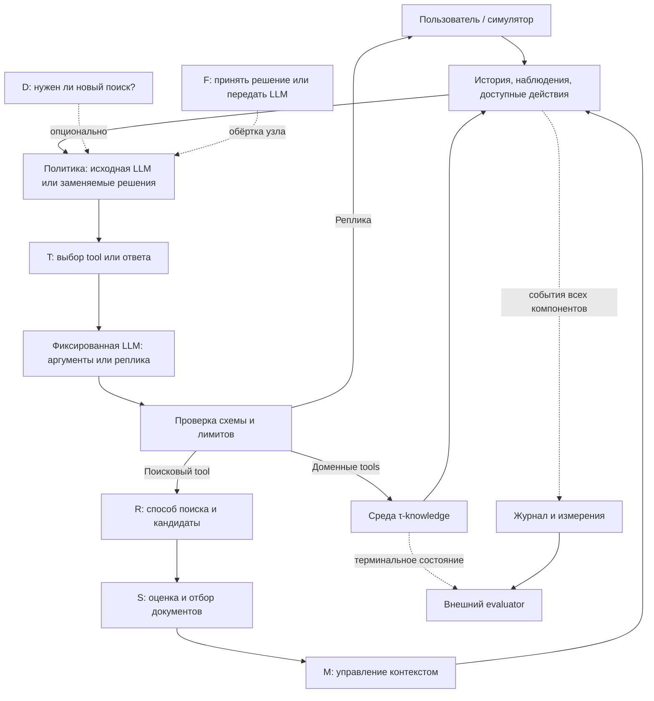

# Архитектура агента и программа экспериментов с System One

Основа — версия **0.2 от 01.10.2026**, уточнения планирования — **11.10.2026**.
Спецификация для review; работающего агента и модельных экспериментов пока нет.
Есть отдельное [измерение контекста с командой воспроизведения](resource-assessment.md#воспроизведение-и-границы-личной-адаптационной-темы),
которое не является реализацией агента.

**Актуальная граница после продолжения обсуждения 11.10.2026:** искать интеграцию
System One в **отбор контекста и маршрутизацию**, совместимую с адаптацией модели.
Выбор и сборка tool calls компактной моделью исключены из текущего направления;
обычные tools основного LLM-агента τ-knowledge сохраняются.
Выбран вариант А; [источник решения](README.md#wayfinder-decision-contract)
и [актуальная схема](#shared-context-integration).
Использовать open-source решения, Jev оставить только в обзоре.
Основная цель — снижать полную стоимость при ограниченной потере качества;
задержку измерять отдельно. Стенд — последовательные прогоны на Mac,
локальные решающие модели и допустимый API-хостинг открытой LLM.

**Изменение относительно v0.1:** платформа больше не ограничивается ответами
на вопросы HotpotQA. **11.10.2026 инициатор выбрал** банковский τ-knowledge
основным сквозным стендом и разрешил менять harness, обработку контекста
и пропускать LLM на подходящих шагах при сохранении native задач, policy,
семантики tools и критериев evaluator. Остальные домены вспомогательные;
[протокол HotpotQA](hotpotqa-protocol.md) сохраняется отдельно.
Объект маршрутизации выбран ниже; конкретные модели, представление контекста
и численные параметры пока не утверждены.
[Согласованные направления команды](research.md#согласованные-направления-трёх-исследований)
и [карта решений](README.md#wayfinder-system-one) задают текущий маршрут review.

## 1. Исследовательский объект

Нужен один воспроизводимый языковой агент с несколькими заменяемыми местами
принятия решения. В конкретном опыте меняется выбранный узел, остальные условия
сохраняются. Общие функции измерений используются во всех сериях, но смысл успеха
задаёт соответствующий benchmark.

| Вариант | Применение в проекте |
| --- | --- |
| Исходный агент бенчмарка на открытой LLM | Обязательная точка отсчёта |
| Тот же агент с отдельными узлами выбора/оценки | Основной исследовательский вариант; замены System One, правилами и специализированными методами |
| Несколько автономных агентов | Только отдельная будущая гипотеза о делегировании; для выбора tools и RAG не требуется |

Исследовательская единица — полная задача/диалог, узловая единица — решение
в конкретном наблюдаемом состоянии. Дешёвый узел может сделать агента дороже,
если ошибки порождают новые поиски, исправления, реплики и вызовы.

## 2. Бенчмарки и границы оценки

### τ-knowledge

Используем домен `banking_knowledge` проекта Sierra `tau2-bench`, текстовый режим.
Поиск знаний связан с применением правил и действиями в симулируемой среде;
банковские операции выполняются только внутри бенчмарка. Статья описывает
698 документов и 97 задач в своей версии. Эти числа не заменяют инвентаризацию
выбранного commit. [Статья, arXiv:2603.04370v1][tau-paper]

Переиспользовать среду, задачи, симулятор пользователя, правила завершения и
оценщик upstream. В согласованной основной серии меняется исследуемый агент:
отбор полученных retrieval-результатов выполняется в harness над наблюдениями,
с сохранением исходных ответов в журнале. Подмена реализации native tool,
его backend или корпуса не следует из разрешения менять контекст.
Интерфейс подключения — `HalfDuplexAgent`, методы `get_init_state` и
`generate_next_message`; отдельный цикл симуляции не нужен. [Agent guide][tau-agent]

В upstream описано исправление оценки `banking_knowledge` в v1.0.1;
результаты до и после него объявлены несопоставимыми. Перед реализацией закрепить
точный commit с нужными исправлениями, хеши задач, корпуса, политик и evaluator.
Просмотренный `main` от 01.10.2026 — источник для проектирования, не закреплённая
зависимость запуска. [README upstream][tau-repo]

В базовом retrieval-условии явно выбрать `bm25`. Текущий default `alltools`
включает OpenAI embeddings, а готовые варианты `*_reranker` также требуют
OpenAI API. Они не подходят нашему ограничению без явной замены этих частей.
Открытый dense-retriever и изменение native postprocessor — отдельные
предложения вне согласованной основной серии; harness-side отбор наблюдений
не требует подменять эти компоненты.
[Конфигурации поиска][tau-knowledge]

Требование открытых весов/кода с проверенной лицензией относится к **агенту,
System One, embeddings, reranker, симулятору пользователя и LLM-judge**, если он
участвует. Внешний API допустим как хостинг открытой модели. Репозиторий τ-bench
имеет MIT; лицензии конкретных артефактов сохраняются в manifest. [Лицензия][tau-license]

Замена модели симулятора меняет условия эксперимента. Результаты на нашем открытом
симуляторе нельзя напрямую выдавать за воспроизведение чисел статьи/leaderboard.
Фиксируем один симулятор для всех вариантов и проверяем соблюдение сценария
на пилоте. Его скрытые инструкции не передаются исследуемому агенту.

### HotpotQA

Сохраняется для контролируемого отбора доказательств при известных ответах и
supporting facts. Здесь проще разделить потери поиска, ранжирования и генерации.
[Подробный протокол и источники](hotpotqa-protocol.md).

| Свойство | τ-knowledge | HotpotQA distractor |
| --- | --- | --- |
| Единица задачи | Многошаговый диалог в среде | Вопрос по заданным документам |
| Успех | Native evaluator и `reward_basis` задачи | Ответ и доказательства |
| Tools | Поиск и доменные действия | Поиск/чтение источников |
| Главная метрика | `pass^1`, дополнительно `pass^k` | Joint F1; строгий успех — joint EM |
| Выбор доменных tools | Полноценная сквозная проверка | Не проверяется |
| Два поиска из v0.1 | Не применяется | Стартовый параметр этого стенда |

Метрики двух стендов не усредняются в один «балл агента». HotpotQA не заменяет
проверку открытого baseline на τ-knowledge и не доказывает полезность выбора tools.

## 3. Общий цикл и заменяемые узлы

<a id="shared-context-integration"></a>

### Принятая общая схема: маршрутизация отбора контекста

Источник и границы согласования — [решение инициатора «вариант А» от 11.10.2026](README.md#wayfinder-decision-contract).
Это выбранная схема, не готовая реализация и не утверждение всех деталей протокола.

```text
Основная LLM → штатный поиск → наблюдаемые KB-доказательства
    → System One C (модель): полезность каждого кандидата
    → алгоритм отбора: предложенный набор в бюджет B
    → System One R (вторая модель): риск принять этот набор
    → маршрутизатор: калибровка + стоимость ошибок + правило выбора
        принять → предложенный набор
        передать → LLM-селектор: тот же отбор, кандидаты и выходной бюджет
    → контекст основной LLM → ответ / native tool call → новые наблюдения

Отдельно сохраняются исходный журнал и фиксированное представление диалога.
Вне диалога: размеченные данные → адаптация оценщика → версии весов.
```

| Направление | Что меняет автор | Что фиксируется для собственного сравнения |
| --- | --- | --- |
| Маршрутизация | Модельный узел System One R для риска принять набор; калибровку, политику принять/передать и цену ошибок | Фиксированные System One C, packer, snapshot и LLM-селектор; сравнение также с немодельным риск-гейтом |
| Отбор контекста | Модельный узел System One C для полезности единиц; сборку набора по релевантности, длине, дублям и бюджету | Фиксированные System One R и политика маршрутизации в парных опытах; отдельно режим always-accept |
| Адаптация | Эффект обучения компактной модели и объёма разметки; выбор C или R как объекта адаптации остаётся открытым | Зафиксированные контракты, остальные веса, packer, калибровка по независимому split и LLM |

Основной LLM-вызов остаётся в обеих ветвях; вызов LLM-селектора — дополнительный.
**Уточнение инициатора 11.10.2026:** нужны как минимум два разных узла с
компактным модельным выводом: C оценивает кандидатов, R оценивает риск принятия
уже собранного набора. Packer и пороговая политика не объявляются моделями.
Это два типизированных решения, не обещание двух независимо обученных backbone:
проверяемый способ размещения весов/голов ещё предстоит выбрать.
Смена весов требует повторной настройки тем же независимым протоколом калибровки,
а не автоматического переноса старых порогов. Ни Laya, ни KEV пока не выбраны
победителем; одновременное использование KEV и Laya **в одном узле** не требуется.

**Уточнения инициатора 11.10.2026:** пул — все KB-доказательства, реально
полученные в текущем диалоге, включая ранее не выбранные. По подтверждённому Q3
native запись переиспользуется целиком, если полный вход оценщика помещается;
дополнительное разбиение на фрагменты вводится только при обоснованной необходимости.
Накопленный пул хранится отдельно от текущего модельного входа;
это не разрешение читать скрытый корпус или переносить данные других диалогов.
**Q4 подтверждён инициатором:** оценщик получает текущую информационную
потребность и необходимые наблюдаемые факты вместе с кандидатом, а не только
поисковую строку. **По Q5 базовое состояние собирается фиксированным правилом
из наблюдаемых сообщений и ответов tools, без отдельной LLM-сводки.** Точные поля,
порядок и лимиты предложены в [рабочем контракте v0](#context-contract-v0);
достаточность такого представления не гарантирована и проверяется отдельно
от качества оценщика. Согласованные принципы и инженерные предложения различаются
в [записи контракта контекста](README.md#wayfinder-context-contract). Полезность оценивается
на фоне native агента и дешёвого отбора, а не только дорогого LLM-селектора.

**Q6 подтверждён:** в контролируемом сравнении узла baseline отбора, компактный
метод и LLM-селектор получают одинаковую содержательную информацию: общее
наблюдаемое состояние и один пул кандидатов, при общем бюджете выбранного
контекста. LLM-селектору не добавляется расширенная история; такой вариант
потребует отдельного условия. Одинаковое число токенов разных tokenizer само
по себе не устанавливает равенство информации. Исходный native-агент остаётся
неизменным отдельным сквозным контролем; на собственных траекториях методы
могут приходить к разным наблюдениям, что не исправляется искусственной подменой.

**Проверка готовой инфраструктуры 11.10.2026:** [аудит upstream](tau-bench-review.md#native-context-pipeline-audit)
разделяет штатный retrieval/postprocessing и нашу производную модельную view.
Не строим новый поисковый backend и не выбираем свою нарезку до проверки native
единиц: `KB_search` возвращает полное содержимое полученных KB-записей.
По Q3 подтверждено переиспользование этих наблюдений без обязательной нарезки;
дополнительное разбиение обосновывается измеренным бюджетом полного входа
выбранного оценщика. Метод разбиения и токенные пределы ещё не утверждены.

Обычный `LLMAgent` передаёт накопленную историю в `generate`. Поэтому просто
добавить выбранные фрагменты, оставив весь raw retrieval в модельной истории,
не означает сократить контекст: полный журнал хранится отдельно, а для LLM
строится производное представление с соблюдением протокола tool-call/response.
Наличие upstream `BasePostprocessor` не означает, что наша выбранная серия
автоматически меняет backend native tool. Контроль «native eviction» в E5
исправлен: такой механизм в проверенном стандартном пути не подтверждён.

<a id="context-contract-v0"></a>

### Рабочий контракт контекста v0 — инженерный проект 11.10.2026

**Статус:** конкретизация принятых Q3–Q6 по поручению инициатора продолжить
проработку самостоятельно, без микросогласований. Ниже — предложенная базовая
реализация и стартовые параметры, **не новые согласования пользователя и не
результат модельного пилота**. Один агент и несколько обычных функций в harness;
новая multi-agent платформа, свой retrieval и генератор сводок не нужны.
[Полная визуальная схема (SVG)](../system-one-context-architecture.svg) ·
[PNG](../system-one-context-architecture.png). Векторный SVG редактируемый.
Начальное условие — текстовый `banking_knowledge + bm25`; другие retrieval-режимы
не подключаются незаметно. Первичные основания — [аудит native пути](tau-bench-review.md#native-context-pipeline-audit).

#### 1. Три представления вместо одной переписываемой истории

| Представление | Содержимое и инвариант |
| --- | --- |
| `raw_history` | Полный исходный журнал сообщений, вызовов и результатов. Не перезаписывается при отборе |
| `observed_pool` | Все реально полученные KB-наблюдения текущего диалога, включая не выбранные ранее. Текст, native ID при наличии, версия содержимого и ссылки на исходные сообщения |
| `model_view` | Производный вход основной LLM: защищённая история и только выбранный KB-блок вместо полных retrieval bodies |

До выбора ветви создаётся неизменяемый `snapshot = (cutoff, state, candidates,
B_t, representation_version)`. `cutoff` — граница уже полученных сообщений;
representation version задаёт шаблон и общее разбиение. Модели, prompts, tokenizers
и общий профиль admission закрепляются отдельно в manifest. **Семантический hash**
считается по общему snapshot без специфических параметров метода; хеш конкретного
модельного запроса и ключ кеша, напротив, учитывают их. Иначе разные модели
ложно выглядели бы как разные входные сведения. При отсутствии native message ID
назначается стабильный локальный номер события; он не подменяет native
`tool_call_id`. Ни task gold, ни будущие наблюдения, ни чтение скрытого corpus
по известному ID сюда не входят.

#### 2. Конкретный шаблон состояния без LLM-сводки

Для первого baseline не использовать окно «последние две пары»: оно теряет
старую коррекцию или отзыв согласия. Выделять следующие наблюдаемые события:

| Поле | Детерминированный источник |
| --- | --- |
| `dialogue` | Все пользовательские реплики до cutoff, включая текущую неотвеченную; для каждой — ближайшее предшествующее assistant-сообщение с непустым речевым content, в том числе совмещённое с tool calls. Повторы сообщения устраняются по ID, исходный порядок сохраняется |
| `search_context` | Последний наблюдаемый вызов `KB_search`: query, ID вызова и его наблюдаемый исход. До первого поиска — `null`, без выдуманной поисковой строки |
| `tool_events` | Все полученные non-KB результаты tools вместе с именем, аргументами, call ID, наблюдаемым статусом и номером события. Одинаковые name/args не схлопывают разные исполнения; содержимое не сокращается до предполагаемого списка «важных» банковских полей |

Это **журнал наблюдений для оценщика, не вычисленный истинный статус клиента**.
Старый и новый баланс не склеиваются, `user says` не превращается в банковское
подтверждение, текст assistant не считается проверенным фактом. Краткость
получается за счёт отделения KB, полных схем tools и остальных assistant-сообщений,
а не за счёт удаления старых пользовательских ограничений. Последняя query может
устареть после смены темы; она имеет timestamp и не заменяет диалог.

Набор включённых/исключённых message IDs журналируется. Даже такой шаблон
не гарантирует достаточность: возможны ссылки на старые assistant-объяснения
или факты в исключённом тексте. Это отдельная проверяемая ошибка представления;
ни уверенность scorer, ни передача LLM с тем же state не гарантируют её обнаружение.
Поля, порядок и правило извлечения фиксируются **до** сравнения frozen/adapted.

#### 3. Кандидаты и разбиение

- Известный formatter BM25 разбирается только по реально полученному тексту.
  Проверяются ID, границы и сохранность содержимого; неясный разбор даёт
  `KB_PARSE_ERROR`, а не достраивание документа из corpus. Штатные ответы
  «ничего не найдено» и сообщения об ошибке не становятся KB-документами.
- Повтор той же записи с тем же содержимым объединяется с сохранением всех
  provenance. Тот же ID с другим текстом — другая версия. Семантически похожие
  документы автоматически не сливаются.
- Сначала пробовать запись целиком. Если полный scorer payload не помещается,
  строить **одинаковое для сравниваемых методов** дополнительное разбиение:
  по явным заголовкам, затем по абзацам внутри слишком длинного раздела.
  Заголовки родителей и преамбула документа сохраняются как контекст части.
  Внутри предложения не резать; слишком длинный неделимый блок даёт
  `CANDIDATE_OVERFLOW`. Это конкретный консервативный splitter для пилота,
  а не утверждение, что все смысловые зависимости определяются заголовками.
- ID части задаётся версией источника и offsets её исходных spans, включая
  добавленную преамбулу. Структурная нарезка может отделить исключение от правила;
  такие ошибки проверяются отдельно, а не объявляются устранёнными автоматически.
- Пул хранит исходные наблюдения. `candidates` — воспроизводимое представление
  всего пула на данный snapshot: либо целая запись, либо её части, не оба вида
  одновременно. При изменении state границы могут измениться; старые разбиения
  не накапливаются как новые независимые доказательства. Нет скрытого top-M
  prefilter или удаления кандидатов только потому, что закончился batch.

#### 4. Оценка, упаковка и передача LLM

**Компактная ветвь:** для каждого кандидата передаётся `(state, candidate)`
и фиксированный вопрос о полезности для текущей потребности с вариантами
`useful / not_useful`. В адаптере state и текст кандидата относятся к длинной
текстовой части входа, а не помещаются целиком в короткие варианты или question
head. `p_i` — оценка полезности единицы, не вероятность успеха диалога и не
вероятность достаточности набора. Каждая единица должна получить конечную
валидную оценку в `[0, 1]`; batch только меняет организацию вычисления.

**Базовый packer:** сортировать по `p_i` убыванию, затем по стабильному ID;
добавлять единицу, если целиком помещается в оставшийся бюджет готового KB-блока,
иначе переходить к следующей. Не резать текст при упаковке и не вводить
непроверенный порог `p >= 0.5`. Повтор одной версии/части не добавляется дважды.
Пустой набор допустим и не означает доказанную достаточность. Более сложный
учёт длины, смысловых дублей и взаимодополняемости — фактор исследования отбора.

**LLM-селектор:** получает тот же `state`, весь тот же `candidates` и эффективный `B_t`;
возвращает упорядоченные ID без пересказа документов и без новых tool calls.
Никакой дополнительной истории, compact scores или только compact shortlist.
Проверяются принадлежность ID snapshot, уникальность и реальный бюджет
собранного блока. Допускается одна попытка исправления формата/ID/бюджета
с теми же исходными сведениями, затем — явная ошибка селектора. Все вызовы считаются.
Если весь вход LLM-селектора не помещается, это `SELECTOR_OVERFLOW`, а не скрытый
переход на новый алгоритм постраничного отбора.

Joint LLM selection и pointwise scorer + packer — **разные алгоритмы отбора**,
даже при одинаковом наборе доступных сведений. Их сравнение не изолирует только
качество весов. Для адаптации основной контроль — frozen/adapted одной модели
с одним packer; для отдельного сравнения scorers возможен LLM pointwise + тот же
packer. Native агент и дешёвые методы обязательны: дорогой LLM-селектор сам по
себе не является достаточным контролем экономии.

Первая матрица контролей: неизменный native BM25-агент; последние уникальные
KB-единицы с общим бюджетом; BM25-переранжирование **наблюдаемого пула** по
сериализованному state; LLM-only отбор; frozen/adapted компактный scorer с тем же
packer. Локальное BM25-переранжирование в harness не заменяет native search.
Recency/лексические оценки не объявляются вероятностями; для них используется
тот же детерминированный принцип упаковки по их порядку. Риск-гейт добавляется
после этих контролей, а не скрывает их качество в единственном итоговом числе.

**Второй модельный узел — System One R (предложенный контракт):** после packer
отдельный компактный вызов получает тот же наблюдаемый `state`, предложенные
`selected_ids`/тексты и воспроизводимые признаки выбора по всему `observed_pool`
(например, оценки невыбранных единиц, занятый бюджет и дубли). Выдаёт `q_t` —
оценку риска **ошибочно принять именно этот набор**, а не ещё одну релевантность
фрагмента и не вероятность успеха всего диалога. Формальное событие ошибки и
источник проверенных per-step меток остаются открытым вопросом
[о данных](README.md#wayfinder-data-labels). Конкретный формат входа R, admission
в компактное окно и решение о раздельных/общих весах C и R проверяются в пилоте;
ни одно из них не даёт доступа к скрытому corpus или будущим сообщениям.
Высокие `p_i` не гарантируют малого `q_t`: условие-исключение может остаться
в невключённой единице. Если нужный факт потерян уже в общем state, ни одна из
ветвей не становится оракулом. LLM fallback получает исходный общий snapshot,
**не** `q_t`, компактные оценки или предложенный набор в качестве дополнительной
содержательной подсказки.

**Маршрутизация — отдельная политика над выходом System One R:** технически
допустимый набор либо принимается, либо передаётся LLM по откалиброванному
`q_t`, цене ошибочного принятия и полной цене fallback. Начальные контроли —
`always_accept`, `always_LLM` и недорогой немодельный риск-гейт по тем же
наблюдаемым признакам. Порог не назначается произвольно и не подбирается на test;
калибровка проводится на независимых проверенных метках ошибки набора. Среднее,
минимум или произведение `p_i` не объявляются готовым `q_t`. Эффект второго
модельного вызова проверяется отдельно: он может съесть всю экономию LLM.
При исследовании отбора R и его калибровку фиксируют либо используют
`always_accept`; при исследовании маршрутизации фиксируют C и packer.
Для адаптации фиксируют прочие узлы и повторяют калибровку только по выделенному
split, а не автоматически переносят старый порог.

Повторная оценка выполняется перед следующим основным LLM-вызовом после завершения
полученного batch сообщений, если изменился snapshot. Кеш допускается только
при совпадении state, версии кандидата, модели, prompt и настроек inference;
новый пользовательский факт делает старые оценки неприменимыми. До первого
KB-наблюдения отбор не вызывается, основной агент работает штатно.

#### 5. Бюджеты и поведение при переполнении

**Стартовый инженерный профиль, не измеренный оптимум:** `B_KB = 2048` токенов
основной LLM; чувствительность затем проверять на `1024 / 4096` при неизменных
прочих условиях. Для первого сопоставления KEV и Laya multilingual пробовать
предел **4096 токенов полного pointwise-входа** у каждой модели, явно задавая
runtime. Это ниже внешнего validated окна KEV 8192; для Laya multilingual
наличие режима 4k не доказывает качество на banking. English Laya512 не подставлять
в этот профиль как эквивалент. [Проверенные ограничения](resource-assessment.md#контекст--четыре-разных-ограничения).
Профиль может оказаться непригодным — это результат пилота, не повод скрывать отказы.

Каждый запрос к C и отдельный запрос к R считаются собственным закреплённым
tokenizer **после окончательной сериализации**: инструкции, state, заголовки/ID,
кандидат или предложенный набор и признаки пула, варианты и wrappers.
Проверяется и реальный путь runtime: автоматическая truncation запрещена.
Одинаковые сведения не требуют одинакового числа токенов; одна общая сегментация
должна проходить admission всех компактных моделей данного сравнения либо иметь
явно зарегистрированную техническую непригодность. Внутренние head/state sublimits
модели проверяются отдельно от общего окна.

Для основной LLM обозначим `P_t` как размер защищённой проекции со служебным
оформлением, `L_main` — реально настроенное окно, `R_main` — фиксированный резерв
генерации из manifest. Общий для методов бюджет на данном snapshot:
`B_t = min(B_KB, L_main - P_t - R_main)`. Проверка по готовому запросу обязательна:
аддитивная оценка длин отдельных строк не заменяет tokenization всей сериализации.
В бюджет KB входят текст, заголовки, IDs, provenance и разделители, не только content.
Если защищённая часть с резервом не помещается, возникает `MAIN_OVERFLOW`;
пользовательские факты или policy ради освобождения места не удаляются.
Окно и резерв LLM-селектора также явно задаются по выбранной модели до прогона.

| Исход | Действие baseline harness |
| --- | --- |
| `ACCEPT` | Передать проверенный компактный набор основному агенту |
| `CALIBRATED_DEFER` | Выполнить тот же отбор LLM по настроенной политике риска |
| `STATE_OVERFLOW` | State с обязательным оформлением не помещается ещё до кандидата; нарезка KB не помогает |
| `CANDIDATE_OVERFLOW` | После допустимого разбиения осталась единица, которую scorer обработать не может |
| `SCORER_ERROR` | Timeout, NaN, неполные оценки C или ошибка исполнения, не «низкая уверенность» |
| `RISK_MODEL_ERROR / RISK_OVERFLOW` | Второй компактный вызов не выдал валидный риск или не вместил обязательный вход; это не `CALIBRATED_DEFER` |
| `KB_PARSE_ERROR` | Не удалось достоверно получить кандидатов из наблюдения; не восстанавливать их через скрытые данные |
| `SELECTOR_ERROR / SELECTOR_OVERFLOW` | Некорректный результат после разрешённого повтора либо невместимый вход LLM-селектора |
| `MAIN_OVERFLOW` | Невместимый защищённый вход основного агента |

При `STATE_OVERFLOW`, `CANDIDATE_OVERFLOW`, `SCORER_ERROR`,
`RISK_MODEL_ERROR` или `RISK_OVERFLOW` разрешена **техническая передача**
того же неизменённого snapshot LLM, если полный вход
помещается у него. Это не дополнительная информация для LLM и не успех
калиброванного маршрутизатора. Ошибки разбора, исчерпанный LLM fallback и
невместимый main input дают явную техническую неудачу; не включать скрытую
ветвь «передадим основной LLM весь raw KB» с другим информационным контрактом.
После неудачного LLM fallback нельзя молча вернуться к ранее отвергнутому
компактному набору и назвать передачу успешной. Неудавшийся эпизод не выбрасывается
из итогового знаменателя и учёта затрат; способ отображения технической остановки
в native runner нужно проверить при
реализации адаптера, не выдумывать успешный native reward.

#### 6. Производный вход основной LLM

Сохраняются исходная policy, доступные схемы tools, пользовательские/assistant
сообщения и non-KB результаты. У retrieval tool messages заменяется только
KB-body на явную квитанцию с provenance. Роли, имена, call IDs, порядок и все
ответы смешанного batch сохраняются; сиротские tool calls недопустимы.

Выбранный KB-блок вставляется **один раз**, в производное содержимое последнего
существующего retrieval tool message. Исходные query/args reference, call ID
и статус сохраняются: неудачный поиск не превращается в успешный из-за добавления
старых доказательств. От квитанции явно отделяется agent-side projection
наблюдений до текущего cutoff, со ссылкой каждого фрагмента на исходное наблюдение;
это не выдаётся за оригинальный результат того поискового запроса. Проекция
заново строится из raw перед следующим main call, а не дописывается к прошлой.
При отсутствии KB-вызова не создаётся фиктивный tool result; новый tool call
или фальшивая пользовательская реплика для вставки также не нужны. Текст
доказательств остаётся данными, а не новыми системными инструкциями. Полный raw
журнал при этом не меняется и используется для аудита/evaluator по native контракту.

Это не обещание «забыть» уже процитированные знания: protected assistant-реплики
могут содержать прежние KB-факты. Такие повторы учитываются в полном main input,
но не удаляются скрыто. `B_KB` ограничивает выбранный evidence block, а не весь
диалог. Экономия проверяется по реальному запросу и полным расходам эпизода.

#### 7. Минимальная проверка перед модельным пилотом

Ниже — **план тестов, не уже пройденные runtime-тесты**:

1. Старое исправление типа счёта, отзыв согласия, короткое «да» и новая
   неотвеченная реплика присутствуют в state с нужными источниками.
2. Повтор retrieval не удваивает ту же версию; новый текст под старым ID
   сохраняется отдельно; в scoring нет потерянного последнего batch.
3. Все селекторы используют один hash семантического snapshot; LLM не видит
   дополнительную историю, compact scores, hidden gold или будущее.
4. Проверяются точное попадание в предел и превышение на один токен, отдельно
   state, кандидат C, отдельный вход R, selector и main input; runtime не обрезает вход сам.
5. В смешанном KB/business batch сохраняется соответствие всех calls/results;
   невыбранный sentinel отсутствует в заменённых retrieval bodies, выбранный
   блок добавлен один раз. Отдельно учитываются копии в protected истории.
6. Релевантные дубликаты и условие-исключение показывают различие между relevance,
   достаточностью набора и успехом диалога; высокий `p_i` не служит oracle gate.
   Выход R сравнивается с проверенной ошибкой принятия набора, дешёвым гейтом и
   `always_accept`; в парном опыте фиксируются C, packer и версия данных.
7. Ошибочный ID LLM, NaN в C или R, отказ парсера и исчерпанный fallback дают
   различимые исходы; все расходы и неудачи остаются в отчёте.

Метрики включают потери представления и разбиения, техническое покрытие,
качество узла, сквозной native результат, все вызовы C/R/LLM-селектора,
token counts, стоимость и задержку. Selective risk считается на явно определённых допустимых
решениях; отдельно публикуется доля технических передач среди **всех** решений.
Подгонка шаблона/бюджетов и калибровка отделены от test на уровне задач/семейств.

### Исторический каталог узлов v0.2

Диаграмма и каталог ниже сохраняют широкое предложение v0.2, а не выбранную
конфигурацию. T и эксперименты E1/E2 больше не входят в текущую интеграцию
System One. Разделы о discovery/аргументах описывают ограничения среды и прежней
ветки, не поручение реализовать компактный tool caller.



Это точки вмешательства, а не требование вызывать все узлы на каждом шаге.
При отключённых заменах сохраняется исходный цикл upstream. Нативный вызов LLM,
одновременно выбирающий tool и аргументы, остаётся отдельным baseline.

| Узел | Решение | Что остаётся у генеративной LLM |
| --- | --- | --- |
| T — tools | Выбор tool, shortlist или `respond` | Аргументы tool и текст реплики |
| R — retrieval routing | Выбор разрешённого способа поиска | Поисковый запрос |
| S — evidence selection | Оценка/ранжирование найденных документов | Применение правил и дальнейшее рассуждение |
| D — search control | Новый поиск или возврат управления агенту | Действие после завершения поиска |
| M — context selection | Какие прочитанные документы оставить в бюджете | Генерация сводки, если отдельно изучается суммаризация |
| F — fallback | Принять дешёвое решение или передать LLM | Повторное принятие того же решения |

Уточнение **11.10.2026**: [проверка выбора действий и контекста](action-selection-review.md)
подтверждает именно T/E2 как предлагаемую постановку вместо validity gate.
Собственная токенизация показывает: одна policy уже занимает 1186–1745 токенов;
Laya512/1024 нельзя считать получающей полный native вход без отдельной схемы
контекста. Совместное влияние state builder, каталога и селектора измеряется явно.

System One выбирает в заданном пространстве ответов. В первой версии он не
генерирует произвольный JSON аргументов и не подменяет проверку политик.
Ошибки аргументов считаются отдельно от ошибок выбора имени tool.

Вход узла: доступный префикс диалога, наблюдённые результаты, ID прочитанных
документов, доступные описания tools, бюджет. Скрытая БД, будущие реплики,
gold documents и `evaluation_criteria` исключены. Если factory получает объект
задачи, адаптер не передаёт модели его привилегированные поля.

В τ-knowledge часть функций описана в документах и вызывается через
`unlock_discoverable_agent_tool(agent_tool_name)` и
`call_discoverable_agent_tool(agent_tool_name, arguments)` в проверенном commit
4ce7c039. Здесь arguments — JSON-строка; semantic ID конкретной известной
функции должен выбирать selector, иначе основное решение останется внутри
генератора аргументов. Нельзя заранее вручить селектору полный
скрытый каталог: это устранит часть задачи поиска знаний. Наши кандидаты берутся
из публичных tools среды и реально прочитанных описаний; происхождение сохраняется.
Native tool semantics и reward не меняются. [Механизм discovery][tau-paper]

Для длинной истории нужна подходящая модель либо общее для сравниваемых
селекторов преобразование состояния. LLM-компрессия добавляет вызов и стоимость.
Полный контекст у LLM против короткого у Laya — сравнение систем целиком;
для эффекта селектора нужен LLM-контроль на том же коротком входе.
Переполнение не обрезается незаметно: это событие и причина fallback.

<a id="shared-integration-proposal"></a>

### Общая схема-кандидат для трёх направлений

**Историческое предложение 11.10.2026, не принятое решение.** После продолжения
обсуждения инициатор исключил ветку System One tool calling. Схема ниже сохранена
как контекст прежнего обсуждения; она не является актуальной рекомендацией.
[Первый вопрос карты](README.md#wayfinder-decision-contract) закрыт выбором
[иной схемы — отбора контекста](#shared-context-integration). Ранее пользователь
разрешил широкую интеграцию System One и попросил проработать **полный вызов без
генеративной LLM на принятом шаге**. [Варианты построения и исполнения](complete-call-options.md)
сравнивались до отказа от этой ветки; fast path не был выбран. Name-only ветка
ниже предлагалась как контроль, а не механизм сокращения генеративных вызовов.

```text
Наблюдаемые реплики и результаты native tools
    → журнал исходных наблюдений и известных/открытых функций
    → фиксированное представление диалога + отбор доступных KB-доказательств
    → компактное решение и оценки вариантов
    → политика маршрутизации:
        принять ID операции → фиксированная LLM формирует args/реплику
        принять полный допустимый вызов → native tool без генерации args
        передать решение → исходная LLM сама выбирает действие и args/реплику
    → native проверки, выполнение, новые наблюдения → следующий шаг

Вне диалога: данные выбранного узла → адаптация модели → новые версии весов
```

Три ветки исполнения — альтернативы для сравнения, не требование реализовать
их все. **Адаптация не является третьим онлайн-этапом:** она меняет модель,
которой затем пользуются тот же узел и политика маршрутизации.

| Направление | Изменяемый фактор в самостоятельном опыте | Что держать фиксированным |
| --- | --- | --- |
| Маршрутизация | Калибровка, правило принять/передать, пороги и цена ошибок | Checkpoint решающей модели, вход, кандидаты, схема генерации и контекст |
| Отбор контекста | Релевантность, длина, удаление дублей, бюджет доказательств | Модели, данные и базовая политика; взаимодействие с маршрутизацией — отдельный опыт |
| Адаптация | Объём разметки, обучаемые параметры, цель обучения и перенос — по одному контролируемому вопросу | Контракт узла, представление состояния, источники кандидатов, генератор и протокол калибровки |

**Возможные места моделей:** Laya — короткая оценка пары «локальный вопрос —
фрагмент», KEV-4B или Laya multilingual — выбор операции на достаточном
ограниченном входе. Это не утверждение, что первая всегда scorer, а вторая всегда
router; модели сравниваются на совместимых входах и могут оказаться невыгодными.
Готовую KEV-0.8B не считать основным tool router по [аудиту моделей](action-selection-review.md#что-известно-о-пригодности-к-routing).
Одновременный вызов Laya и KEV на каждом ходе не обязателен.

**Механизмы пользы различаются.** Отбор доказательств относительно BM25-only
добавляет scorer, но может сократить downstream prompt и повторы; нужен контроль
BM25/простого отбора при том же бюджете и специализированный reranker.
Выбор ID с последующим generator не убирает native LLM-вызов. Полный вызов
без generator экономит его лишь тогда, когда имя и все аргументы получены
из разрешённых наблюдений без предварительной генерации большой LLM.
Считать стоимость построения кандидатов, всех scorers, повторов и fallback;
простые правила обязательно остаются контролем.

Для fast path сначала обсуждается ограниченный read-only поднабор. Read-only
не доказывает правильность или допустимость. Подтверждения, предпосылки policy,
discovery и происхождение аргументов должны сохраняться; вероятности правильного
ID недостаточно для допуска полного вызова. Если аргументы требуют интерпретации
либо сведений не хватает, это не автоматическая ветка. Произвольный банковский
write-call и свободный ответ не превращаются в безопасный шаблон по умолчанию.

Полный журнал хранится для аудита и разрешённого повторного обращения к фактам;
это не обещание, что вся история помещается в fallback LLM. Его view, overflow
и цена также определяются. Нельзя незаметно заменить штатные retrieval-ответы
своей разметкой или передать gold-поля.

Сначала сравниваются одиночные изменения и native joint baseline; затем
контекст × маршрутизация × frozen/adapted на небольшой осмысленной матрице.
После смены весов или view калибровку нельзя переносить без проверки:
фиксируется процедура настройки на независимых данных, а не один универсальный
порог. Личная адаптационная тема уточняется [отдельным вопросом](README.md#wayfinder-adaptation)
после контракта узла и данных; RLCD пока не выбран.

## 4. Контракты и обработка ошибок

Переиспользуем native схемы сообщений/tools, registry и retrieval pipeline τ-bench.
Наш код добавляет функции решающих узлов и измерения. Отдельный сервер оркестрации,
универсальный plugin framework и процессы для каждого узла не требуются.

Для варианта А актуальны `rank_documents`, `select_context` и маршрутизация
принять/передать отбор. Остальные строки таблицы — исторический каталог v0.2,
не выбранные узлы. Детали схемы результата, технических fallback и лимитов ниже
остаются предложениями до завершения вопросов контекста и маршрутизации.

| Контракт узла | Вход | Выход |
| --- | --- | --- |
| `select_tool` | Видимое состояние и кандидаты | Один ID либо `respond/defer`; оценки при наличии |
| `rank_tools` | То же | Упорядоченные ID shortlist |
| `select_retrieval` | Состояние и разрешённые способы поиска | ID способа либо `defer` |
| `rank_documents` | Запрос/видимое состояние, кандидаты | Оценки известных document ID |
| `decide_search` | Состояние, найденные знания, бюджет | `search_more/return_to_agent/defer` |
| `select_context` | Наблюдённые документы, токенный бюджет | Подмножество ID и порядок, исходные тексты неизменны |

Общий результат: `node`, `input_hash`, `candidate_ids`, `selected_ids`,
`raw_scores`, при наличии `probabilities`, `calibration_id`, `fallback_reason`,
ссылки на события измерений. Это контракт данных, не требование иерархии классов.
Ранговый score не является вероятностью; независимые бинарные оценки кандидатов
не обязаны суммироваться в единицу.

Проверять принадлежность ID предъявленному набору, отсутствие дубликатов,
конечность чисел, диапазон вероятностей, native JSON Schema аргументов и лимиты.
Невалидный выбор передавать исходной LLM один раз; при повторной неудаче сохранить
ошибку/завершение по правилам адаптера. Не выбирать молча первый tool из списка.

Fallback по неопределённости — отдельный эксперимент с заранее выбранным порогом.
Технический fallback вызывается ошибкой, timeout или overflow. Причины, частоты
и расходы разделяются. При сбое reranker использовать исходный порядок целиком,
не смешивать несопоставимые оценки разных шкал.

Доменные записи исполняются только в экземпляре симулятора. После timeout записи
нельзя слепо повторять tool: действие могло примениться. Следовать контракту среды,
проверять состояние разрешёнными tools; не менять БД напрямую и не откатывать
неудачное действие вне траектории. Повторы чтения/модельных вызовов ограничить
и записывать, включая retries SDK.

Лимиты шагов, ошибок, токенов и времени τ-knowledge берутся из закреплённой
конфигурации upstream либо объявляются общим экспериментальным условием.
`2 поиска / 180 секунд / 2048 токенов` из HotpotQA сюда не переносятся.
Превышение лимита — измеряемый исход, не причина удалить пример.

## 5. Программа экспериментов

Серии ниже исследуются отдельно. Модели генерации аргументов/реплик и симулятора,
данные, бюджеты и evaluator сохраняются внутри сравнения.

| Серия | Вопрос | Изменяемый фактор | Контроли и кандидаты |
| --- | --- | --- | --- |
| E0 — baseline | Воспроизводится ли агент в открытом стеке? | Пока ничего | Native LLMAgent + BM25; открытый dense retrieval отдельным условием |
| E1 — shortlist tools | Можно ли сократить список без потери нужного действия? | `rank_tools` и размер shortlist | Полный список; лексическое ранжирование; энкодер/классификатор; Laya |
| E2 — выбор tool | Можно ли заменить выбор имени инструмента? | `select_tool`, заполнение аргументов фиксировано | LLM-селектор; правила/классификатор; Laya; также native LLMAgent |
| E3 — отбор RAG | Какие документы передавать агенту? | S при одинаковом кандидатном пуле | Исходный порядок; cross-encoder; открытая LLM; Laya |
| E4 — управление поиском | Когда искать ещё и каким способом? | Сначала D, отдельно R | Исходная политика; правило; LLM; Laya. Доступные способы поиска одинаковы |
| E5 — контекст | Что сохранять из уже найденного? | M при равном токенном бюджете | Native история без нашего отбора — отдельная точка отсчёта; при равном бюджете — последние фрагменты, ранговый отбор, Laya |
| E6 — калибровка/fallback | При каком охвате дешёвые решения полезны? | F поверх одного узла | Без fallback; сырые вероятности; калибровка; LLM-fallback |
| E7 — графовый поиск | Полезен ли выбор переходов по связям документов? | Графовый retrieval/оценка перехода | Обычный retrieval; наблюдаемые ссылки; специализированный score; Laya |

После уточнения 11.10.2026 актуальны кандидаты E3/E5/E6; E1/E2 исключены
из текущей интеграции, их описание ниже сохранено исторически. E4/E7 не выбраны
и не входят в обязательную первую серию. Для E7 дополнительно нужны воспроизводимые
связи и проверяемая постановка; взаимосвязанный корпус сам по себе не даёт gold-рёбра.
GraphRAG не обязан стать первой реализацией или отдельной ВКР.

Для E2 нужны **два контроля**: native LLM с совместным выбором имени/аргументов
и факторизованный вариант «LLM выбирает имя → та же LLM заполняет аргументы».
Первый показывает итоговую пользу модификации, второй выделяет эффект замены
селектора. Дополнительный вызов на аргументы может съесть экономию — это результат опыта.

В E1 размер shortlist выбирается на development. Переход к полному наблюдаемому
каталогу доступен сопоставляемым методам по одному правилу. Разделять исключение
допустимого tool из списка и ошибку LLM при достаточном списке.

В E3 фиксируются запрос, кандидатный пул и бюджет контекста. Offline-оценка
использует одинаковые входы; сквозная — собственные траектории каждой политики.
Gold-document recall τ-knowledge относится ко всей задаче, а не является готовой
per-query разметкой. Sentence-level диагностика с supporting facts — в HotpotQA.

Zero-shot, калибровка и обучение — разные условия. Обучение вводится при наличии
разрешённой разметки и отдельного бюджета. Laya — первый кандидат, не ограничение
исследования одним checkpoint; другие открытые модели добавляются по совместимости
входов, выходов, лицензий и ресурсов.

После одиночных изменений — небольшая матрица «отбор × маршрутизация ×
исходный/адаптированный оценщик». Прежнее предложение `T × S` не относится
к выбранному варианту А. Проверять взаимодействие; не складывать проценты
отдельных улучшений и не запускать все комбинации всех настроек сразу.

## 6. Формальная постановка и метрики

Для benchmark `b` политика `π` порождает траекторию задачи `x` с качеством `Qᵇπ(x)`,
стоимостью агента `Cᵇπ(x)` и задержкой `Tᵇπ(x)`. При одинаковой среде:

$$
\min_{\pi\in\Pi_b}\mathbb{E}[C^b_\pi(x)]\quad\text{при}\quad
\mathbb{E}[Q^b_\pi(x)-Q^b_{\pi_0}(x)]\geq-\varepsilon_b.
$$

Для τ-knowledge `Q` — бинарный успех по evaluator, для HotpotQA — joint F1.
`ε_tau` и `ε_hotpot` определяются отдельно до теста. Предложенные в v0.1
0.02 joint F1 не являются согласованным допуском по `pass^1`.
Задержка остаётся отдельной осью сравнения.

### Сквозной успех

Использовать `reward_basis` задачи и native evaluator: проверка может включать
БД, assertions, коммуникацию и действия. Не заменять её качеством текста
или только хешем БД. `actions` обычно задаёт одну эталонную траекторию;
совпадение действий обязательно там, где оно включено в критерий задачи.
[Семантика оценки][tau-evaluation]

При `n_i` повторах задачи `i` и `c_i` успехах:

$$
\widehat{\mathrm{pass}^k}=
\frac1N\sum_{i=1}^N\frac{\binom{c_i}{k}}{\binom{n_i}{k}},\quad n_i\geq k.
$$

`pass^1` — основной показатель; `pass^2/pass^4` — надёжность при достаточном
числе повторов. `pass^k` требует успеха во всех `k` попытках, не хотя бы одного,
как `pass@k`. Критерий успеха и формулу сверять с кодом. [Native metrics][tau-metrics]

Upstream исключает `INFRASTRUCTURE_ERROR` из части агрегатов. Сохранять отдельно
native-метрики со списком исключений и операционную долю успехов среди всех
заранее назначенных попыток, где инфраструктурный сбой/timeout — неуспех.
Вторую не называть официальным `pass^k`; расходы исключённых попыток не удалять.
При незавершённой серии сообщать неполноту и покрытие каждого метода.

### Диагностика узлов

| Объект | Метрики | Ограничение интерпретации |
| --- | --- | --- |
| Shortlist | Recall допустимых tools@k, размер/токены списка, fallback | Допустимые действия требуют разметки наблюдаемого состояния |
| Выбор tool | Доля допустимых выборов; macro-F1 на однозначных классах; недопустимые вызовы | Reference next tool не всегда единственно правильный |
| Аргументы | Schema-valid rate, ошибки полей и доменные ошибки | Схема не доказывает правильность действия |
| Retrieval | Candidate recall, gold-document recall за траекторию, полнота после отбора, число поисков | Считать попадание в реальный контекст, а не только в скрытый пул |
| Ранжирование | nDCG/average precision при подходящей разметке | Gold всей задачи не автоматически per-turn relevance |
| Поиск/контекст | Преждевременная остановка, повторные чтения, удаление нужного документа | Для «нужного» требуется эталон или отдельная разметка |
| Вероятности | Brier, log loss, reliability diagram | Только по определённой метке; rank score не равен вероятности |
| Fallback | Риск–охват, доля/стоимость передач, качество после передачи | При нулевом охвате риск не определён |

Для tools подготовить небольшую размеченную коллекцию development-префиксов
с множеством допустимых действий и неоднозначностями. Reference/teacher outputs —
кандидаты для проверки, не безошибочные метки. При нескольких правильных действиях
не назначать произвольный единственный класс для NLL/Brier. Возможный выход —
бинарная полезность каждого кандидата; иначе оценивать принадлежность выбранного
действия допустимому набору.

Метрики без подходящей разметки помечать «не измерены», не заменять их самооценкой.
Native reward остаётся доступным для сквозной оценки. Нарушения политик вне
покрытия evaluator проверяются отдельным аудитом; положительный reward не доказывает их отсутствия.

### Стоимость и задержка

Разделять `C_agent`, `C_user_simulator`, `C_evaluator`, `C_setup`.
В основном ограничении оптимизируется `C_agent`; бюджет исследования учитывает
все части. Стоимость агента включает поиск, embeddings запросов, управление
контекстом, неуспешные вызовы, retries и fallback.

$$
C_{\mathrm{per\ success}}=
\frac{\sum C_{\mathrm{agent}}}{\#\{\text{успешных выполнений}\}}.
$$

Отдельно публиковать аналогичный показатель для всех расходов стенда. При нуле
успехов он не определён. Денежные списания и локальное CPU/MPS/GPU-время показывать
раздельно; монетизация оборудования требует явной ставки. Окупаемость setup
существует при положительной экономии inference и сохранении качества.

Измерять p50/p95 полного диалога, активного времени агента с tools и ответа
на реплику. Время симулятора/evaluator выделять отдельно; родительские и дочерние
интервалы не суммировать с двойным счётом. Показывать успешные и все терминальные
исходы, timeout rate, cold/warm режим и условия параллелизма.

## 7. Протокол сравнения и статистика

Состав задач, splits и gold metadata проверяются у закреплённой версии.
`base` — полный набор для оценки, его нельзя автоматически считать обучающим split.
[Структура доменов][tau-domains], [README][tau-repo]

Для настраиваемых решений разделить task-family группы на обучение, калибровку,
выбор конфигурации и итоговую оценку. Все префиксы, парафразы и повторы одной
задачи остаются в её группе. Доли и ID фиксируются после инвентаризации, до
сравнительных результатов. Малый набор ограничивает точность выводов;
собственное разбиение не объявлять официальным leaderboard split.

Альтернатива zero-shot серии — весь `base` как evaluation с настройкой на внешних
или отдельно созданных development-задачах. Нельзя подобрать пороги на `base`
и назвать оценку на нём независимым тестом. Просмотренные для отладки gold-задачи
включаются в development manifest.

Доступный корпус одинаков для политик. Gold documents, эталонные действия и
инструкции симулятора скрыты от агента. Gold-контекст допустим лишь как отдельно
помеченная диагностика. Граф строится по разрешённому корпусу/ссылкам,
не по gold documents и траекториям теста.

До теста каждой серии закрепить вопрос, primary metric/сравнение, `ε`,
конфигурацию и повторы. Технический пилот τ-knowledge — несколько development-
задач разных сценариев и один повтор для проверки tools, симулятора, стоимости
и длины диалога. Для `pass^4` нужны минимум четыре повтора каждой задачи,
что заранее входит в бюджет. Пилот не объявляется итоговой оценкой.

Исполнять одинаковые task IDs и наборы seed; фиксировать симулятор и параметры.
Seed не гарантирует одинаковые реплики при разных траекториях; baseline-реплики
нельзя вслепую переигрывать в другой среде. Порядок методов рандомизировать
в блоках; конкурентные нагрузки на Mac исключить при измерении задержки.

Использовать парные интервалы разницы качества/стоимости: bootstrap по task-family
группам с повторами внутри группы, например 10 000 перевыборок с фиксированным seed.
Число независимых наблюдений — задачи/семейства, не все tool calls. Публиковать
ширину интервала и предел обнаружимого эффекта. Качество подтверждается нижней
границей `ΔQ > −ε`, экономия — верхней границей `ΔC < 0`; иначе вывод может быть
«недостаточно данных». Простое отсутствие значимой разницы не доказывает эквивалентность.
При редких/нулевых успехах и вырожденных bootstrap-интервалах этого расчёта
недостаточно для подтверждения гипотезы: нужны дополнительные независимые задачи
или подходящий для границы параметра метод интервалов, заданный до итогового вывода.

Многочисленные поисковые эксперименты отделять от подтверждающих. До итогового
теста определить семейства гипотез и правило множественных сравнений, например
Holm для подтверждающих тестов. Результаты теста не использовать для новой настройки
с последующим заявлением о независимой проверке на тех же задачах.
Выигрыш у дорогой LLM не доказывает преимущества над дешёвым классификатором/reranker.

Сохранять отрицательные результаты, shift на собственных траекториях, ошибки
симулятора и зависимость от длины истории/числа tools. Открытость весов не гарантирует
отсутствия benchmark в предобучении.

## 8. Журнал, бюджет и последовательность реализации

Сохранять [запись эксперимента](research.md#запись-эксперимента) и дополнительно:

- Commit upstream/агента, retrieval/evaluator config, split, хеши корпуса,
  БД, политик, prompts, tool schemas, весов, калибраторов.
- Модели **всех ролей**, provider, device/dtype/quantization, преобразования
  входа; неизвестную ревизию API-хостинга явно отмечать.
- `run_id/task_id/trial_id/step_id/node/event_id/parent_event_id`, хеш входа,
  предъявленные кандидаты, выбранное действие, реальные аргументы tool.
- Документы до/после отбора, raw/calibrated scores, причины fallback/overflow/retry,
  терминальный статус и компоненты reward.
- Токены, тариф/дату/валюту, списания, длительности и принадлежность затрат
  агенту, пользователю, evaluator или setup. Неизвестные расходы не равны нулю.

Native trajectories сохраняются вместе с дополнительным журналом. Не подменять
неудачные прогоны удачными перезапусками. В Git — разрешённые manifests,
конфигурации и сводки; большие данные/веса — вне Git.

Последовательность реализации:

1. Закрепить upstream, лицензии, reward dependencies; подключить открытые модели
   агента/пользователя и явно выбрать BM25. Если LLM-judge входит в reward задачи,
   выбрать открытый backend штатной конфигурацией, одинаковый во всех сравнениях,
   и объявить отличие от upstream default; критерии и код evaluator не менять,
   обязательный компонент не отключать. Необязательный диагностический judge
   можно отключить с записью этого решения.
2. Получить native E0 и журнал на малом пилоте. Qwen3-8B из v0.1 — кандидат
   для smoke-test, не заранее достаточная модель для τ-knowledge. При необходимости
   выбрать более сильную открытую LLM через API до итогового сравнения.
   Нулевой успех baseline на пилоте — повод диагностировать общую выполнимость,
   а не объявлять полезным столь же неуспешный, но более дешёвый агент.
3. Ввести одну замену: E1 или E3, затем E2. HotpotQA-пилот выполняется по
   отдельному протоколу; его результат не заменяет сквозной опыт τ-knowledge.
4. После устойчивого baseline — E4–E6, одиночные замены и совместные абляции.
   E7 — после проверки графовых данных.

Бюджет: задачи × варианты × повторы × средняя стоимость диалога с симулятором
и оценкой, плюс setup и резерв. До первого платного пилота использовать верхние
границы вызовов/токенов, установить денежный cap и остановку до его превышения.
API-бюджет пока не установлен; 30 000 ₽ возможной аренды GPU не являются лимитом API.

Минимальные проверки будущего кода: baseline не меняется при отключённых hooks;
gold-поля не попадают во входы; discovery и схемы tools соблюдаются; ошибки выбора
и аргументов разделяются; retries/fallback учитываются; лимиты завершают цикл;
reward и `pass^k` совпадают с evaluator на ручных примерах.

## 9. Самостоятельные исследования и статус

Команда согласовала [маршрутизацию, отбор контекста и адаптацию](research.md#согласованные-направления-трёх-исследований).
Каталог E1–E7 не является распределением авторов; E1/E2 исключены из текущей ветки.
Общий узел выбран — [отбор контекста с маршрутизацией](#shared-context-integration).
Конкретные гипотезы и протоколы ещё выбираются в [карте](README.md#wayfinder-system-one).
RLCD — возможное уточнение адаптации, не обязательная тема. Общий стенд не заменяет
собственные выводы каждого автора. [Правила команды](team.md).

Спецификация включает τ-knowledge и сохраняет HotpotQA. Она не требует реализовать
все серии до первой ВКР или создавать универсального агента. Перед основными опытами
остаются: точный commit, модели всех ролей, split/разметка узлов, допуски качества,
число повторов и бюджет. Их выбирают пилотом до итогового теста.

Самопроверка: native reward отделён от локальной точности tools; симулятор включён
в бюджет; скрытый каталог не раскрывается; HotpotQA-лимиты отделены от τ-knowledge.
Review участника и проверка реализацией ещё не выполнены.

## Источники

Проверены **01.10.2026**. Статья и upstream-код — внешние источники, не наши измерения;
`main` требуется заменить точной ревизией в manifest запуска.

- [Shi et al., τ-Knowledge, arXiv:2603.04370v1][tau-paper] — постановка.
- [τ-bench README][tau-repo] — домен, версии и изменение grading.
- [Knowledge retrieval][tau-knowledge] — режимы и зависимости поиска.
- [Agent developer guide][tau-agent] — интеграция агента.
- [Task schema and evaluation][tau-evaluation] — `actions` и `reward_basis`.
- [Agent metrics][tau-metrics] — `pass^k` и инфраструктурные исключения.
- [Evaluator][tau-evaluator] — состав проверок.
- [Domain structure][tau-domains], [MIT license][tau-license] — данные и лицензия.
- Источники HotpotQA и кандидатов моделей — в [его протоколе](hotpotqa-protocol.md#источники).

[tau-paper]: https://arxiv.org/html/2603.04370v1
[tau-repo]: https://github.com/sierra-research/tau2-bench
[tau-knowledge]: https://github.com/sierra-research/tau2-bench/blob/main/src/tau2/knowledge/README.md
[tau-agent]: https://github.com/sierra-research/tau2-bench/blob/main/src/tau2/agent/README.md
[tau-evaluation]: https://github.com/sierra-research/tau2-bench/blob/main/docs/evaluation.md
[tau-metrics]: https://github.com/sierra-research/tau2-bench/blob/main/src/tau2/metrics/agent_metrics.py
[tau-evaluator]: https://github.com/sierra-research/tau2-bench/blob/main/src/tau2/evaluator/evaluator.py
[tau-domains]: https://github.com/sierra-research/tau2-bench/blob/main/src/tau2/domains/README.md
[tau-license]: https://github.com/sierra-research/tau2-bench/blob/main/LICENSE
