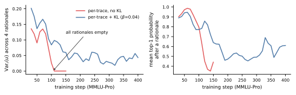
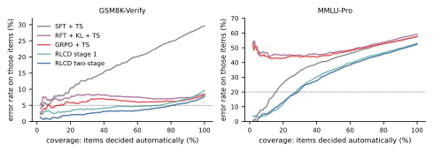
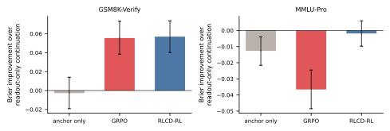

# OpenJev-RLCD: работающая реализация RLCD

**Оригинальное название:** *OpenJev-RLCD: A Working RLCD Implementation*.
**Авторы:** Zhimin Gao, Pichao Wang.
**Контактные адреса, указанные авторами:** <zhimingao113@gmail.com>; <pichaowang@gmail.com>.
**Источник:** [arXiv:2609.38850v1](https://arxiv.org/html/2609.38850v1), версия 1 от 30.09.2026.
**Лицензия оригинала:** [Creative Commons Attribution 4.0 International (CC BY 4.0)](https://creativecommons.org/licenses/by/4.0/).
**Перевод:** неофициальный полный перевод на русский язык, выполненный Codex 25.10.2026. Авторы оригинала перевод не проверяли. Изменение по отношению к оригиналу — перевод текста и представление таблиц в Markdown; библиографические записи сохранены на языке оригинала. Примечания переводчика вынесены в конец и не являются частью статьи.

## Аннотация

Модели принятия решений, такие как Jev, отвечают на вопросы о состоянии агента вероятностями, и эти вероятности полезны лишь тогда, когда они откалиброваны: система, автоматизирующая решения, в которых она уверена, должна оказываться права, когда заявляет об этом. Открытые воспроизведения этой идеи обучают с помощью контролируемого дообучения, а затем исправляют их уверенность температурным масштабированием, тогда как стандартное обучение с подкреплением по проверяемым вознаграждениям делает рассуждающие модели резко переуверенными. Мы описываем работающую реализацию *обучения с подкреплением для калиброванных решений* (reinforcement learning for calibrated decisions, RLCD) для рассуждающих моделей и анализ, который к ней привёл. Модель сэмплирует обоснование (rationale), а мы затем *считываем* распределение ответов, которое она задаёт после него; каждое обоснование оценивается строго собственным правилом оценки[^proper] этого распределения. Однострочное тождество для дисперсии объясняет, почему популярная альтернатива — оценивать смесь нескольких выборок — вознаграждает обоснования за несогласие друг с другом и приводит к вырождению рассуждений; оно также показывает, что RLVR в точности соответствует целевой функции смеси без слагаемого разнообразия. Целевая функция для отдельных обоснований имеет калиброванный оптимум, но при наивной оптимизации она либо отключает рассуждения, либо теряется на фоне высокодисперсных градиентов политики. Отсюда получается рецепт: *сначала калибровать, затем подкреплять*. Сначала следует обучить решение, выдаваемое после обоснования, с помощью собственного правила оценки на обоснованиях самой модели, а затем оптимизировать рассуждения, используя ту же оценку как вознаграждение. На Qwen3-1.7B в двух реальных задачах, требующих рассуждений (3 случайных зерна, парные проверки), RLCD достигает не меньшей точности, чем SFT, RFT/STaR и GRPO — каждый с последующим температурным масштабированием, — либо превосходит их и превосходит все эти методы в предсказании с возможностью отказа, измеряемом площадью под кривой «риск–охват». В задаче проверки ответов GSM8K один запрос RLCD позволяет принять решение для 81% примеров при ошибке ≤5%, тогда как GRPO — для 19%. В задаче, где неопределённость обусловлена несогласием аннотаторов, та же целевая функция доказуемо не может превзойти кросс-энтропию и, будучи предоставлена сама себе, обнаруживает, что рассуждения следует прекратить. Мы публикуем код, все журналы запусков и сервер с совместимым API. Код доступен по адресу: [https://github.com/ZimmyGao/openjev-rlcd](https://github.com/ZimmyGao/openjev-rlcd).

## 1 Введение

Калиброванная модель принятия решений возвращает для вопроса о некотором состоянии («будет ли этот план успешным?», «правилен ли этот ответ?», «какой вариант верен?») распределение вероятностей ответов, уверенность которого соответствует его точности. Ценность такой модели заключается не столько в её точности, сколько в возможностях, которые даёт калибровка: последующий агент может автоматизировать решения, в которых модель уверена, а остальные передавать на следующий уровень обработки, причём делать это на основе собственной уверенности модели, без меток. Jev от TypeSafe AI [[17](https://arxiv.org/html/2609.38850v1#bib.bib1)] рекламирует именно эту возможность под названием *обучение с подкреплением для калиброванных решений* (RLCD), не раскрывая алгоритм обучения. Возникшая вслед за ним открытая экосистема — несколько сотен репозиториев за считаные недели — обучает модели-оценщики с помощью контролируемого дообучения (supervised fine-tuning, SFT), а затем исправляет их уверенность постфактум с помощью температурного масштабирования (temperature scaling, TS) [[8](https://arxiv.org/html/2609.38850v1#bib.bib4)].

Обучение с подкреплением — естественный инструмент для решений, исходы которых становятся известны лишь постфактум; именно так сегодня обучают рассуждающие модели [[15](https://arxiv.org/html/2609.38850v1#bib.bib9)]. Однако вознаграждение, используемое для рассуждений, — 1 за правильный ответ — не является собственным правилом оценки ни одной из величин, сообщаемых моделью, и обучение с подкреплением на таком вознаграждении порождает модели, которые уверенно ошибаются. Поэтому ряд недавних работ вознаграждает *наборы* выборок: использует штрафы за дубликаты, слагаемые совпадений и групповые вознаграждения за калибровку. В этой статье мы ставим вопрос о том, как выглядит работающий RLCD для рассуждающих моделей, и отвечаем на него посредством анализа, практического рецепта и контролируемого эмпирического исследования.

### Основные результаты

- Формулировка через считывание распределения ответов и тождество для дисперсии (§[3](https://arxiv.org/html/2609.38850v1#S3)). Мы оцениваем распределение ответов $u(r)$, которое рассуждающая модель задаёт после собственного обоснования $r$. Для оценки Брайера $J(\mathbb{E}_{r}u)=\mathbb{E}_{r}J(u)+\mathrm{Var}_{r}(u)$: оценивание смеси выборок выплачивает бонус за несогласие обоснований друг с другом независимо от того, имеет ли это несогласие основания. Для ответов в формате one-hot то же тождество представляет калиброванное групповое вознаграждение как RLVR плюс бонус за разнообразие по Джини, коэффициент при котором должен быть в точности равен единице. Оценивание собственного распределения каждого обоснования устраняет этот бонус и имеет калиброванный оптимум $u(r)=q(x)$ для каждого обоснования, так что уже один запрос оказывается калиброванным.
- Два режима неудачи и рецепт, позволяющий их избежать (§[3.2](https://arxiv.org/html/2609.38850v1#S3.SS2)). При сквозной оптимизации целевая функция для отдельных обоснований либо отказывается от рассуждений (коллапс «System-One», предотвращаемый KL-привязкой), либо оказывается заглушена слагаемым градиента политики: его градиент в 7–12 раз больше градиента считываемого распределения и доминирует в оптимизаторе. *Сначала калибровать, затем подкреплять*: сначала обучить считываемое распределение, а затем подкреплять рассуждения, используя собственную оценку как вознаграждение и привязываясь к откалиброванной модели.
- Контролируемое сравнение на реальных задачах (§[5](https://arxiv.org/html/2609.38850v1#S5)). На MMLU-Pro и в задаче проверки ответов GSM8K, при трёх случайных зернах и парных проверках по каждому тестовому примеру, RLCD достигает не меньших точности и качества по оценке Брайера, чем SFT+TS, RFT/STaR+TS (с KL и без него) и GRPO+TS, либо превосходит их, а по площади под кривой «риск–охват» превосходит все эти методы. Контрольные продолжения обучения от одной контрольной точки показывают, когда подкрепление рассуждений помогает — когда рассуждение является вычислением — и почему вознаграждение должно быть собственным: вознаграждение за правильность разрушает калибровку считываемого распределения.
- Случай, когда RL не может помочь (§[5.3](https://arxiv.org/html/2609.38850v1#S5.SS3)). Если неопределённость обусловлена несогласием аннотаторов (ChaosNLI), рассуждения не могут её уменьшить; целевая функция для отдельных обоснований обнаруживает это и отключает рассуждения, а ни один вариант RL не превосходит кросс-энтропию на тех же метках.

## 2 Постановка

Вопрос $x$ имеет $K$ вариантов ответа и исход $Y\sim q(\cdot\mid x)$; $q$ является one-hot-распределением, когда существует правильный ответ (эпистемическая неопределённость), и распределено между несколькими вариантами, когда люди расходятся во мнениях (алеаторная неопределённость). Рассуждающая модель с параметрами $\theta$ сэмплирует обоснование $r\sim\pi_{\theta}(\cdot\mid x)$, завершающееся маркером `Answer:`; затем мы *считываем* её распределение следующего токена по $K$ токенам вариантов ответа:

$$
u_{\theta}(x,r)=\mathrm{softmax}\big(\text{logits}_{\theta}(x,r)[\text{option tokens}]\big)\in\Delta_{K},
$$

вместо того чтобы сэмплировать из него ответ. Распределение решений модели представляет собой смесь $p_{\theta}(x)=\mathbb{E}_{r}u_{\theta}(x,r)$; один запрос возвращает $u_{\theta}(x,r)$ для одного сэмплированного обоснования. Мы используем оценку Брайера со сдвигом и сменой знака $J(u,y)=2u_{y}-\|u\|^{2}=1-\|u-e_{y}\|^{2}$, математическое ожидание которой $J(u,q)=\mathbb{E}_{Y\sim q}J(u,Y)=2u^{\top}q-\|u\|^{2}$ имеет единственный максимум при $u=q$ [[2](https://arxiv.org/html/2609.38850v1#bib.bib2), [7](https://arxiv.org/html/2609.38850v1#bib.bib3)]; логарифмическая оценка в наших экспериментах ведёт себя аналогично.

## 3 Метод

### 3.1 Что оценивать: смесь или каждое обоснование

**Утверждение 1 (Разложение дисперсии).** Для любого распределения обоснований и любого $q$, если $p=\mathbb{E}_{r}u(r)$, то

$$
J(p,q)\;=\;\mathbb{E}_{r}\,J\big(u(r),q\big)\;+\;\mathbb{E}_{r}\big\|u(r)-p\big\|^{2}.
$$

**Доказательство.** $J(p,q)-\mathbb{E}_{r}J(u(r),q)=\mathbb{E}_{r}\|u(r)\|^{2}-\|p\|^{2}=\mathbb{E}_{r}\|u(r)-p\|^{2}$, поскольку $J$ аффинна по $u$, за исключением слагаемого $-\|u\|^{2}$. ∎

Таким образом, целевая функция смеси $J(p,q)$ — функция, стоящая за оцениванием групп выборок, — равна средней оценке отдельных обоснований плюс бонус за несогласие обоснований друг с другом. Ничто в этом бонусе не требует, чтобы несогласие имело основания: политика может получать его, рандомизируя свои выводы. Отсюда следуют два результата.

**Следствие 1 (RLVR — целевая функция смеси без слагаемого разнообразия).** Если ответ сэмплируется, $u(r)=e_{A}$ при $A\sim p$, то $\mathbb{E}_{A}J(e_{A},q)=2p^{\top}q-1=2\Pr(A=Y)-1$ является целевой функцией RLVR, а $\mathrm{Var}=1-\|p\|^{2}$ — неоднородностью Джини распределения $p$: калиброванное групповое вознаграждение есть «RLVR + бонус Джини». При любом коэффициенте $\lambda<1$ перед бонусом оптимум уже не равен $p=q$; при $\lambda=0$ (RLVR) он соответствует моде.

**Утверждение 2 (Целевая функция для отдельных обоснований).** Пусть $J_{\lambda}(\theta)=\mathbb{E}_{x}\mathbb{E}_{r}J(u_{\theta}(x,r),q(x))+\lambda\,\mathbb{E}_{x}\mathrm{Var}_{r}(u_{\theta})$. Если при заданном вопросе исход не зависит от собственного обоснования модели ($Y\perp r\mid x$, что верно всегда, когда $Y$ порождается внешним миром), то для любого $\lambda<1$ единственный максимум по считываемым распределениям достигается при $u(x,r)=q(x)$ для каждого обоснования $r$; при $\lambda=1$ оптимально любое считываемое распределение, удовлетворяющее $\mathbb{E}_{r}u(x,r)=q(x)$.

**Доказательство.** По утверждению [1](https://arxiv.org/html/2609.38850v1#Thmproposition1), $J_{\lambda}=(1-\lambda)\mathbb{E}_{r}J(u(r),q)+\lambda J(p,q)$. Оба слагаемых максимизируются при $u(r)\equiv q$; первое строго вогнуто по каждому $u(r)$, что даёт единственность при $\lambda<1$. ∎

Поэтому мы используем целевую функцию для отдельных обоснований ($\lambda=0$): в оптимуме один запрос калиброван, и целевая функция больше не оплачивает несогласие. Обоснования по-прежнему важны — более качественное обоснование позволяет модели ограниченной ёмкости точнее вычислять $q(x)$, — однако за случайность они никогда не вознаграждаются.

**Оценка градиента.** При $M$ обоснованиях на вопрос и одном исходе $Y$ обозначим $R_{i}=J(u_{\theta}(x,r_{i}),Y)$. Градиент $\mathbb{E}_{r}J$ распадается на градиент по пути вычислений через считываемое распределение и оценку градиента через логарифм плотности (score-function) для обоснований:

$$
\widehat{\nabla}=\frac{1}{M}\sum_{i=1}^{M}\nabla_{\theta}R_{i}\;+\;\frac{1}{M}\sum_{i=1}^{M}\Big(R_{i}-\frac{1}{M-1}\sum_{j\neq i}R_{j}\Big)\nabla_{\theta}\log\pi_{\theta}(r_{i}\mid x),
$$

с базовой линией, вычисляемой по всем обоснованиям, кроме текущего (leave-one-out) [[10](https://arxiv.org/html/2609.38850v1#bib.bib6), [1](https://arxiv.org/html/2609.38850v1#bib.bib7)]. Эта оценка несмещённая; то же верно для её вариантов с KL-штрафом или затратами отдельных обоснований в качестве добавок к вознаграждению, а также для оценки целевой функции смеси, полученной рао-блэкуэллизацией (приложение [A](https://arxiv.org/html/2609.38850v1#A1)). Мы проверили все эти оценки сравнением с точным перебором на табличных моделях; максимальная ошибка составила $<10^{-15}$. Считывание $u$ вместо сэмплирования ответа представляет собой рао-блэкуэллизацию оценки, использующей только сэмплирование [[11](https://arxiv.org/html/2609.38850v1#bib.bib8)]; при пустом обосновании оно сводится к обучению прямой модели-оценщика с помощью оценки Брайера.

### 3.2 Два режима неудачи целевой функции для отдельных обоснований

**Она отключает рассуждения.** Рассуждающие модели уверенно завершают свои обоснования, поэтому $u$ после обоснования почти является one-hot-распределением, а оценка Брайера штрафует каждую уверенную ошибку. Снижать уверенность после *пустого* обоснования модель учится быстрее, чем после рассуждения, и градиент политики переносит всю вероятностную массу на пустое обоснование. На MMLU-Pro это происходит примерно за 100 шагов (рисунок [1](https://arxiv.org/html/2609.38850v1#S3.F1), красный): все четыре обоснования превращаются в один лишь маркер, а модель становится прямой моделью-оценщиком. KL-привязка к рассуждающей модели ($\beta=0.04$, синий) предотвращает коллапс и позволяет модели научиться снижать уверенность *после* рассуждения.

**Она теряется на фоне градиента политики.** Даже с привязкой добавление слагаемого score-function при обучении с нуля ухудшает каждую метрику по сравнению с обучением только считываемого распределения, причём монотонно с ростом веса этого слагаемого (таблица [4](https://arxiv.org/html/2609.38850v1#S5.T4)). Норма градиента слагаемого score-function в 7–12 раз больше нормы градиента по пути вычислений (среднеквадратичное значение за обучение), поэтому оно доминирует в оценке второго момента в Adam: полезный сигнал считываемого распределения с низкой дисперсией используется в шагах, размер которых определяется шумом. На ранней стадии его направление также не помогает: пока считываемое распределение ещё плохо откалибровано, вознаграждение преимущественно учит обоснования звучать уверенно.

**Рисунок 1.** Коллапс System-One (MMLU-Pro, целевая функция для отдельных обоснований, сквозное обучение). Без KL-привязки четыре обоснования каждого вопроса становятся одинаковыми и пустыми через ∼100 шагов (слева: дисперсия $u$ между обоснованиями), в то время как считываемое распределение учится отражать меньшую уверенность (справа). С KL-привязкой модель продолжает рассуждать и учится снижать уверенность после рассуждения. Запуск без KL был остановлен на шаге 150, после коллапса.

### 3.3 Рецепт: сначала калибровать, затем подкреплять

**Алгоритм 1. RLCD для рассуждающей модели (один шаг; $M$ обоснований для каждого вопроса в пакете).**

| Строка | Действие |
| --- | --- |
| 1 | Сэмплировать $r_{1},\dots,r_{M}\sim\pi_{\theta}(\cdot\mid x)$ до `Answer:`; считать $u_{i}=u_{\theta}(x,r_{i})$; наблюдать $Y$. |
| 2 | $R_{i}\leftarrow J(u_{i},Y)$; $\triangleright$ любая строго собственная оценка считываемого распределения. |
| 3 | **Если** этап 1 (калибровка решения), **то** |
| 4 | $\quad\mathcal{L}\leftarrow-\frac{1}{M}\sum_{i}R_{i}$; $\triangleright$ только градиент по пути вычислений: обоснования сэмплируются из текущей политики, но не подкрепляются. |
| 5 | **Иначе** этап 2 (подкрепление рассуждений), начиная с модели этапа 1 $\theta_{1}$. |
| 6 | $\quad A_{i}\leftarrow\frac{1}{M}\big(R_{i}-\beta\log\frac{\pi_{\theta}(r_{i})}{\pi_{\theta_{1}}(r_{i})}\big)-\text{среднее без текущего обоснования}$. |
| 7 | $\quad\mathcal{L}\leftarrow-\frac{1}{M}\sum_{i}R_{i}-c\sum_{i}\mathrm{sg}(A_{i})\log\pi_{\theta}(r_{i}\mid x)$; $\triangleright$ $c=0.3$, $\beta=0.04$. |
| 8 | **Конец условия.** |
| 9 | Обновить $\theta$ с помощью Adam по $\mathcal{L}$. |

Алгоритм [1](https://arxiv.org/html/2609.38850v1#alg1) разделяет эти две роли. Этап 1 обучает решение, которое модель сообщает после собственного рассуждения, с помощью собственного правила оценки; это та половина градиента RLCD, которая проходит по пути вычислений, то есть детерминированный градиент политики для вознаграждения в виде собственной оценки по отношению к сообщаемому распределению, причём обоснование рассматривается как латентная переменная, полученная из текущей политики. Затем этап 2 подкрепляет рассуждения, используя *ту же* собственную оценку как вознаграждение, слагаемое score-function с уменьшенным весом и KL-привязку к откалиброванной модели, чтобы вознаграждение было информативным, а привязка защищала выученное на этапе 1. На обоих этапах наблюдается ровно исход $Y$ каждого вопроса, как и во всех базовых методах.

## 4 Условия экспериментов

**Задачи.** *MMLU-Pro* [[18](https://arxiv.org/html/2609.38850v1#bib.bib17)]: вопросы с 10 вариантами ответа, случайное разбиение бенчмарка из 12 тысяч вопросов на 4000/500/1500 (мы оцениваем качество на первых 1000 тестовых и 300 валидационных вопросах); задача требует большого объёма знаний. *GSM8K-Verify*: задача решения «да/нет», построенная на GSM8K [[4](https://arxiv.org/html/2609.38850v1#bib.bib18)], — «правилен ли этот предложенный окончательный ответ?»; предложение представляет собой сэмплированное решение Qwen3-0.6B (53% предложений правильны на обучающей выборке, 50% — на тестовой); обучающая и валидационная выборки взяты из GSM8K-train (использованы 4000/300 примеров), тестовая — все 1260 задач GSM8K-test, для которых удалось разобрать предложенный ответ. Рассуждения необходимы: в пробе на 400 примерах базовая модель достигает 56% при прямом ответе и 87% после рассуждения. *ChaosNLI* [[12](https://arxiv.org/html/2609.38850v1#bib.bib19)]: примеры MNLI со 100 метками аннотаторов на каждый пример (199 валидационных, 400 тестовых примеров); при каждом обращении к обучающему примеру выбирается одна новая метка аннотатора, а целевым является распределение человеческих меток.

**Модель и методы.** Все методы стартуют с Qwen3-1.7B [[14](https://arxiv.org/html/2609.38850v1#bib.bib20)] в режиме non-thinking, используют AdamW со скоростью обучения $2\cdot 10^{-6}$, 8 вопросов и $M=4$ обоснования на шаг и при заданном случайном зерне видят одну и ту же последовательность вопросов и исходов. SFT+TS: та же модель отвечает напрямую и дообучается с кросс-энтропией по токену метки (400 или 800 шагов; на обеих задачах 800 шагов не дали улучшения по сравнению с 400, поэтому мы приводим результат для 400). RFT/STaR+TS [[20](https://arxiv.org/html/2609.38850v1#bib.bib10)]: дообучение на выборке с отбраковкой траекторий; используются траектории, у которых сэмплированный ответ правилен (по токенам обоснования и ответа), с KL-привязкой и без неё. GRPO+TS [[15](https://arxiv.org/html/2609.38850v1#bib.bib9)]: вознаграждение за правильность, преимущества, нормированные по группе, KL-привязка $\beta=0.04$. RLCD: этап 1 (400 шагов, оценка Брайера или логарифмическая оценка) и этап 2 (ещё 400 шагов от контрольной точки этапа 1). Ко всем базовым методам применяется одинаковое температурное масштабирование, подобранное поиском по сетке на валидационной выборке.

**Метрики и статистика.** Точность, оценка Брайера, NLL и ECE считываемого распределения одного запроса после температурного масштабирования; площадь под кривой «риск–охват» (AURC; примеры упорядочены по уверенности, риск — доля ошибок); Cov@$\epsilon$ — наибольшая доля примеров, упорядоченных по уверенности, для которой доля ошибок не превышает $\epsilon$ [[6](https://arxiv.org/html/2609.38850v1#bib.bib16)]; а также подобранная температура $T$ ($T\approx 1$: модель откалибрована самим обучением). Все значения усредняются по трём случайным зернам; проверки парные по тестовым примерам (значения для каждого примера усреднены по случайным зернам), с 95%-ными бутстреп-интервалами и двусторонними перестановочными $p$-значениями для средних, полученными сменой знаков. $\ast$: $p<0.05$, $\ast\ast$: $p<0.01$.

## 5 Результаты

### 5.1 Основное сравнение

**Таблица 1.** Решения по одному запросу после температурного масштабирования (среднее ± стандартное отклонение по 3 случайным зернам). Cov@$\epsilon$: доля тестовых примеров, для которых можно автоматически принять решение при доле ошибок $\leq\epsilon$ (5% для GSM8K-Verify, 20% для MMLU-Pro, где доля ошибок выше). $T$: температура, подобранная на валидационной выборке (1 = модель откалибрована самим обучением). Лучшие результаты выделены полужирным.

*GSM8K-Verify — рассуждения необходимы.*

| Метод | Точность $\uparrow$ | Брайер $\downarrow$ | AURC $\downarrow$ | Cov@5% $\uparrow$ | $T$ |
| --- | ---: | ---: | ---: | ---: | ---: |
| Базовая модель (рассуждения без примеров) | 84.1 | 0.211 | 0.073 | 14.9 | 9.1 |
| SFT + TS (прямой ответ) | $70.4\pm0.2$ | $0.382\pm0.009$ | $0.174\pm0.010$ | $6.2\pm2.0$ | 2.1 |
| RFT/STaR + TS | $89.0\pm1.6$ | $0.207\pm0.020$ | $0.103\pm0.013$ | $0.9\pm0.7$ | 7.3 |
| RFT/STaR + KL + TS | $91.4\pm0.5$ | $0.160\pm0.006$ | $0.075\pm0.010$ | $11.6\pm8.1$ | 6.6 |
| GRPO + KL + TS | $91.8\pm0.6$ | $0.150\pm0.009$ | $0.061\pm0.006$ | $19.4\pm7.3$ | 7.2 |
| RLCD, этап 1, считывание распределения с оценкой Брайера | $90.4\pm2.0$ | $0.164\pm0.020$ | $0.047\pm0.010$ | $62.6\pm21.3$ | 1.6 |
| RLCD, этап 1, считывание распределения с логарифмической оценкой | $91.3\pm0.4$ | $0.149\pm0.009$ | $0.038\pm0.002$ | $72.2\pm7.2$ | 1.8 |
| Двухэтапный RLCD (этап 1 + RLCD-RL) | **$92.2\pm0.7$** | **$0.135\pm0.009$** | **$0.034\pm0.001$** | **$81.1\pm7.2$** | 1.4 |

*MMLU-Pro — задача, требующая большого объёма знаний.*

| Метод | Точность $\uparrow$ | Брайер $\downarrow$ | AURC $\downarrow$ | Cov@20% $\uparrow$ | $T$ |
| --- | ---: | ---: | ---: | ---: | ---: |
| Базовая модель (рассуждения без примеров) | 38.9 | 0.786 | 0.516 | 0.0 | 10.9 |
| SFT + TS (прямой ответ) | $42.3\pm0.4$ | $0.711\pm0.002$ | $0.386\pm0.005$ | $15.6\pm0.7$ | 1.6 |
| RFT/STaR + TS | $32.7\pm0.9$ | $0.830\pm0.004$ | $0.619\pm0.011$ | $0.0\pm0.0$ | 17.6 |
| RFT/STaR + KL + TS | $40.9\pm0.6$ | $0.761\pm0.006$ | $0.493\pm0.008$ | $0.0\pm0.0$ | 11.0 |
| GRPO + KL + TS | $42.4\pm0.5$ | $0.753\pm0.006$ | $0.481\pm0.015$ | $0.0\pm0.0$ | 11.1 |
| RLCD, этап 1, считывание распределения с оценкой Брайера | $47.0\pm1.3$ | $0.667\pm0.014$ | $0.312\pm0.019$ | $27.3\pm2.1$ | 1.4 |
| RLCD, этап 1, считывание распределения с логарифмической оценкой | $46.5\pm0.7$ | $0.668\pm0.009$ | $0.319\pm0.012$ | $24.8\pm1.6$ | 1.5 |
| Двухэтапный RLCD (этап 1 + RLCD-RL) | **$47.7\pm2.0$** | **$0.658\pm0.015$** | **$0.304\pm0.022$** | **$27.6\pm3.3$** | 1.6 |

**Рисунок 2.** Риск и охват решений по одному запросу (после температурного масштабирования, с усреднением по случайным зернам). Пунктир: допустимый уровень ошибки, использованный для Cov@$\epsilon$ в таблице [1](https://arxiv.org/html/2609.38850v1#S5.T1). Температурное масштабирование не может исправить ранжирование переуверенных моделей (GRPO, RFT), у которых доля ошибок не меняется с охватом.

Таблица [1](https://arxiv.org/html/2609.38850v1#S5.T1) и рисунок [2](https://arxiv.org/html/2609.38850v1#S5.F2) обобщают результаты сравнения. На GSM8K-Verify, где рассуждения необходимы, SFT+TS достигает точности лишь 70.4%, а двухэтапный RLCD улучшает этот результат на +21.8 процентного пункта по точности и на −0.247 по оценке Брайера. Базовые методы с рассуждениями точны, но плохо откалиброваны в отношении ранжирования: после температурного масштабирования GRPO сопоставим с RLCD по точности (91.8% против 92.2%, статистически незначимо) и близок по оценке Брайера (разность −0.015, $p=0.09$), однако его уверенность значительно хуже отделяет правильные ответы от неправильных (AURC 0.061 против 0.034, парный бутстреп $p<10^{-3}$), поэтому при допустимой доле ошибок 5% он позволяет принять решение для 19% примеров против 81% у RLCD. RFT ведёт себя подобно GRPO: с KL-привязкой он достигает точности 91.4%, но всё равно позволяет принять решение лишь для 12% примеров при 5% ошибок (двухэтапный RLCD против RFT+KL: Брайер −0.025, AURC −0.041, $p<0.01$). Подобранные температуры показывают ту же картину с другой стороны: GRPO и RFT требуют $T\approx 7$, RLCD — $T=1.4$.

На MMLU-Pro ни один базовый метод с рассуждениями после температурного масштабирования не превосходит SFT+TS, а без KL-привязки RFT во всех трёх случайных зернах коллапсирует к пустым обоснованиям (точность 32.7%, ниже 38.9% у базовой модели). RLCD повышает точность на +5.3 процентного пункта относительно SFT+TS и на +5.2 относительно GRPO+TS, с изменением оценки Брайера на −0.053 и −0.095 соответственно (во всех случаях $p<10^{-3}$). При допустимой доле ошибок 20% он позволяет принять решение для 28% примеров против 16% у SFT+TS и ни одного примера у любого из базовых методов с рассуждениями, уверенность которых после температурного масштабирования неинформативна. Уже один этап 1 обеспечивает основную часть выигрыша на обеих задачах; выбор собственного правила оценки для считываемого распределения мало влияет на результат (оценка Брайера против логарифмической оценки).

### 5.2 Что даёт подкрепление рассуждений

**Таблица 2.** Продолжения этапа 2, ответвлённые от одной и той же контрольной точки этапа 1 (3 случайных зерна); изменение относительно контрольной точки (один запрос, после TS). Только привязка: тот же шум score-function и та же KL-привязка, что и в RLCD-RL, но без вознаграждения за исход.

| Продолжение этапа 2 (400 шагов, одна контрольная точка) | GSM8K-Verify: $\Delta$точность | GSM8K-Verify: $\Delta$Брайер | GSM8K-Verify: $\Delta$AURC | MMLU-Pro: $\Delta$точность | MMLU-Pro: $\Delta$Брайер | MMLU-Pro: $\Delta$AURC |
| --- | ---: | ---: | ---: | ---: | ---: | ---: |
| Продолжение обучения только считываемого распределения | $-1.7^{\ast\ast}$ | $+0.028^{\ast\ast}$ | $+0.011^{\ast}$ | +0.5 | −0.010 | −0.011 |
| Только привязка (шум REINFORCE, без вознаграждения) | $-2.6^{\ast\ast}$ | $+0.031^{\ast\ast}$ | $+0.016^{\ast\ast}$ | −0.1 | +0.002 | +0.007 |
| GRPO (вознаграждение за правильность) | $+1.8^{\ast\ast}$ | $-0.028^{\ast\ast}$ | $-0.012^{\ast\ast}$ | −1.1 | $+0.026^{\ast\ast}$ | $+0.033^{\ast\ast}$ |
| RLCD-RL (вознаграждение в виде собственной оценки) | $+1.8^{\ast\ast}$ | $-0.029^{\ast\ast}$ | $-0.013^{\ast\ast}$ | +0.6 | −0.009 | −0.009 |

**Рисунок 3.** Вознаграждение на этапе 2 имеет значение. Улучшение оценки Брайера по сравнению с продолжением обучения только считываемого распределения при одинаковом бюджете 400 шагов от одной и той же контрольной точки (95%-ные бутстреп-интервалы по тестовым примерам, данные 3 случайных зерён объединены).

Чтобы выделить вклад этапа 2, мы сохранили модель этапа 1 для каждого случайного зерна и ответвили от неё четыре продолжения по 400 шагов с одним и тем же потоком данных (таблица [2](https://arxiv.org/html/2609.38850v1#S5.T2), рисунок [3](https://arxiv.org/html/2609.38850v1#S5.F3)). Три вывода согласуются между случайными зернами.

- Там, где рассуждение является вычислением, его подкрепление помогает. На GSM8K-Verify продолжение обучения только считываемого распределения *ухудшает* модель, тогда как RLCD-RL её улучшает; по сравнению с продолжением обучения только считываемого распределения RLCD-RL даёт +3.5 процентного пункта точности и −0.057 по оценке Брайера ($p<10^{-3}$, для каждого из трёх случайных зерён результат по отдельности значим).
- Результат обеспечивает вознаграждение за исход, а не привязка. Контрольный вариант только с привязкой имеет тот же шум score-function и ту же KL-привязку, но не имеет вознаграждения; он хуже RLCD-RL (GSM8K-Verify: +4.4 процентного пункта в пользу RLCD-RL; MMLU-Pro: Брайер −0.011; оба $p<0.01$) и нестабилен между случайными зернами (в одном из них произошёл коллапс).
- Вознаграждение должно быть собственным. Продолжение обучения с вознаграждением GRPO за правильность даёт такой же хороший результат, как RLCD-RL, на GSM8K-Verify, но на MMLU-Pro, где RL не может существенно повысить точность, вновь завышает уверенность откалиброванного считываемого распределения ($T$ возрастает с 1.4 до 3.8) и делает оценку Брайера и AURC значимо хуже, чем в контрольной точке; RLCD-RL превосходит его на +1.8 процентного пункта точности и −0.035 по оценке Брайера ($p<10^{-3}$).

На MMLU-Pro подкрепление рассуждений собственной оценкой в среднем нейтрально (разность по оценке Брайера относительно продолжения обучения только считываемого распределения +0.002, статистически незначима; знак различается между случайными зернами): польза этапа 2 специфична для задач, где более качественное рассуждение меняет ответ.

### 5.3 Алеаторная неопределённость: когда RL не может помочь

**Таблица 3.** ChaosNLI (400 тестовых примеров). Цель — распределение 100 человеческих меток; при каждом обращении каждый метод видит одну новую метку аннотатора.

| ChaosNLI (100 аннотаторов на пример), Qwen3-1.7B | JSD относительно людей $\downarrow$ | Точность относительно большинства $\uparrow$ | Случайные зерна | Обоснования |
| --- | ---: | ---: | ---: | --- |
| Прямой ответ, CE на потоке меток (SFT) | 0.074 | 66.2 | 3 | — |
| Целевая функция смеси $\lambda{=}1$, смесь 16 обоснований | 0.121 | 63.1 | 3 | Вырожденные (достигают ограничения длины) |
| Целевая функция смеси $\lambda{=}1$, одно обоснование | 0.342 | 55.4 | 3 | Вырожденные |
| Целевая функция смеси $\lambda{=}1$ + KL, смесь | 0.149 | 67.8 | 1 | Нормальные (48 токенов) |
| Целевая функция для отдельных траекторий $\lambda{=}0$, без KL | 0.075 | 63.0 | 1 | Пустые (System-One) |

Если $q(x)$ распределено между несколькими вариантами из-за несогласия аннотаторов, рассуждения не могут уменьшить неопределённость, а при явном считывании распределения градиент RLCD в среднем равен градиенту Брайера, поэтому он не может превзойти контролируемое обучение на тех же метках. ChaosNLI подтверждает обе части этого утверждения (таблица [3](https://arxiv.org/html/2609.38850v1#S5.T3)). Целевая функция смеси ($\lambda=1$) калибрует свою смесь из 16 выборок (JSD 0.121), делая обоснования случайными: они достигают ограничения длины, а отдельное обоснование плохо откалибровано, как и предсказывает утверждение [1](https://arxiv.org/html/2609.38850v1#Thmproposition1). Напротив, целевая функция для отдельных обоснований обнаруживает, что рассуждения здесь бесполезны, и отключает их, достигая того же качества, что и кросс-энтропия на прямых ответах (JSD 0.075 против 0.074). Мы считаем это правильным поведением целевой функции принятия решений и основанием предпочесть быструю прямую модель-оценщик, когда неопределённость алеаторна.

### 5.4 Абляции

**Таблица 4.** Вес слагаемого score-function при обучении с нуля (MMLU-Pro, случайное зерно 17, целевая функция для отдельных обоснований с KL-привязкой, один запрос после TS). Увеличение вклада градиента политики монотонно ухудшает результат; это мотивирует разделение этапов.

| Вес REINFORCE $c$ (с нуля) | Точность $\uparrow$ | Брайер $\downarrow$ | AURC $\downarrow$ | Токены обоснования |
| --- | ---: | ---: | ---: | ---: |
| 0 (только считываемое распределение) | 46.3 | 0.676 | 0.323 | 182 |
| 0.1 | 45.0 | 0.677 | 0.327 | 155 |
| 0.3 | 44.6 | 0.694 | 0.352 | 148 |
| 1 (несмещённая оценка) | 43.7 | 0.703 | 0.354 | 178 |

**Вес слагаемого score-function.** Таблица [4](https://arxiv.org/html/2609.38850v1#S5.T4): если этапы не разделены, любой положительный вес слагаемого score-function вредит, что согласуется с объяснением через ослабление полезного градиента в §[3.2](https://arxiv.org/html/2609.38850v1#S3.SS2).

**Одного предварительного обучения считываемого распределения недостаточно.** Обучение считываемого распределения в течение 200 шагов с последующим подкреплением в течение 200 шагов (в обоих случаях — с нуля) даёт результат на уровне модели, обучаемой только по считываемому распределению; выигрыши в таблице [2](https://arxiv.org/html/2609.38850v1#S5.T2) требуют, чтобы считываемое распределение сошлось.

**Кто оценивает обоснование.** Оценивание обоснований с помощью замороженной копии откалиброванной модели считывания вместо собственной модели считывания политики (для предотвращения совместной адаптации) дало худший результат на GSM8K-Verify (случайное зерно 17: Брайер $+0.021$, AURC $+0.030$): рассуждения стали короче, а собственное считываемое распределение политики стало переуверенным.

**Отсутствие KL-привязки на этапе 2.** Рассуждения вырождаются через ∼330 шагов (модель перестаёт писать маркер и повторяет свой вывод до ограничения длины); вознаграждение на основе считываемого распределения не чувствительно к формату обоснования, поэтому привязка необходима.

**RLCD с явными вероятностями.** Для модели без обоснований (прямой модели-оценщика) RLCD с явным распределением имеет тот же ожидаемый градиент, что и функция потерь Брайера; на CLINC150 и ChaosNLI он ни разу не превзошёл кросс-энтропию (точность на CLINC150: 94.6% против 96.3%), а RLVR на тех же моделях коллапсировал к моде.

## 6 Связанные работы

**Калибровка языковых моделей.** Температурное масштабирование постфактум [[8](https://arxiv.org/html/2609.38850v1#bib.bib4)] и уверенность, выраженная словами или оценённая по выборкам [[9](https://arxiv.org/html/2609.38850v1#bib.bib14), [16](https://arxiv.org/html/2609.38850v1#bib.bib15)], калибруют *уровень* уверенности, но не ранжирование по ней; предсказание с возможностью отказа [[6](https://arxiv.org/html/2609.38850v1#bib.bib16)] оценивает именно ранжирование, по которому методы из таблицы [1](https://arxiv.org/html/2609.38850v1#S5.T1) различаются сильнее всего. Обучение с собственными правилами оценки [[2](https://arxiv.org/html/2609.38850v1#bib.bib2), [7](https://arxiv.org/html/2609.38850v1#bib.bib3)] стандартно для классификаторов; наш вклад состоит в выборе места его применения в рассуждающей модели.

**RL для рассуждений и калибровки.** RLVR и GRPO [[15](https://arxiv.org/html/2609.38850v1#bib.bib9)] оптимизируют вероятность правильного сэмплированного ответа, которую следствие [1](https://arxiv.org/html/2609.38850v1#Thmcorollary1) отождествляет с целевой функцией смеси без слагаемого разнообразия; нашей оценкой градиента служит REINFORCE с базовыми линиями leave-one-out [[19](https://arxiv.org/html/2609.38850v1#bib.bib5), [10](https://arxiv.org/html/2609.38850v1#bib.bib6), [1](https://arxiv.org/html/2609.38850v1#bib.bib7)]. В параллельно выполнявшейся работе выраженная словами уверенность вознаграждается оценкой Брайера [[5](https://arxiv.org/html/2609.38850v1#bib.bib13)]; мы же оцениваем распределение ответов, которое модель фактически задаёт, и анализируем групповые вознаграждения через утверждение [1](https://arxiv.org/html/2609.38850v1#Thmproposition1).

**Обоснования как латентные переменные.** Этап 1 напоминает слагаемое правдоподобия ответа в обучении с латентными обоснованиями (TRICE, LaTRO) [[13](https://arxiv.org/html/2609.38850v1#bib.bib11), [3](https://arxiv.org/html/2609.38850v1#bib.bib12)] и STaR [[20](https://arxiv.org/html/2609.38850v1#bib.bib10)], которые максимизируют правдоподобие правильного ответа; различие состоит в собственной оценке полного распределения, именно благодаря которой сообщаемая уверенность становится пригодной для использования. Базовый метод RFT/STaR в таблице [1](https://arxiv.org/html/2609.38850v1#S5.T1) показывает, что клонирование правильных траекторий на основе правдоподобия наследует переуверенность RLVR.

## 7 Ограничения

Во всех экспериментах используются модель с 1.7 миллиарда параметров, 400–800 шагов обновления и три случайных зерна; эффекты велики по сравнению с вариативностью между случайными зернами, но более крупные модели и более долгое обучение могут изменить соотношение двух этапов. GSM8K-Verify — задача, которую мы построили из GSM8K с моделью-предлагателем размером 0.6 миллиарда параметров. С Jev мы сравниваемся только по поведению (API воспроизведён; обучающие данные не опубликованы) и ничего не утверждаем о внутреннем алгоритме Jev. Этап 2 помогает на задаче, где рассуждения необходимы, и нейтрален на задаче, требующей большого объёма знаний; мы пока не знаем, как предсказать его пользу, не выполняя его.

## 8 Заключение

Работающий RLCD для рассуждающих моделей оценивает с помощью собственного правила оценки то, что модель фактически решает, — распределение ответов после собственного обоснования, — сначала для калибровки этого решения, а затем для подкрепления рассуждения, которое к нему приводит. Оценивание групп выборок, напротив, вознаграждает несогласие, а вознаграждение за правильность разрушает калибровку; оба эффекта видны в одном тождестве. Выигрыш состоит не в нескольких пунктах точности, а в решениях, которые можно делегировать: при той же точности, что и GRPO, один запрос RLCD знает, каким из своих ответов доверять.

## Литература

- \[1\] A. Ahmadian, C. Cremer, M. Gallé, M. Fadaee, J. Kreutzer, O. Pietquin, A. Üstün, and S. Hooker (2024) Back to basics: revisiting REINFORCE-style optimization for learning from human feedback in LLMs. In Annual Meeting of the Association for Computational Linguistics (ACL), Cited by: [§3.1](https://arxiv.org/html/2609.38850v1#S3.SS1.SSS0.Px1.p1.2), [§6](https://arxiv.org/html/2609.38850v1#S6.SS0.SSS0.Px2.p1.1).
- \[2\] G. W. Brier (1950) Verification of forecasts expressed in terms of probability. Monthly Weather Review 78 (1), pp. 1–3. Cited by: [§2](https://arxiv.org/html/2609.38850v1#S2.p1.2), [§6](https://arxiv.org/html/2609.38850v1#S6.SS0.SSS0.Px1.p1.1).
- \[3\] H. Chen, Y. Feng, Z. Liu, W. Yao, A. Prabhakar, S. Heinecke, R. Ho, P. Mui, S. Savarese, C. Xiong, and H. Wang (2024) Language models are hidden reasoners: unlocking latent reasoning capabilities via self-rewarding. arXiv preprint arXiv:2411.04282. Cited by: [§6](https://arxiv.org/html/2609.38850v1#S6.SS0.SSS0.Px3.p1.1).
- \[4\] K. Cobbe, V. Kosaraju, M. Bavarian, M. Chen, H. Jun, L. Kaiser, M. Plappert, J. Tworek, J. Hilton, R. Nakano, C. Hesse, and J. Schulman (2021) Training verifiers to solve math word problems. arXiv preprint arXiv:2110.14168. Cited by: [§4](https://arxiv.org/html/2609.38850v1#S4.SS0.SSS0.Px1.p1.1).
- \[5\] M. Damani, I. Puri, S. Slocum, I. Shenfeld, L. Choshen, Y. Kim, and J. Andreas (2025) Beyond binary rewards: training LMs to reason about their uncertainty. arXiv preprint arXiv:2507.16806. Cited by: [§6](https://arxiv.org/html/2609.38850v1#S6.SS0.SSS0.Px2.p1.1).
- \[6\] Y. Geifman and R. El-Yaniv (2017) Selective classification for deep neural networks. In Advances in Neural Information Processing Systems (NeurIPS), Cited by: [§4](https://arxiv.org/html/2609.38850v1#S4.SS0.SSS0.Px3.p1.1), [§6](https://arxiv.org/html/2609.38850v1#S6.SS0.SSS0.Px1.p1.1).
- \[7\] T. Gneiting and A. E. Raftery (2007) Strictly proper scoring rules, prediction, and estimation. Journal of the American Statistical Association 102 (477), pp. 359–378. Cited by: [§2](https://arxiv.org/html/2609.38850v1#S2.p1.2), [§6](https://arxiv.org/html/2609.38850v1#S6.SS0.SSS0.Px1.p1.1).
- \[8\] C. Guo, G. Pleiss, Y. Sun, and K. Q. Weinberger (2017) On calibration of modern neural networks. In International Conference on Machine Learning (ICML), Cited by: [§1](https://arxiv.org/html/2609.38850v1#S1.p1.1), [§6](https://arxiv.org/html/2609.38850v1#S6.SS0.SSS0.Px1.p1.1).
- \[9\] S. Kadavath et al. (2022) Language models (mostly) know what they know. arXiv preprint arXiv:2207.05221. Cited by: [§6](https://arxiv.org/html/2609.38850v1#S6.SS0.SSS0.Px1.p1.1).
- \[10\] W. Kool, H. van Hoof, and M. Welling (2019) Buy 4 REINFORCE samples, get a baseline for free!. In ICLR Workshop on Deep Reinforcement Learning Meets Structured Prediction, Cited by: [§3.1](https://arxiv.org/html/2609.38850v1#S3.SS1.SSS0.Px1.p1.2), [§6](https://arxiv.org/html/2609.38850v1#S6.SS0.SSS0.Px2.p1.1).
- \[11\] S. Mohamed, M. Rosca, M. Figurnov, and A. Mnih (2020) Monte Carlo gradient estimation in machine learning. Journal of Machine Learning Research 21 (132), pp. 1–62. Cited by: [§3.1](https://arxiv.org/html/2609.38850v1#S3.SS1.SSS0.Px1.p1.2).
- \[12\] Y. Nie, X. Zhou, and M. Bansal (2020) What can we learn from collective human opinions on natural language inference data?. In Conference on Empirical Methods in Natural Language Processing (EMNLP), Cited by: [§4](https://arxiv.org/html/2609.38850v1#S4.SS0.SSS0.Px1.p1.1).
- \[13\] D. Phan, M. D. Hoffman, D. Dohan, S. Douglas, T. A. Le, A. Parisi, P. Sountsov, C. Sutton, S. Vikram, and R. A. Saurous (2023) Training chain-of-thought via latent-variable inference. In Advances in Neural Information Processing Systems (NeurIPS), Cited by: [§6](https://arxiv.org/html/2609.38850v1#S6.SS0.SSS0.Px3.p1.1).
- \[14\] Qwen Team (2025) Qwen3 technical report. arXiv preprint arXiv:2505.09388. Cited by: [§4](https://arxiv.org/html/2609.38850v1#S4.SS0.SSS0.Px2.p1.1).
- \[15\] Z. Shao, P. Wang, Q. Zhu, R. Xu, J. Song, M. Zhang, Y. K. Li, Y. Wu, and D. Guo (2024) DeepSeekMath: pushing the limits of mathematical reasoning in open language models. arXiv preprint arXiv:2402.03300. Cited by: [§1](https://arxiv.org/html/2609.38850v1#S1.p2.1), [§4](https://arxiv.org/html/2609.38850v1#S4.SS0.SSS0.Px2.p1.1), [§6](https://arxiv.org/html/2609.38850v1#S6.SS0.SSS0.Px2.p1.1).
- \[16\] K. Tian, E. Mitchell, A. Zhou, A. Sharma, R. Rafailov, H. Yao, C. Finn, and C. D. Manning (2023) Just ask for calibration: strategies for eliciting calibrated confidence scores from language models fine-tuned with human feedback. In Conference on Empirical Methods in Natural Language Processing (EMNLP), Cited by: [§6](https://arxiv.org/html/2609.38850v1#S6.SS0.SSS0.Px1.p1.1).
- \[17\] TypeSafe AI (2026) Jev: calibrated decisions for ai agents. Note: Product documentation, <https://typesafe.ai> Cited by: [§1](https://arxiv.org/html/2609.38850v1#S1.p1.1).
- \[18\] Y. Wang, X. Ma, G. Zhang, Y. Ni, A. Chandra, S. Guo, W. Ren, A. Arulraj, X. He, Z. Jiang, T. Li, M. Ku, K. Wang, A. Zhuang, R. Fan, X. Yue, and W. Chen (2024) MMLU-Pro: a more robust and challenging multi-task language understanding benchmark. In Advances in Neural Information Processing Systems (NeurIPS) Datasets and Benchmarks Track, Cited by: [§4](https://arxiv.org/html/2609.38850v1#S4.SS0.SSS0.Px1.p1.1).
- \[19\] R. J. Williams (1992) Simple statistical gradient-following algorithms for connectionist reinforcement learning. Machine Learning 8, pp. 229–256. Cited by: [§6](https://arxiv.org/html/2609.38850v1#S6.SS0.SSS0.Px2.p1.1).
- \[20\] E. Zelikman, Y. Wu, J. Mu, and N. D. Goodman (2022) STaR: bootstrapping reasoning with reasoning. In Advances in Neural Information Processing Systems (NeurIPS), Cited by: [§4](https://arxiv.org/html/2609.38850v1#S4.SS0.SSS0.Px2.p1.1), [§6](https://arxiv.org/html/2609.38850v1#S6.SS0.SSS0.Px3.p1.1).

## Приложение A. Оценки градиента и их точные проверки

**Целевая функция для отдельных обоснований с дополнительными слагаемыми вознаграждения.** Для слагаемых $s_{i}$, относящихся к отдельным обоснованиям и зависящих только от $r_{i}$ (и $Y$), например $s_{i}=-\frac{\beta}{M}\log\frac{\pi_{\theta}(r_{i})}{\pi_{\mathrm{ref}}(r_{i})}$ или затрат на длину, суррогатная функция

$$
\mathcal{L}=-\frac{1}{M}\sum_{i}R_{i}-\sum_{i}\mathrm{sg}\Big(\tfrac{R_{i}}{M}+s_{i}-\frac{1}{M-1}\sum_{j\neq i}\big(\tfrac{R_{j}}{M}+s_{j}\big)\Big)\log\pi_{\theta}(r_{i})
$$

имеет ожидаемый градиент $-\nabla_{\theta}\big(\mathbb{E}_{r}J(u_{\theta},q)+\mathbb{E}_{r}s\big)$, поскольку каждая базовая линия использует только другие, независимые обоснования.

**Целевая функция смеси.** $\widehat{J}=\frac{2}{M}\sum_{i}u_{i}[Y]-\frac{1}{M(M-1)}\sum_{i\neq j}u_{i}^{\top}u_{j}$ — несмещённая оценка $J(p,q)$, поскольку обоснования независимы; её градиент равен производной $\widehat{J}$ по пути вычислений плюс, для каждого обоснования, слагаемое score-function, вознаграждением в котором служит зависящая от $r_{i}$ часть $\widehat{J}$, а базовая линия от $r_{i}$ не зависит.

**Проверки.** Для табличных моделей ($R\leq 4$ типов обоснований, $K\leq 4$, $M\in\{3,4\}$) мы перебираем все $R^{M}$ кортежей обоснований и все исходы и сравниваем ожидаемый градиент суррогатной функции с точным градиентом целевой функции: максимальное абсолютное различие меньше $10^{-15}$ для оценки смеси, оценки для отдельных обоснований, их выпуклых комбинаций и версий с дополнительными слагаемыми вознаграждения (`test_rlcd_rb.py`).

## Приложение B. Гиперпараметры

| Параметр | Значение |
| --- | --- |
| Модель | Qwen3-1.7B, шаблон чата non-thinking; обоснования сэмплируются с температурой 1 (копия в bf16). |
| Оптимизатор | AdamW, скорость обучения $2\cdot 10^{-6}$, без затухания весов, обрезка градиента 1.0, веса fp32, автоматическое приведение типов bf16. |
| Пакет | 8 вопросов × $M=4$ обоснования; длина обоснования ≤256 (MMLU-Pro), ≤320 (GSM8K-Verify). |
| Этап 1 | 400 шагов, оценка Брайера (или логарифмическая) для отдельных обоснований, только градиент по пути вычислений. |
| Этап 2 | 400 шагов от этапа 1, вес слагаемого score-function $c=0.3$, KL $\beta=0.04$ относительно модели этапа 1. |
| GRPO / RFT | 400 шагов, KL $\beta=0.04$ относительно базовой модели (RFT также без KL). |
| SFT | Прямой ответ, кросс-энтропия по токену варианта ответа, 400 или 800 шагов. |
| Оценивание | 4 обоснования на тестовый вопрос; один запрос = первое из них; TS: поиск по сетке $T\in[0.1,50]$, NLL на валидационной выборке. |

## Приложение C. Считываемое распределение смеси

*GSM8K-Verify.*

| Метод (среднее $u$ по 4 обоснованиям) | Точность | Брайер | AURC | $T$ |
| --- | ---: | ---: | ---: | ---: |
| Базовая модель (рассуждения без примеров) | 88.4 | 0.181 | 0.035 | 5.1 |
| RFT/STaR + TS | $91.7\pm1.4$ | $0.139\pm0.021$ | $0.034\pm0.013$ | 2.5 |
| RFT/STaR + KL + TS | $93.1\pm0.4$ | $0.119\pm0.003$ | $0.026\pm0.003$ | 3.5 |
| GRPO + KL + TS | $93.8\pm0.3$ | $0.114\pm0.007$ | $0.025\pm0.002$ | 3.7 |
| RLCD, этап 1, считывание распределения с оценкой Брайера | $92.8\pm2.0$ | $0.111\pm0.025$ | $0.019\pm0.006$ | 0.9 |
| RLCD, этап 1, считывание распределения с логарифмической оценкой | $92.7\pm0.9$ | $0.116\pm0.010$ | $0.022\pm0.004$ | 1.2 |
| Двухэтапный RLCD (этап 1 + RLCD-RL) | $94.5\pm0.3$ | $0.092\pm0.005$ | $0.014\pm0.000$ | 1.0 |

*MMLU-Pro.*

| Метод (среднее $u$ по 4 обоснованиям) | Точность | Брайер | AURC | $T$ |
| --- | ---: | ---: | ---: | ---: |
| Базовая модель (рассуждения без примеров) | 40.8 | 0.758 | 0.473 | 9.3 |
| RFT/STaR + TS | $32.7\pm0.9$ | $0.830\pm0.004$ | $0.619\pm0.011$ | 17.6 |
| RFT/STaR + KL + TS | $42.2\pm0.7$ | $0.745\pm0.005$ | $0.458\pm0.008$ | 9.5 |
| GRPO + KL + TS | $44.3\pm0.4$ | $0.729\pm0.004$ | $0.428\pm0.005$ | 9.6 |
| RLCD, этап 1, считывание распределения с оценкой Брайера | $49.3\pm1.5$ | $0.655\pm0.014$ | $0.303\pm0.018$ | 1.3 |
| RLCD, этап 1, считывание распределения с логарифмической оценкой | $48.6\pm1.1$ | $0.655\pm0.007$ | $0.311\pm0.009$ | 1.4 |
| Двухэтапный RLCD (этап 1 + RLCD-RL) | $48.9\pm2.0$ | $0.651\pm0.014$ | $0.300\pm0.020$ | 1.5 |

Усреднение считываемого распределения по четырём обоснованиям улучшает каждый метод с рассуждениями; порядок методов из таблицы [1](https://arxiv.org/html/2609.38850v1#S5.T1) не меняется.

## Примечания переводчика

1. **Строго собственное правило оценки** (*strictly proper scoring rule*) — правило, при котором ожидаемая оценка имеет единственный максимум, когда сообщённое распределение совпадает с истинным. Авторы используют для обучения оценку Брайера со сменой знака и сдвигом, которую максимизируют; в экспериментальных таблицах приведена обычная ошибка Брайера, которую минимизируют. Термин *score-function* относится к оценке градиента через логарифм вероятности, а не к правилу оценки распределения и не к вознаграждению.
2. **Считывание распределения ответов** (*readout*) здесь означает извлечение и нормирование логитов токенов вариантов после обоснования. Это не сэмплирование ответа. *Hedging* переведено как «снижение уверенности»: речь идёт о менее концентрированном распределении вероятностей, а не об уклончивой словесной формулировке.
3. Формулы и границы утверждений сохранены в виде оригинала. В частности, утверждение 2 сформулировано для всех $\lambda<1$, хотя приведённое авторами рассуждение о двух максимизируемых слагаемых непосредственно применимо при $0\leq\lambda<1$; для отрицательного $\lambda$ требуется отдельное обоснование. В приложении A обозначение $s$ в ожидаемом градиенте не уточняет, как оно нормировано относительно $s_i$ и суммы по $M$ обоснованиям. Перевод не устраняет эти особенности исходного текста.
4. Число случайных зерён сохранено для каждой строки: в таблице 3 некоторые варианты проверены на одном зерне, хотя общее описание экспериментов говорит о трёх. Название режима *non-thinking* также сохранено: в нём авторы всё равно сэмплируют текстовые обоснования. Никакой новой проверки результатов авторов в рамках перевода не выполнялось.

[^proper]: Определение термина и различие между оценкой для максимизации и ошибкой Брайера приведены в примечании переводчика 1.
