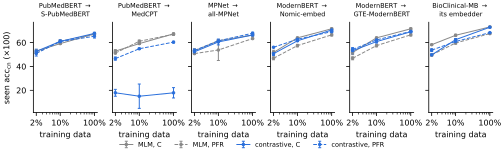
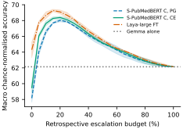
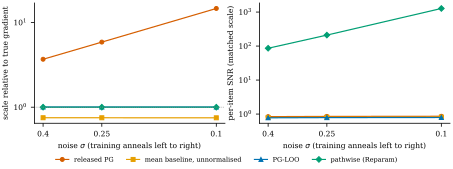
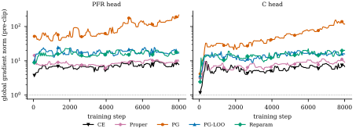
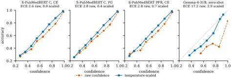

<!-- Нумерация разделов и подписи библиографии сохранены по оригиналу. -->
<!-- markdownlint-disable MD001 MD026 MD059 -->

# От поиска к типизированным решениям: калиброванные модели System One на основе биомедицинских энкодеров предложений

**Оригинальное название:** From Retrieval to Typed Decisions: Calibrated System One Models from Biomedical Sentence Encoders.  
**Автор:** Pritam Deka, Queen’s University Belfast, Белфаст, Великобритания.  
**Версия:** arXiv:2610.02486v1, 01.10.2026.  
**Источник:** [полный текст оригинала](https://arxiv.org/html/2610.02486v1).  
**Лицензия оригинала:** [CC BY 4.0](https://creativecommons.org/licenses/by/4.0/).  
**Перевод:** неофициальный перевод Codex, 25.10.2026, автор не проверял.

> **Терминологическое примечание переводчика:** «априорный сигнал поиска» (retrieval prior) обозначает сходство, вычисляемое энкодером, а не априорную вероятность в байесовском смысле.

## Аннотация

Модели типизированных решений за один прямой проход отвечают на вопросы о тексте с ограничениями, заданными схемой, и возвращают вероятности, к которым предполагается применять порог. Мы исследуем, служат ли биомедицинские энкодеры предложений, обученные для поиска, хорошей отправной точкой для таких моделей. Мы представляем sbert2s1 — средство преобразования энкодеров Sentence-Transformers в модели решений с двухэнкодерной архитектурой, кросс-энкодерной головой (C) и остаточной головой с априорным сигналом поиска (PFR), — а также BioDecide, набор биомедицинских задач типизированного принятия решений, и MEDLINE-S1 — 243 тыс. обучающих решений, полученных из индексации NLM. Во всех шести парах «родительская модель — поисковая модель» обучение для поиска улучшает сопоставление содержательно различающихся вариантов ответа без дообучения. После дообучения его эффект зависит от выходной головы: в пяти парах и при трёх размерах обучающей выборки обучение для поиска значимо помогает PFR, сохраняющей априорный сигнал поиска, в 10 из 15 сравнений, но помогает C в одном случае и ухудшает её результат в пяти. Сопоставимая сетка экспериментов с двумя выходными головами и пятью целевыми функциями показывает, что C превосходит PFR при любой целевой функции, а опубликованная схема RLCD открытых моделей System One уступает кросс-энтропии на 2.5–3.0 пункта. Этот разрыв главным образом обусловлен нормализацией вознаграждения, которая увеличивает шумный член оценки градиента через логарифм плотности в 3.6–15 раз; несмещённая оценка с исключением текущего элемента устраняет большую часть разрыва. После температурного масштабирования ни одна целевая функция не даёт явно лучшей калибровки, чем кросс-энтропия. Мы публикуем код, метки MEDLINE-S1 и модель.

## 1 Введение

Значительная часть обработки языка в биомедицинском программном обеспечении состоит из небольших, чётко ограниченных решений: сообщает ли эта аннотация о рандомизированном исследовании, подтверждают ли свидетельства утверждение, насколько серьёзны побочные эффекты, описанные пациентом? Поскольку ответы используются программным кодом, решение полезно только тогда, когда оно соответствует схеме и сопровождается оценкой уверенности, к которой можно применить порог, чтобы выполнить действие, отложить решение или передать его на следующий уровень.


**Рисунок 1.** Общая схема. Запрос System One объединяет состояние с типизированными вопросами. Биомедицинский энкодер предложений, преобразованный с помощью одной из четырёх выходных голов (§ [3](https://arxiv.org/html/2610.02486v1#S3)), за один прямой проход возвращает калиброванное распределение по вариантам ответа на каждый вопрос, а последующий программный код применяет к нему порог, чтобы выполнить действие или передать решение на следующий уровень. Значения в примере приведены для иллюстрации.

*Текст на рисунке 1:* запрос; состояние: заголовок и аннотация записи PubMed; `choice`: «Дизайн исследования?» {РКИ, когортное исследование, описание клинического случая, …}; `noul`: «Участвовали ли в исследовании люди?»; `score`: «Убедительность доказательств?» [нет $<$ слабая $<$ … $<$ высокая]. C: кросс-энкодерная голова над вопросом, позициями `[MASK]` и состоянием. Z / B: косинусное сходство между состоянием и вопросом с вариантом ответа. PFR: C как остаточная поправка к априорному сигналу поиска Z. Один прямой проход: распределение с температурным масштабированием для каждого вопроса, например РКИ 0.91; люди $P(\textit{true})=0.97$; уровень доказательств 2.3 из 3. Высокая уверенность $\rightarrow$ выполнить действие; неопределённость $\rightarrow$ отложить решение или передать его LLM. Энкодер предложений $E_{\theta}$ преобразуется с одной из четырёх выходных голов и дообучается с CE, собственными оценками или RLCD; температуры подбираются отдельно для каждого типа.

Модели *System One* были предложены именно для такого интерфейса ([TypeSafe AI, 2026](https://arxiv.org/html/2610.02486v1#bib.bib1)). Запрос объединяет текст (*состояние*) с типизированными вопросами трёх видов (`choice`, `score` и `noul`), а модель за один прямой проход возвращает распределение по допустимым вариантам ответа на каждый вопрос. Открытая модель Laya ([Convai Innovations, 2026](https://arxiv.org/html/2610.02486v1#bib.bib2)) сочетает энкодер с выходной головой на основе маскированных позиций и обучается с RLCD — смесью кросс-энтропии и градиента политики по собственным правилам оценки ([Gneiting and Raftery, 2007](https://arxiv.org/html/2610.02486v1#bib.bib10)). Все существующие модели System One относятся к общей предметной области и используют в качестве исходных моделей контрольные точки маскированных языковых моделей (MLM) или декодеров. Большинство биомедицинских энкодеров, например BioBERT ([Lee et al., 2020](https://arxiv.org/html/2610.02486v1#bib.bib56)) и PubMedBERT ([Gu et al., 2021](https://arxiv.org/html/2610.02486v1#bib.bib20)), тоже являются MLM. Меньшая группа дополнительно прошла контрастивное обучение для поиска в качестве энкодеров Sentence-Transformers: S-PubMedBERT-MS-MARCO ([Deka et al., 2022](https://arxiv.org/html/2610.02486v1#bib.bib22)) — это PubMedBERT, дообученная на MS MARCO ([Nguyen et al., 2016](https://arxiv.org/html/2610.02486v1#bib.bib57)), а MedCPT ([Jin et al., 2023](https://arxiv.org/html/2610.02486v1#bib.bib21)) обучена на журналах поисковых запросов PubMed. Типизированное решение напоминает поиск: требуется определить, соответствует ли состоянию гипотеза, составленная из вопроса и варианта ответа. Однако поисковое сходство не обязательно кодирует отрицание, порядковое суждение или калиброванную истинность. В этой работе проверяется, можно ли преобразовать биомедицинские энкодеры предложений в модели System One и от чего зависит результат:

1. **RQ1. Инициализация:** когда обучение для поиска улучшает решения без дообучения или после дообучения?
2. **RQ2. Преобразование:** как двухэнкодерное преобразование, кросс-энкодерная голова и преобразование с добавлением априорного сигнала поиска соотносятся по точности, устойчивости к порядку вариантов, затратам и сохранению поисковых возможностей при одинаковых целевых функциях?
3. **RQ3. Целевая функция:** какая составляющая RLCD имеет значение после подбора температур: собственная оценка, сглаживание шумом или оценка градиента политики?

### Основные результаты работы

(1) sbert2s1 — фреймворк, преобразующий энкодеры Sentence-Transformers в модели типизированных решений четырьмя способами, включая *остаточную голову с априорным сигналом поиска* (PFR), которая начинает с калиброванной поисковой модели без дообучения; (2) BioDecide — набор биомедицинских задач типизированного принятия решений с открытым и клиническим треками, причём для последнего требуется подтверждённый доступ, — и MEDLINE-S1, обучающие данные с несколькими вопросами, размеченные на основе индексации NLM, а не LLM-учителем; (3) контролируемое исследование одиннадцати энкодеров, шести пар «родительская модель — поисковая модель» и сопоставимой сетки экспериментов с двумя выходными головами и пятью целевыми функциями; (4) анализ, показывающий, что RLCD оптимизирует сглаженную шумом собственную оценку, что опубликованная оценка градиента смещена и изменена по масштабу и что простой базовый уровень с исключением текущего элемента устраняет обе проблемы. Код, MEDLINE-S1 и опубликованная модель доступны по адресам [репозитория sbert2s1](https://github.com/pritamdeka/sbert2s1), [набора MEDLINE-S1](https://huggingface.co/datasets/pritamdeka/MEDLINE-S1) и [модели S1-PubMedBERT](https://huggingface.co/pritamdeka/S1-PubMedBERT).

## 2 Связанные работы

### Модели System One

Jev ([TypeSafe AI, 2026](https://arxiv.org/html/2610.02486v1#bib.bib1)) ввела типизированные решения с тремя примитивами: `choice` (один вариант из схемы), `score` (распределение по порядковой шкале) и `noul` (вероятность истинности утверждения); её целевая функция обучения не опубликована. Laya ([Convai Innovations, 2026](https://arxiv.org/html/2610.02486v1#bib.bib2)), первая открытая реализация, сочетает ModernBERT-large ([Warner et al., 2025](https://arxiv.org/html/2610.02486v1#bib.bib16)) с двухслойной выходной головой, которая оценивает одну позицию `[MASK]` для каждого варианта ответа. Она обучается с кросс-энтропией и градиентом политики с групповым базовым уровнем (как в GRPO; [Shao et al., 2024](https://arxiv.org/html/2610.02486v1#bib.bib15)) на логитах, возмущённых шумом, с вознаграждением по собственным оценкам. Decider ([Marosi, 2026](https://arxiv.org/html/2610.02486v1#bib.bib3)) дообучает декодеры, а Decision Index ([Decision Index contributors, 2026](https://arxiv.org/html/2610.02486v1#bib.bib4)) служит бенчмарком для движков типизированного принятия решений. Параллельные работы применяют или исследуют модели System One в агентах для задач безопасности, разметке, кодировании отчётов о ДТП, отвлекающих контекстах и активном формулировании вопросов ([dos Santos, 2026](https://arxiv.org/html/2610.02486v1#bib.bib5); [Ibrahim and Zaki, 2026](https://arxiv.org/html/2610.02486v1#bib.bib6); [Rafe and Das, 2026](https://arxiv.org/html/2610.02486v1#bib.bib7); [Xu, 2026](https://arxiv.org/html/2610.02486v1#bib.bib8); [Yilmaz et al., 2026](https://arxiv.org/html/2610.02486v1#bib.bib9)) (приложение [A](https://arxiv.org/html/2610.02486v1#A1)). Эти исследования не оценивают биомедицинские преобразования, инициализацию поисковыми моделями или абляции RLCD.

### Калибровка и правила оценки

Строго собственное правило оценки имеет единственный оптимум математического ожидания при указании истинного распределения ([Gneiting and Raftery, 2007](https://arxiv.org/html/2610.02486v1#bib.bib10)); примерами служат логарифмическая, Брайера ([Brier, 1950](https://arxiv.org/html/2610.02486v1#bib.bib11)), сферическая и ранговая вероятностная ([Epstein, 1969](https://arxiv.org/html/2610.02486v1#bib.bib12)) оценки. Нейронные сети, включая предварительно обученные трансформеры, часто плохо калиброваны, а температурное масштабирование — действенный способ исправить это после обучения ([Guo et al., 2017](https://arxiv.org/html/2610.02486v1#bib.bib13); [Desai and Durrett, 2020](https://arxiv.org/html/2610.02486v1#bib.bib14)). Поэтому заявляемое преимущество целевой функции обучения по калибровке должно сохраняться после температурного масштабирования.

### Энкодеры предложений как модели решений

Сиамские энкодеры, обученные так, чтобы косинусное сходство отражало смысловую близость ([Reimers and Gurevych, 2019](https://arxiv.org/html/2610.02486v1#bib.bib17)), на данных вида «запрос — фрагмент текста», например MS MARCO ([Nguyen et al., 2016](https://arxiv.org/html/2610.02486v1#bib.bib57)), являются стандартным средством плотного векторного поиска; кросс-энкодеры выполняют более точное повторное ранжирование ценой бо́льших затрат ([Nogueira and Cho, 2019](https://arxiv.org/html/2610.02486v1#bib.bib18)). Сравнение текста с описаниями меток лежит в основе классификации без дообучения, основанной на логическом следовании ([Yin et al., 2019](https://arxiv.org/html/2610.02486v1#bib.bib19)). В биомедицине предметное предварительное обучение ([Gu et al., 2021](https://arxiv.org/html/2610.02486v1#bib.bib20)) с последующим контрастивным обучением на журналах поиска ([Jin et al., 2023](https://arxiv.org/html/2610.02486v1#bib.bib21)) или MS MARCO ([Deka et al., 2022](https://arxiv.org/html/2610.02486v1#bib.bib22)) даёт сильные поисковые модели. Мы используем такие энкодеры для *инициализации* моделей решений и измеряем вклад контрастивного этапа.

## 3 Метод

### 3.1 Типизированные решения

Запрос состоит из состояния $s$ (текста или сериализованной записи) и вопросов $q=(\tau,x,o_{1:K})$, где $\tau\in\{\texttt{choice},\texttt{score},\texttt{noul}\}$ — тип, $x$ — инструкция, а $o_{1},\dots,o_{K}$ — варианты ответа: ключи схемы с необязательными описаниями для `choice`, упорядоченные уровни шкалы для `score` и $(\textit{false},\textit{true})$ для `noul`. Мы используем общую для Jev и Laya схему запроса. Модель отображает $(s,q)$ в логиты $z\in\mathbb{R}^{K}$ и возвращает

$$
p(\cdot\mid s,q)=\operatorname{softmax}\big(z/T_{\tau,K}\big), \tag{1}
$$

где $T_{\tau,K}>0$ — определяемая после обучения температура, общая для всех вопросов типа $\tau$ в одной группе по числу вариантов ответа (§ [3.4](https://arxiv.org/html/2610.02486v1#S3.SS4)). Для `choice` ответом служит $\arg\max_{k}p_{k}$, для `score` — ожидаемый уровень $\sum_{k}(k-1)\,p_{k}$, а для `noul` — $p_{2}$ (*true*). Уверенность $\max_{k}p_{k}$ — величина, к которой применяется порог и для которой измеряется ожидаемая ошибка калибровки (ECE).

### 3.2 Преобразование энкодера

Пусть $E_{\theta}$ — трансформер модели Sentence-Transformers, а

$$
e_{\theta}(\cdot)=\frac{\operatorname{pool}(E_{\theta}(\cdot))}{\lVert\operatorname{pool}(E_{\theta}(\cdot))\rVert_{2}} \tag{2}
$$

— его нормированный эмбеддинг, получаемый с помощью пулинга данной контрольной точки (усреднение или `[CLS]`). Для варианта $k$ мы строим *гипотезу* $h_{k}=x\oplus o_{k}$ (инструкция, за которой следует текстовое представление варианта) и определяем априорный сигнал поиска $c_{k}=\langle e_{\theta}(s),e_{\theta}(h_{k})\rangle$; гипотеза играет роль запроса, а состояние — фрагмента текста. Мы сравниваем четыре способа преобразования:

$$
\text{Z, B:}\qquad z_{k}=\alpha_{\tau}\,c_{k}, \tag{3}
$$

$$
\text{C:}\qquad z_{k}=r_{\theta,\phi}(s,q)_{k}, \tag{4}
$$

$$
\text{PFR:}\qquad z_{k}=r_{\theta,\phi}(s,q)_{k}+\alpha_{\tau}\,c_{k}. \tag{5}
$$

Z сохраняет параметры $\theta$ замороженными и подбирает только масштаб $\alpha_{\tau}$ для каждого типа. B обучает $\theta$ и $\alpha$; эмбеддинги состояний можно вычислить заранее, поэтому проверка корпуса требует одного вычисления эмбеддингов $K$ гипотез и матричного произведения. C — кросс-энкодерная голова: $E_{\theta}$ кодирует

$$
\begin{aligned}
&\texttt{[CLS]}\,\tau\,x\,\texttt{[SEP]}\;\texttt{[MASK]}\,o_{1}\cdots\texttt{[MASK]}\,o_{K}\\
&\qquad\texttt{[SEP]}\;s\,\texttt{[SEP]},
\end{aligned}
$$

двухслойный трансформер $\phi$ с эмбеддингом типа контекстуализирует это представление, а MLP вычисляет оценку по скрытому состоянию в $k$-й позиции `[MASK]`. Выходная голова воспроизводит голову Laya, поэтому обе реализации могут загружать веса друг друга: открытая контрольная точка Laya в нашей реализации воспроизводит заявленную точность без дообучения на typed-decisions (0.3615 против 0.362). PFR добавляет эту кросс-энкодерную оценку к априорному сигналу поиска. Последний слой блока вычисления оценок инициализируется нулями, поэтому необученная модель PFR равна Z, а при обучении поверх поисковой модели изучается остаточная поправка с перекрёстным вниманием. По умолчанию априорный сигнал использует общие параметры $\theta$; замороженная копия сохраняет исходную поисковую модель, удваивая объём памяти. Масштаб априорного сигнала инициализируется значением $\alpha_{\tau}=20$, обычным масштабом сходства для контрастивных энкодеров,[^sbert2s1-1] имеет собственную скорость обучения и не подвергается затуханию весов.

[^sbert2s1-1]: Реализация задаёт $\alpha_{\tau}=\max(1/T^{0}_{\tau},20)$ на основе температуры $T^{0}_{\tau}$, подобранной по исходным косинусным сходствам; поскольку $T^{0}_{\tau}$ ограничивается интервалом $[0.05,20]$, результат всегда равен 20.

### 3.3 Целевые функции обучения и оценка градиента RLCD

Все целевые функции сравнивают возвращаемое распределение $p$ с целевым распределением $t$ (для большинства примеров оно сосредоточено на одном варианте, то есть имеет вид one-hot). Простейшая из них — кросс-энтропия (CE). Вознаграждение Laya $S(p,t)$ добавляет к логарифмической оценке ещё два собственных правила оценки: сферическую оценку для каждого вопроса и, для вопросов `score`, ранговую вероятностную оценку, которая также штрафует за вероятность, отданную удалённым уровням шкалы. Правило оценки является *собственным*, если указание истинного распределения максимизирует его ожидаемое значение, поэтому высокое $S$ поощряет честные вероятности ([Gneiting and Raftery, 2007](https://arxiv.org/html/2610.02486v1#bib.bib10)).

RLCD не максимизирует $S$ напрямую. Для каждого примера она $G=4$ раза добавляет к логитам гауссовский шум, оценивает каждое зашумлённое предсказание с помощью $S$ и сдвигает логиты в тех направлениях шума, которые дали оценку выше среднего. Это шаг по градиенту стратегии (REINFORCE), к которому с единичным весом добавляется CE. Часть обновления, связанная с вознаграждением, для одного примера имеет вид

$$
\hat{g}=\frac{1}{G\sigma^{2}}\sum_{g=1}^{G}\frac{R^{(g)}-\bar{R}}{d}\,\varepsilon^{(g)}, \tag{6}
$$

где $\varepsilon^{(g)}$ — $g$-я реализация шума, $\sigma$ — его масштаб (постепенно уменьшаемый с 0.4 до 0.1), $R^{(g)}$ — соответствующее вознаграждение, $\bar{R}$ — среднее вознаграждение по $G$ реализациям для данного примера, а $d$ — стандартное отклонение центрированных вознаграждений в мини-пакете.

Без $\bar{R}$ и $d$ величина $\hat{g}$ была бы несмещённой оценкой градиента ожидаемого вознаграждения при добавлении шума — сглаженной версии $S$, стремящейся к $S$ при $\sigma\to 0$. Эти два решения меняют ситуацию. Во-первых, $\bar{R}$ включает вознаграждение самой реализации, поэтому в среднем оценка уменьшается в $(G-1)/G=3/4$ раза. Во-вторых, разности вознаграждений уменьшаются примерно пропорционально $\sigma$, поэтому деление на $d$ заставляет оценку расти примерно как $1/\sigma$ по мере уменьшения шума. Поскольку вес CE остаётся постоянным, шумный член вознаграждения постепенно начинает преобладать над ней. В приложении [C](https://arxiv.org/html/2610.02486v1#A3) это сформулировано строго (утверждение [1](https://arxiv.org/html/2610.02486v1#Thmproposition1)) и доказано, а в приложении [D](https://arxiv.org/html/2610.02486v1#A4) приведены измерения.

Чтобы устранить эти смещения, в качестве базового уровня следует использовать среднее *остальных* $G-1$ вознаграждений и не делить на $d$. Мы называем этот вариант PG-LOO (с исключением текущего элемента). При одинаковых данных и расписании обучения мы сравниваем шесть целевых функций: CE; Proper, которая максимизирует $S$ без шума; PG, опубликованную схему RLCD; PG w/o CE, то есть только её член вознаграждения; PG-LOO; Reparam, которая напрямую дифференцирует сглаженное вознаграждение через шум (приём репараметризации) и добавляет CE. PG-LOO и Reparam оценивают один и тот же градиент в одном и том же масштабе и различаются только дисперсией.

### 3.4 Калибровка и длинные состояния

#### Температуры

После обучения для каждой пары «тип — группа по числу вариантов ответа» ($K=2$, $3$–$5$, $6$–$10$, ${\geq}11$) подбирается одна температура путём минимизации отрицательного логарифма правдоподобия на калибровочной выборке, выделенной из обучающих данных до начала обучения. Для групп, в которых меньше десяти примеров, используется резервная температура соответствующего типа. Все метрики приводятся до и после этого шага.

#### Длинные состояния

Клинические записи превышают контекст базовых энкодеров, равный 512 токенам. Помимо усечения и скользящих окон, мы оцениваем подход *сначала поиск, затем решение*: собственный эмбеддинг модели $e_{\theta}$ выбирает $m=3$ фрагмента записи, наиболее похожих на инструкцию $x$, и решение принимается по этим фрагментам в порядке их следования в документе. Для этого преобразованная модель должна сохранять поисковые возможности.

## 4 Данные

### BioDecide

Мы преобразуем существующие биомедицинские наборы данных в типизированные решения по состоянию (таблица [1](https://arxiv.org/html/2610.02486v1#S4.T1); преобразования описаны в приложении [B](https://arxiv.org/html/2610.02486v1#A2)). В треке с опорой на текст ответ определяется состоянием: ответы на вопросы по свидетельствам (PubMedQA; [Jin et al., 2019](https://arxiv.org/html/2610.02486v1#bib.bib24)), проверка утверждений (SciFact, HealthVer и PUBHEALTH; [Wadden et al., 2020](https://arxiv.org/html/2610.02486v1#bib.bib28); [Sarrouti et al., 2021](https://arxiv.org/html/2610.02486v1#bib.bib29); [Kotonya and Toni, 2020](https://arxiv.org/html/2610.02486v1#bib.bib30)), межлекарственные взаимодействия (DDI; [Herrero-Zazo et al., 2013](https://arxiv.org/html/2610.02486v1#bib.bib31)), характерные признаки рака с десятью вопросами `noul` на каждую аннотацию (HoC; [Baker et al., 2016](https://arxiv.org/html/2610.02486v1#bib.bib32)), нежелательные лекарственные явления (ADE; [Gurulingappa et al., 2012](https://arxiv.org/html/2610.02486v1#bib.bib33)), отзывы пациентов о лекарствах с тремя вопросами `score` на каждый отзыв (Druglib; [Gräßer et al., 2018](https://arxiv.org/html/2610.02486v1#bib.bib34)), сходство предложений (BIOSSES; [Soğancıoğlu et al., 2017](https://arxiv.org/html/2610.02486v1#bib.bib35)) и маршрутизация по медицинской специальности (MTSamples). В треке знаний (MedQA, MedMCQA и MMLU-medical; [Jin et al., 2021](https://arxiv.org/html/2610.02486v1#bib.bib25); [Pal et al., 2022](https://arxiv.org/html/2610.02486v1#bib.bib26); [Hendrycks et al., 2021](https://arxiv.org/html/2610.02486v1#bib.bib27)) состояние представляет собой экзаменационную клиническую задачу, ответ на которую зависит от запомненных знаний; результаты этого трека приводятся, но не определяют основные показатели. PUBHEALTH, BIOSSES и MMLU никогда не используются для обучения, а MTSamples представляет собой отложенное семейство задач. Мы также проводим оценивание на наборе typed-decisions общей предметной области, используемом в Laya.

**Таблица 1.** BioDecide и MEDLINE-S1: число решений (одно состояние может содержать несколько вопросов).

| Трек | Задача | Семейство | Тип | Обучение | Тест |
| --- | --- | --- | --- | ---: | ---: |
| С опорой на текст | PubMedQA-L | Вопросы по свидетельствам | `choice` | 400 | 500 |
| С опорой на текст | PubMedQA-A<sup>§</sup> | Вопросы по свидетельствам | `noul` | 20,000 | – |
| С опорой на текст | SciFact | Проверка утверждений | `choice` | 780 | 321 |
| С опорой на текст | HealthVer | Проверка утверждений | `choice` | 10,073 | 1,823 |
| С опорой на текст | PUBHEALTH<sup>†</sup> | Проверка утверждений | `choice` | – | 1,231 |
| С опорой на текст | DDI-2013 | Отношения | `choice` | 18,379 | 7,039 |
| С опорой на текст | HoC | Классификация документов | `noul` | 11,660 | 3,710 |
| С опорой на текст | ADE | Нежелательные явления | `noul` | 16,318 | 2,089 |
| С опорой на текст | Druglib | Отзывы | `score` | 8,391 | 3,108 |
| С опорой на текст | BIOSSES<sup>†</sup> | Сходство | `score` | – | 100 |
| С опорой на текст | MTSamples<sup>‡</sup> | Маршрутизация | `choice` | – | 370 |
| С опорой на текст | MEDLINE-S1 | Индексация | Смешанный | 242,986 | 30,522 |
| Знания | MedQA-USMLE | Экзамен | `choice` | 9,778 | 1,273 |
| Знания | MedMCQA | Экзамен | `choice` | 20,000 | 2,816 |
| Знания | MMLU-medical<sup>†</sup> | Экзамен | `choice` | – | 1,089 |
| Общая предметная область | typed-decisions<sup>†</sup> | Общие задачи | Смешанный | – | 2,000 |
| Клинический, с подтверждённым доступом PhysioNet | MedNLI | Вывод на естественном языке (NLI) | `choice` | 10,832 | 1,422 |
| Клинический, с подтверждённым доступом PhysioNet | MIMIC-III trials<sup>†</sup> | Длинные записи | Смешанный | – | 1,532 |
| Клинический, с подтверждённым доступом PhysioNet | MIMIC-IV names | Приватность | `noul` | 1,828 | 9,808 |
| **Итого** | | | | **371,425** | **70,753** |

$\dagger$ — только тестирование (никогда не используется для обучения); $\ddagger$ — отложенное семейство задач; § — только обучение. Исторически использовавшиеся калибровочные подвыборки выделяются из обучающих данных до начала обучения и здесь не учитываются. Объёмы клинических обучающих данных относятся только к варианту +clinical. Числа описывают исходные разбиения; исключения отдельно приведены в аудите целостности.

### Преобразование

Каждый исходный пример становится одной записью: *состояние* (текст, по которому принимается решение), один или несколько типизированных вопросов и эталонное распределение по вариантам ответа на каждый вопрос (рисунок [1](https://arxiv.org/html/2610.02486v1#S1.F1); полная запись приведена на рисунке [4](https://arxiv.org/html/2610.02486v1#A2.F4)). Вопрос или набор меток исходного набора данных становится инструкцией, а каждая метка получает краткое описание, составленное один раз для каждой задачи, чтобы варианты ответа содержали смысл, а не только отдельные слова-метки. Многометочная разметка преобразуется в один вопрос `noul` для каждой метки (HoC), оценки по нескольким аспектам — в несколько вопросов об одном состоянии (Druglib), градуированная оценка — в вопрос `score`, в целевом распределении которого масса разделена между двумя ближайшими уровнями (BIOSSES), а экзаменационные задания — в вопросы `choice` с текстами ответов в качестве описаний. Поля, раскрывающие ответ, удаляются (выводы PubMedQA, пояснения PUBHEALTH). Официальные разбиения сохраняются там, где они существуют, а до любого обучения отделяется калибровочная подвыборка (около 10% обучающих данных, не более 400 состояний) с группировкой по утверждению или теме, если в источнике есть соответствующие группы. В приложении [B](https://arxiv.org/html/2610.02486v1#A2) подробно описан каждый набор данных.

### MEDLINE-S1

В существующих корпусах на один текст приходится один вопрос, тогда как запросы System One обычно содержат несколько разнородных вопросов об одном состоянии. Обучающие данные с несколькими вопросами обычно создаёт LLM-учитель, ошибки которого затем становятся целевыми ответами. Вместо этого мы получаем метки из индексации MEDLINE, которую курирует NLM: *дизайн исследования* (шесть классов по типам публикаций с фиксированным приоритетом для пересекающихся тегов); *область заболеваний* (единственная категория дерева заболеваний MeSH среди основных тем, противопоставляемая 3–7 случайно выбранным отвлекающим вариантам, чтобы отрицательные примеры, отобранные моделью, не давали преимущества какому-либо энкодеру); *участие людей или животных*; указание на *нежелательные эффекты* или *лекарственную терапию*; для исследований с участием людей — две случайно выбранные *возрастные или половые группы*. Мы оставляем записи за 2005–2021 годы с ручной индексацией или индексацией, проверенной человеком, и исключаем все PMID из любого оценочного набора BioDecide. Теги являются слабыми метками: отсутствие тега не обязательно означает ложность, а индексаторы могут использовать полный текст статьи. Обучающий набор содержит 40 тыс. аннотаций (242,986 решений); тестовый набор — 5 тыс. аннотаций из непересекающихся файлов.

### Клинический трек

При подтверждённом доступе PhysioNet ([Pollard et al., 2026](https://arxiv.org/html/2610.02486v1#bib.bib42)) мы преобразуем MedNLI ([Romanov and Shivade, 2018](https://arxiv.org/html/2610.02486v1#bib.bib36); [Shivade, 2019](https://arxiv.org/html/2610.02486v1#bib.bib41)); 1,000 проверенных людьми вопросов о соответствии критериям включения в клинические исследования по выписным эпикризам MIMIC-III ([Woo et al., 2024](https://arxiv.org/html/2610.02486v1#bib.bib39); [Woo et al., 2025](https://arxiv.org/html/2610.02486v1#bib.bib40); [Johnson et al., 2016](https://arxiv.org/html/2610.02486v1#bib.bib37)), задаваемых в форме *да*/*нет*/*не указано* и в форме `noul` о возможности ответить; вопрос `noul` об упоминании имени в окнах записей MIMIC-IV с подставленными суррогатными именами ([Lim et al., 2023](https://arxiv.org/html/2610.02486v1#bib.bib43); [Johnson et al., 2023](https://arxiv.org/html/2610.02486v1#bib.bib38)), включая подвыборку имён, которые также являются общеупотребительными словами. Записи MIMIC-III в среднем содержат 12.9 тыс. символов и образуют наш тест на длинных состояниях. Данные с ограниченным доступом обрабатывались только на оборудовании организации и никогда не передавались внешнему API; опубликованная модель обучена только на открытых данных.

## 5 Организация экспериментов

### Энкодеры

Мы оцениваем одиннадцать контрольных точек базового размера: PubMedBERT и её поисковые дочерние модели S-PubMedBERT-MS-MARCO и MedCPT-Query; MPNet и all-MPNet-base-v2; ModernBERT-base и её модели эмбеддингов Nomic и GTE; BioClinical-ModernBERT и её модель эмбеддингов; BGE-base-v1.5 как поисковую модель без парной родительской модели ([Gu et al., 2021](https://arxiv.org/html/2610.02486v1#bib.bib20); [Deka et al., 2022](https://arxiv.org/html/2610.02486v1#bib.bib22); [Jin et al., 2023](https://arxiv.org/html/2610.02486v1#bib.bib21); [Song et al., 2020](https://arxiv.org/html/2610.02486v1#bib.bib23); [Sentence Transformers, 2021](https://arxiv.org/html/2610.02486v1#bib.bib52); [Warner et al., 2025](https://arxiv.org/html/2610.02486v1#bib.bib16); [Nussbaum et al., 2024](https://arxiv.org/html/2610.02486v1#bib.bib47); [Zhang et al., 2024](https://arxiv.org/html/2610.02486v1#bib.bib48); [Li et al., 2023](https://arxiv.org/html/2610.02486v1#bib.bib49); [Sounack et al., 2025](https://arxiv.org/html/2610.02486v1#bib.bib51); [NeuML, 2025](https://arxiv.org/html/2610.02486v1#bib.bib50); [Xiao et al., 2024](https://arxiv.org/html/2610.02486v1#bib.bib53)). Это даёт шесть сравнений «родительская модель — поисковая модель» с общими родительскими моделями и разными поисковыми корпусами; это не шесть независимых повторений одного воздействия. Используются предусмотренные конкретными моделями префиксы запросов и документов.

### Обучение

Обучающие задачи выбираются с вероятностью $\propto n_{t}^{1/2}$. Бюджет составляет 8,000 шагов при размере пакета 32 (не более восьми эпох); используются AdamW, автоматическое приведение к bf16 при весах в fp32 и обрезка градиента по норме 1. Варианты ответа перемешиваются, кроме порядковых шкал. Все энкодеры обучаются с C и PFR по опубликованной схеме RLCD (PG), с тремя начальными значениями генератора случайных чисел для каждого случая; для десяти парных контрольных точек также строятся кривые обучения на 2% и 10% данных, тоже с тремя начальными значениями генератора. На S-PubMedBERT-MS-MARCO мы проводим полную сетку экспериментов *выходная голова × целевая функция*: C и PFR с CE, Proper, PG, PG-LOO и Reparam (а также PG w/o CE для PFR), три начальных значения генератора на ячейку, одинаковые данные, расписание и начальные значения генератора. Гиперпараметры перечислены в приложении [K](https://arxiv.org/html/2610.02486v1#A11).

### Базовые модели для сравнения

Laya-large (421 млн параметров) оценивается без дообучения и после дообучения на нашей смеси по той же схеме. Qwen3.8-27B ([Qwen Team, 2026](https://arxiv.org/html/2610.02486v1#bib.bib54)) и Gemma-4-31B ([Gemma Team, 2026](https://arxiv.org/html/2610.02486v1#bib.bib55)) оценивают буквы вариантов ответа за один прямой проход с отключённым рассуждением (приложение [J](https://arxiv.org/html/2610.02486v1#A10)). Для всех систем выполняется температурное масштабирование на одних и тех же калибровочных подвыборках. Экзаменационные вопросы, вероятно, присутствуют в данных предварительного обучения LLM, поэтому показатели LLM в треке знаний носят только описательный характер.

### Метрики и статистика

Основная метрика — точность, нормированная относительно случайного угадывания, $\mathrm{acc}_{\text{cn}}=(\mathrm{acc}-1/K)/(1-1/K)$, усреднённая по группам (вопрос, $K$) внутри задачи, а затем по задачам. *Встречавшиеся* обозначает восемь задач с опорой на текст, использовавшихся при обучении; *отложенные* — PUBHEALTH, BIOSSES и MTSamples. Мы также приводим ECE по наиболее вероятной метке и NLL до и после температурного масштабирования, порядковую ошибку, изменения ответов при перестановке вариантов и сохранение поисковых возможностей (nDCG@10 на BEIR SciFact и NFCorpus; [Thakur et al., 2021](https://arxiv.org/html/2610.02486v1#bib.bib44); [Boteva et al., 2016](https://arxiv.org/html/2610.02486v1#bib.bib45)). Доверительные интервалы получены парным бутстрэпом (10,000 повторных выборок) по кластерам документов внутри каждой задачи: все записи с одинаковым нормализованным текстом пересэмплируются вместе. Интервалы условны относительно наблюдаемых задач и правильности ответов, усреднённой по начальным значениям генератора; стандартное отклонение по начальным значениям генератора приводится отдельно. Поправка Холма применяется внутри каждого исследовательского вопроса по обоим трекам (приложение [F](https://arxiv.org/html/2610.02486v1#A6)). Отсутствие значимости не трактуется как эквивалентность.

### Целостность данных

Аудит точных совпадений входов обнаружил небольшое число дубликатов обучающих примеров в калибровочных (девять записей DDI и семь Druglib) и тестовых (две записи SciFact и 13 Druglib) подвыборках, а также повторяющиеся входы внутри некоторых тестовых наборов. Удаление всех затронутых тестовых входов снижает показатели на встречавшихся задачах на 0.3–0.4 пункта для каждой модели и не меняет порядок моделей (приложение [I](https://arxiv.org/html/2610.02486v1#A9)).

## 6 Результаты

**Таблица 2.** Основные результаты ($\times 100$; среднее ± стандартное отклонение по 3 начальным значениям генератора; для 10% также используются 3 начальных значения).

| Энкодер | Тип | Встречавшиеся, C: $\mathrm{acc}_{\text{cn}}$ | Встречавшиеся, PFR: $\mathrm{acc}_{\text{cn}}$ | Встречавшиеся, C, 10%: $\mathrm{acc}_{\text{cn}}$ | Отложенные, C: $\mathrm{acc}_{\text{cn}}$ | Отложенные, PFR: $\mathrm{acc}_{\text{cn}}$ | Клинические, C | $\mathrm{ECE}_{\text{TS}}$, C |
| --- | --- | ---: | ---: | ---: | ---: | ---: | ---: | ---: |
| PubMedBERT | MLM | $67.3\pm0.7$ | $66.9\pm0.8$ | $59.1\pm0.6$ | $29.5\pm3.3$ | $20.7\pm0.6$ | $20.7\pm0.8$ | $4.8\pm0.9$ |
| S-PubMedBERT-MS-MARCO | Контрастивный | $67.7\pm0.9$ | $65.3\pm1.5$ | $61.0\pm1.4$ | $32.8\pm1.5$ | $23.6\pm1.5$ | $20.5\pm1.8$ | $3.9\pm0.7$ |
| MedCPT-Query | Контрастивный | $17.9\pm4.3$ | $60.4\pm0.7$ | $15.0\pm10.2$ | $3.9\pm0.5$ | $23.6\pm3.2$ | $12.5\pm3.4$ | $14.0\pm2.3$ |
| MPNet | MLM | $66.4\pm0.9$ | $63.3\pm0.4$ | $61.5\pm0.5$ | $30.2\pm2.7$ | $20.8\pm2.5$ | $22.7\pm5.2$ | $4.8\pm0.4$ |
| all-MPNet-base-v2 | Контрастивный | $66.4\pm0.9$ | $67.8\pm0.8$ | $60.5\pm2.5$ | $27.5\pm0.8$ | $24.7\pm2.3$ | $13.7\pm5.0$ | $5.2\pm0.3$ |
| ModernBERT-base | MLM | $71.6\pm0.7$ | $66.5\pm0.9$ | $64.0\pm0.6$ | $32.5\pm1.4$ | $21.4\pm1.8$ | $26.1\pm2.5$ | $4.3\pm0.2$ |
| modernbert-embed-base | Контрастивный | $70.6\pm1.0$ | $69.2\pm0.6$ | $61.5\pm0.4$ | $35.0\pm1.1$ | $32.3\pm4.1$ | $13.4\pm2.9$ | $4.9\pm0.2$ |
| gte-modernbert-base | Контрастивный | $69.1\pm0.8$ | $69.3\pm0.2$ | $60.8\pm1.2$ | $29.8\pm1.7$ | $32.3\pm0.2$ | $24.3\pm1.8$ | $4.5\pm0.1$ |
| BioClinical-ModernBERT | MLM | $73.1\pm0.5$ | $67.5\pm0.5$ | $66.1\pm0.8$ | $31.8\pm2.0$ | $21.0\pm3.6$ | $32.2\pm4.1$ | $4.1\pm0.2$ |
| BioClinical-MB-embeddings | Контрастивный | $72.9\pm0.7$ | $68.3\pm0.0$ | $62.4\pm0.9$ | $32.1\pm4.8$ | $22.5\pm1.7$ | $26.5\pm1.2$ | $4.6\pm0.5$ |
| BGE-base-v1.5 (без пары) | Контрастивный | $60.6\pm0.5$ | $66.8\pm0.3$ | – | $16.1\pm3.2$ | $30.7\pm3.0$ | $7.8\pm15.5$ | $5.7\pm0.7$ |
| PubMedBERT, B | | $67.0\pm0.5$ | | – | $17.8\pm6.5$ | | $23.6\pm1.4$ | $4.1\pm0.1$ |
| S-PubMedBERT, B | | $67.1\pm0.5$ | | – | $23.4\pm1.4$ | | $25.9\pm2.1$ | $3.9\pm0.2$ |
| S-PubMedBERT, C, обученная с CE | | $70.2\pm0.4$ | | – | $31.0\pm1.7$ | | $20.0\pm4.1$ | $3.8\pm0.2$ |
| S-PubMedBERT, PFR с замороженным априорным сигналом | | $67.8\pm1.0$ | | – | $26.8\pm1.9$ | | $19.5\pm5.3$ | $4.3\pm0.2$ |
| S-PubMedBERT, PFR +clinical train | | $66.3\pm0.2$ | | – | $20.4\pm0.8$ | | $55.2\pm0.6$ | $3.9\pm0.4$ |
| Laya-large (421 млн), C после дообучения | | $75.0\pm0.4$ | | – | $35.8\pm2.7$ | | $38.4\pm4.5$ | $4.3\pm0.3$ |
| Qwen3.8-27B, без дообучения | | 57.4 | | – | 46.2 | | 81.6 | 8.5 |
| Gemma-4-31B, без дообучения | | 65.7 | | – | 52.6 | | 83.4 | 9.1 |

Энкодеры сгруппированы по сопоставимым парам (сначала родительская MLM, затем её контрастивные дочерние модели). $\mathrm{acc}_{\text{cn}}$ — точность, нормированная относительно случайного угадывания, усреднённая по группам вопросов внутри задачи, а затем по задачам. Встречавшиеся: 8 обучающих задач с опорой на текст. Отложенные: PUBHEALTH, BIOSSES, MTSamples. Клинические: MedNLI, вопросы о клинических исследованиях MIMIC-III и фильтр имён MIMIC-IV, без дообучения, кроме «+clinical train». $\mathrm{ECE}_{\text{TS}}$ — ECE по наиболее вероятной метке после температурного масштабирования на встречавшихся задачах. Все строки обучены по опубликованной схеме RLCD (PG), кроме «C, обученная с CE». В нижнем блоке в столбцах C приведены результаты собственной модели каждой строки. Результаты трека знаний, исходная ECE и все архитектуры для каждого энкодера приведены в приложении [G](https://arxiv.org/html/2610.02486v1#A7).



**Рисунок 2.** Точность на встречавшихся задачах в зависимости от объёма обучающих данных для шести сравнений «родительская модель — поисковая модель» (серый: родительская MLM; синий: поисковая дочерняя модель; сплошная линия: C; пунктир: PFR). Планки погрешностей показывают стандартное отклонение по трём начальным значениям генератора.

### 6.1 RQ1: помогает ли обучение для поиска?

Обучение для поиска улучшает сопоставление по содержанию без дообучения. Без обучения каждая контрастивная контрольная точка достигает 15–24 пунктов нормированной относительно случайного угадывания точности на вопросах, варианты ответа на которые различаются по содержанию (области заболеваний, дизайн исследований, медицинские специальности, шкалы, экзаменационные ответы), против 0–7 у родительских MLM и 20.3 у Laya-large (таблица [3](https://arxiv.org/html/2610.02486v1#S6.T3)). Для вариантов, различающихся только словом-меткой (*да/нет*, *истина/ложь*), различия косинусного сходства имеют порядок $10^{-3}$, и ни один энкодер не показывает надёжного превышения уровня случайного угадывания.

После дообучения преимущества поисковой подготовки зависят от выходной головы. При полном объёме данных и кросс-энкодерной голове контрастивный этап в целом нейтрален: S-PubMedBERT и PubMedBERT достигают 67.7 и 67.3, обе контрольные точки MPNet — 66.4, а пара BioClinical-ModernBERT — 72.9 и 73.1 (таблица [2](https://arxiv.org/html/2610.02486v1#S6.T2)); единственное различие, значимое после поправки Холма, отрицательно (GTE-ModernBERT $-2.5$; таблица [8](https://arxiv.org/html/2610.02486v1#A6.T8)). Для PFR, сохраняющей априорный сигнал поиска, поисковая модель лучше в трёх из пяти пар (all-MPNet $+4.5$, Nomic $+2.7$, GTE $+2.9$), хуже в случае S-PubMedBERT ($-1.6$), а модели эмбеддингов ModernBERT прибавляют $+10.9$ на отложенных задачах (для каждой после поправки Холма $p\leq.014$). При меньшем объёме данных выходные головы расходятся ещё сильнее (рисунок [2](https://arxiv.org/html/2610.02486v1#S6.F2)). Для PFR поисковые модели впереди в четырёх из пяти пар и на 10%, и на 2% данных (значимо в трёх и четырёх случаях соответственно; например, Nomic $+5.3$ и $+9.2$, GTE $+4.7$ и $+7.4$, и до $+16.3$ на отложенных задачах). Для C поисковые модели семейства ModernBERT отстают от родительских на 2.5–3.7 пункта при 10% данных, модель эмбеддингов BioClinical-ModernBERT отстаёт на 8.5 пункта при 2%, а единственный выигрыш наблюдается у S-PubMedBERT при 10% ($+1.9$). MedCPT-Query иллюстрирует зависимость от способа преобразования: её состояния `[MASK]` одинаковы внутри одного входа, поэтому кросс-энкодерная голова достигает лишь 17.9, тогда как PFR достигает 60.4. Лучшая модель базового размера — BioClinical-ModernBERT с кросс-энкодерной головой (73.1); она близка к дообученной Laya-large (75.0), имея примерно втрое меньший размер. Во всех 15 сравнениях пар и объёмов данных (таблица [8](https://arxiv.org/html/2610.02486v1#A6.T8)) обучение для поиска значимо лучше в десяти случаях и хуже в одном для PFR, а для C — лучше в одном и хуже в пяти.

**Таблица 3.** Точность до обучения (на шаге 0), нормированная относительно случайного угадывания ($\times 100$, после температурного масштабирования на калибровочной подвыборке).

| Энкодер | Z = PFR на шаге 0: содержание | Z = PFR на шаге 0: метка | C на шаге 0: содержание | C на шаге 0: метка |
| --- | ---: | ---: | ---: | ---: |
| PubMedBERT | 1.0 | 13.0 | 1.1 | 24.0 |
| S-PubMedBERT-MS-MARCO | 15.2 | $-20.4$ | 2.3 | $-2.8$ |
| MedCPT-Query | 19.8 | $-20.2$ | 3.5 | 17.6 |
| MPNet | 1.0 | 3.6 | $-1.2$ | 12.5 |
| all-MPNet-base-v2 | 21.2 | $-1.2$ | $-1.2$ | 12.1 |
| ModernBERT-base | 0.0 | 17.1 | 0.6 | $-7.1$ |
| modernbert-embed-base | 18.9 | $-5.0$ | 2.4 | $-19.8$ |
| gte-modernbert-base | 23.3 | $-13.8$ | 1.0 | 0.0 |
| BioClinical-ModernBERT | 6.5 | $-15.1$ | 2.6 | 26.5 |
| BioClinical-MB-embeddings | 18.6 | 5.9 | 5.0 | $-23.1$ |
| BGE-base-v1.5 (без пары) | 23.9 | 11.8 | 1.1 | 14.5 |
| Laya-large (собственная выходная голова Laya) | 20.3 | 36.2 | – | – |

Рассматриваются вопросы, варианты ответа на которые различаются *содержанием* (дизайн и область заболеваний MEDLINE, MTSamples, экзаменационные ответы, шкалы Druglib и BIOSSES) либо только словом-*меткой* (`noul`, PubMedQA, проверка утверждений, DDI, MedNLI). Для C на шаге 0 использованы 3 начальных значения генератора.

### 6.2 RQ2: какой способ преобразования работает лучше всего?

**Таблица 4.** Выходная голова × целевая функция на S-PubMedBERT-MS-MARCO ($\times 100$, среднее по 3 начальным значениям генератора; стандартные отклонения и дополнительные метрики приведены в таблице [7](https://arxiv.org/html/2610.02486v1#A5.T7)).

| Целевая функция | Встречавшиеся, PFR: $\mathrm{acc}_{\text{cn}}$ | Встречавшиеся, C: $\mathrm{acc}_{\text{cn}}$ | Отложенные, PFR: $\mathrm{acc}_{\text{cn}}$ | Отложенные, C: $\mathrm{acc}_{\text{cn}}$ | PFR: $\mathrm{ECE}_{\text{TS}}$ | C: $\mathrm{ECE}_{\text{TS}}$ |
| --- | ---: | ---: | ---: | ---: | ---: | ---: |
| CE | 68.3 | 70.2 | 20.8 | 31.0 | 4.0 | 3.8 |
| Proper | 68.5 | 70.7 | 22.6 | 28.8 | 4.4 | 3.9 |
| PG (опубликованная RLCD) | 65.3 | 67.7 | 23.6 | 32.8 | 3.8 | 3.9 |
| PG w/o CE | 65.5 | – | 20.3 | – | 4.0 | – |
| PG-LOO (несмещённая) | 67.8 | 69.2 | 23.8 | 30.0 | 3.9 | 3.7 |
| Reparam | 68.5 | 69.8 | 21.9 | 25.8 | 3.7 | 3.6 |

PG — опубликованная схема RLCD, используемая для всех остальных обученных моделей. PG-LOO заменяет базовый уровень из среднего по той же выборке и нормализацию вознаграждения базовым уровнем с исключением текущего элемента. PG w/o CE запускалась только для PFR.

Кросс-энкодерная голова достигает более высокой точности. В сопоставимой сетке экспериментов (таблица [4](https://arxiv.org/html/2610.02486v1#S6.T4)) C превосходит PFR на 1.3–2.4 пункта на встречавшихся задачах при всех пяти общих целевых функциях (после поправки Холма $p\leq.011$ для CE, Proper и PG; $.08$ и $.14$ для PG-LOO и Reparam) и на 3.8–10.2 пункта на отложенных задачах. Двухэнкодерная модель B сопоставима с C на встречавшихся задачах ($-0.6$, различие незначимо), но теряет 9.4 пункта на отложенных; её преимущество состоит в возможности заранее вычислить эмбеддинги состояний для проверки корпуса. Замороженный априорный сигнал улучшает PFR на 2.5 пункта.

Добавление априорного сигнала уменьшает чувствительность к порядку вариантов. Оно делает решения почти инвариантными к порядку вариантов: в среднем по всем оценочным подвыборкам случайная перестановка меняет 0.3% ответов S-PubMedBERT PFR против 15.7% у C, у которой изменения сосредоточены на не встречавшихся ранее входах (отложенные задачи — 17%, экзамены — 28%, встречавшиеся задачи — 3%; приложение [H](https://arxiv.org/html/2610.02486v1#A8)). PFR также имеет меньшую порядковую ошибку на Druglib при любой целевой функции (таблица [7](https://arxiv.org/html/2610.02486v1#A5.T7)).

Дообучение ухудшает поисковые результаты. nDCG@10 на SciFact для эмбеддинга после пулинга падает с 67.6 (Z) до 43.3 (C), 35.6 (PFR), 34.3 (B) и 24.6 для C, обученной с CE (таблица [14](https://arxiv.org/html/2610.02486v1#A10.T14) в приложении [K](https://arxiv.org/html/2610.02486v1#A11)); только замороженный априорный сигнал сохраняет поисковую модель неизменной. Запрос с десятью вопросами занимает 6.6 мс для C, 15.2 мс для PFR и 22.7 мс для Laya-large (прямой проход, пакет 1, MI300X).

### 6.3 RQ3: улучшает ли RLCD точность или калибровку?

Опубликованная схема RLCD уступает кросс-энтропии. С обеими выходными головами CE, Proper и Reparam различаются менее чем на один пункт, тогда как опубликованная схема PG уступает CE на 3.0 (PFR) и 2.5 (C) пункта (после поправки Холма $p=.005$), причём стандартное отклонение по начальным значениям генератора у PFR в четыре раза больше (1.5 против 0.4). Добавление сферического члена и RPS значимо не улучшает точность (Proper − CE: $+0.2$ и $+0.5$, различия незначимы), а удаление CE из PG мало влияет на точность ($+0.2$).

Несмещённая оценка градиента уменьшает отставание по точности. PG-LOO, отличающаяся от PG только базовым уровнем и отказом от нормализации вознаграждения, выигрывает у PG 2.5 (PFR) и 1.5 (C) пункта (после поправки Холма $p=.005$) и находится в пределах 0.8 пункта от Reparam (различие незначимо). Сопоставимая диагностическая проверка на фиксированных контрольных точках и пакетах объясняет причину (приложение [D](https://arxiv.org/html/2610.02486v1#A4)): опубликованная оценка градиента направлена верно (косинусное сходство с истинным сглаженным градиентом 0.98), но слишком велика — в 3.6–3.8, 5.7–6.1 и 14–15 раз при $\sigma=0.4$, 0.25 и 0.1 соответственно, поэтому член, связанный с оценкой, перевешивает CE в 5–20 раз вместо 1.3 раза. Поскольку глобальная норма градиента на каждом шаге при любой целевой функции превышает порог обрезки, длина шага фиксирована и целевые функции различаются только направлением; при PG это направление определяется главным образом членом оценки градиента через логарифм плотности (score-function), отношение сигнала к шуму которого для отдельного примера меньше единицы. При одинаковом масштабе оценка градиента по пути вычислений в 100–1,500 раз менее шумная, однако PG-LOO обучается почти столь же хорошо, поэтому дисперсия оценки градиента — вторичный фактор.

Явного выигрыша по калибровке после масштабирования нет. У PG самая низкая исходная ECE (7.0 против 9.3 у CE с PFR), но после температурного масштабирования все целевые функции лежат в диапазоне 3.6–4.4, а у PG худшая NLL (таблица [7](https://arxiv.org/html/2610.02486v1#A5.T7), рисунок [7](https://arxiv.org/html/2610.02486v1#A5.F7)). На трёх отложенных задачах порядок более шумный и отличается от встречавшихся задач (например, C с Reparam на 7 пунктов ниже C с PG), поэтому мы не обобщаем порядок целевых функций за пределы обучающего распределения.

### 6.4 LLM и маршрутизация по уверенности

Дообученные энкодеры конкурентоспособны на встречавшихся задачах: S-PubMedBERT C, обученная с CE (70.2), и Laya-large (75.0) превосходят Gemma-4-31B (65.7) и Qwen3.8-27B (57.4) без дообучения и лучше калиброваны (ECE после масштабирования 3.8–4.3 против 8.5–9.1). LLM достигают более высокой точности на отложенных задачах (Gemma 52.6 против 31.0), в клиническом треке (81.6–83.4 против не более 38.4 без дообучения и 55.2 с клиническим обучением) и на экзаменах. Эти два подхода дополняют друг друга (рисунок [3](https://arxiv.org/html/2610.02486v1#S6.F3)): передача 20% вопросов с наименьшей уверенностью модели Gemma повышает макроусреднённую точность по встречавшимся и отложенным задачам с 59.5 до 68.4 для S-PubMedBERT C (CE) и с 64.3 до 69.1 для Laya-large, тогда как Gemma сама по себе достигает 62.1. Это ретроспективно заданный фиксированный бюджет на тестовом наборе, а не проверенный порог для эксплуатации.



**Рисунок 3.** Ретроспективная маршрутизация к Gemma-4-31B: передаётся доля вопросов с наименьшей уверенностью (после температурного масштабирования). Линии — среднее по трём начальным значениям генератора энкодера; полосы — стандартное отклонение.

## 7 Обсуждение

### Преимущества поисковой подготовки зависят от выходной головы

Обучение для поиска помогает без дообучения и помогает выходной голове с априорным сигналом поиска, особенно при нехватке меток, но почти нейтрально для кросс-энкодерной головы при полном объёме данных и может снижать точность при небольшом количестве меток. Поэтому инициализация поисковой моделью наиболее полезна, когда преобразование сохраняет априорный сигнал поиска (PFR), особенно при нехватке меток; для кросс-энкодерной головы она не даёт устойчивого выигрыша по точности.

### Выбор способа преобразования

Для решений по отдельным запросам мы рекомендуем кросс-энкодерную голову с кросс-энтропией (70.2 у S-PubMedBERT). BioClinical-ModernBERT с кросс-энкодерной головой достигает 73.1 при PG. PFR предпочтительна, когда важна низкая чувствительность к порядку вариантов или когда состояния маскированных позиций энкодера вырождены, а B — когда корпус нужно проверять по множеству вопросов. Любое обученное преобразование ухудшает поисковые свойства эмбеддинга, если априорный сигнал не заморожен.

## 8 Заключение

Биомедицинские энкодеры предложений, обученные для поиска, можно преобразовать в модели System One: с кросс-энкодерной головой они достигают 66–73 пунктов на встречавшихся задачах при ECE по наиболее вероятной метке ниже 6 после температурного масштабирования (за исключением MedCPT-Query), приближаясь к дообученной Laya-large (75.0) при примерно втрое меньшем размере. Помогает ли само обучение для поиска, зависит от способа преобразования: оно помогает PFR в 10 из 15 сравнений, наиболее явно при малом количестве размеченных данных, но не помогает C устойчиво. Обычная кросс-энтропия с температурным масштабированием сопоставима с опубликованной схемой RLCD или превосходит её; отставание последней вызвано нормализацией вознаграждения. В реализациях RLCD следует использовать независимый базовый уровень, например с исключением текущего элемента. Быстрые энкодеры и LLM дополняют друг друга, поэтому калиброванная модель System One естественным образом служит первым этапом, который отвечает в уверенных случаях и передаёт остальные дальше.

## Ограничения

### Область исследования

Результаты охватывают энкодеры базового размера, один фиксированный бюджет обучения и гиперпараметры, унаследованные от Laya; целевые функции отдельно не настраивались, а сетка «выходная голова × целевая функция» выполнена на одном энкодере. Шесть сравнений «родительская модель — поисковая модель» используют общие родительские модели и различаются поисковыми корпусами, поэтому не являются независимыми повторениями. Интервалы условны относительно наблюдаемых задач и правильности ответов, усреднённой по начальным значениям генератора; анализ смешанных эффектов или эквивалентности не заявляется.

### Данные

Метки MEDLINE-S1 слабы: при индексации могут пропускаться теги и используется полная статья. Небольшое число точных обучающих входов повторяется в калибровочных и тестовых подвыборках; мы приводим (небольшую) чувствительность тестовых показателей, но не переобучали модели и не подбирали температуры заново на подвыборках с удалёнными дубликатами. Совпадение на уровне текста не позволяет установить независимость на уровне пациентов или исключить близкие дубликаты. Загрязнение LLM экзаменационными данными не измерялось.

### Калибровка и сдвиг распределения

Низкая ECE на встречавшихся задачах не означает калиброванности на новых задачах: на отложенных задачах несколько моделей плохо калиброваны, а чувствительность кросс-энкодерных голов к порядку вариантов растёт при сдвиге распределения. Перед использованием пороги следует проверять на примерах из целевой предметной области.

### Клиническое применение

Клинические тесты невелики, происходят из одной больничной системы и используют суррогатные имена; стратегии работы с длинными записями для базовых энкодеров остаются близкими к случайному угадыванию. Ничто из представленного здесь не является валидированным медицинским изделием, а опубликованная модель не обучена на клинических записях.

## Заявление об этике

Данные PhysioNet с подтверждённым доступом (производные MedNLI, MIMIC-III и MIMIC-IV) использовались в рамках соответствующих соглашений об использовании данных, обрабатывались только на инфраструктуре организации и никогда не передавались внешней размещённой модели или API; за пределы этой инфраструктуры выходят только агрегированные метрики, а примеры в статье перефразированы. Открытые наборы данных используются в соответствии с опубликованными лицензиями или условиями использования; для них мы публикуем код преобразования и хеши отдельных записей вместо самих данных. Для MEDLINE-S1 мы публикуем PMID, вопросы и метки под лицензией CC BY 4.0 без аннотаций, которые скрипт получает из PubMed. Опубликованная модель обучена только на открытых данных и наследует некоммерческую лицензию S-PubMedBERT-MS-MARCO. Калиброванная уверенность может поощрять автоматизацию; при любом применении, связанном со здоровьем, мы рекомендуем проверку человеком решений, переданных на следующий уровень, и решений с низкой уверенностью.

## Благодарности

Мы благодарим создателей и сопровождающих опубликованных наборов данных, предварительно обученных энкодеров, контрольных точек языковых моделей и программного обеспечения с открытым исходным кодом, использованных в исследовании, включая Laya, Sentence-Transformers, PyTorch и Hugging Face Transformers. Мы также благодарим Национальную медицинскую библиотеку США за PubMed и MeSH, а PhysioNet и участников, предоставивших клинические ресурсы, — за доступ к ним в рамках соответствующих соглашений об использовании данных.

Вычислительные эксперименты использовали GPU-ресурсы Kelvin2, предоставленные Queen’s University Belfast через службу Northern Ireland High Performance Computing (NI-HPC).

## Литература

- Baker et al. (2016) S. Baker, I. Silins, Y. Guo, I. Ali, J. Högberg, U. Stenius, and A. Korhonen Automatic semantic classification of scientific literature according to the hallmarks of cancer. Bioinformatics 32 (3), pp. 432–440. External Links: [Document](https://dx.doi.org/10.1093/bioinformatics/btv585) Cited by: [§4](https://arxiv.org/html/2610.02486v1#S4.SS0.SSS0.Px1.p1.1).
- Boteva et al. (2016) V. Boteva, D. Gholipour, A. Sokolov, and S. Riezler A full-text learning to rank dataset for medical information retrieval. In Advances in Information Retrieval (ECIR 2016), pp. 716–722. External Links: [Document](https://dx.doi.org/10.1007/978-3-319-30671-1%5F58) Cited by: [§5](https://arxiv.org/html/2610.02486v1#S5.SS0.SSS0.Px4.p1.1).
- Brier (1950) G. W. Brier Verification of forecasts expressed in terms of probability. Monthly Weather Review 78 (1), pp. 1–3. External Links: [Document](https://dx.doi.org/10.1175/1520-0493%281950%29078%3C0001%3AVOFEIT%3E2.0.CO%3B2) Cited by: [§2](https://arxiv.org/html/2610.02486v1#S2.SS0.SSS0.Px2.p1.1).
- Chen et al. (2023) L. Chen, M. Zaharia, and J. Zou FrugalGPT: how to use large language models while reducing cost and improving performance. arXiv preprint arXiv:2305.05176. External Links: [Link](https://arxiv.org/abs/2305.05176) Cited by: [Appendix A](https://arxiv.org/html/2610.02486v1#A1.SS0.SSS0.Px2.p1.1).
- Convai Innovations (2026) Convai Innovations Laya: a non-autoregressive system 1 decision engine. Note: <https://github.com/NandhaKishorM/laya>Model: <https://huggingface.co/convaiinnovations/laya>. Accessed 2026-09-29 Cited by: [§1](https://arxiv.org/html/2610.02486v1#S1.p2.1), [§2](https://arxiv.org/html/2610.02486v1#S2.SS0.SSS0.Px1.p1.1).
- Decision Index contributors (2026) Decision Index contributors Decision index: a benchmark suite for typed decision engines, v0.2.1. Note: <https://github.com/bhubbard/decision-index>Accessed 2026-09-29 Cited by: [Appendix A](https://arxiv.org/html/2610.02486v1#A1.SS0.SSS0.Px1.p1.1), [§2](https://arxiv.org/html/2610.02486v1#S2.SS0.SSS0.Px1.p1.1).
- Deka et al. (2022) P. Deka, A. Jurek-Loughrey, and P. Deepak Improved methods to aid unsupervised evidence-based fact checking for online health news. Journal of Data Intelligence 3 (4), pp. 474–504. Cited by: [§1](https://arxiv.org/html/2610.02486v1#S1.p2.1), [§2](https://arxiv.org/html/2610.02486v1#S2.SS0.SSS0.Px3.p1.1), [§5](https://arxiv.org/html/2610.02486v1#S5.SS0.SSS0.Px1.p1.1).
- Desai and Durrett (2020) S. Desai and G. Durrett Calibration of pre-trained transformers. In Proceedings of the 2020 Conference on Empirical Methods in Natural Language Processing, pp. 295–302. External Links: [Document](https://dx.doi.org/10.18653/v1/2020.emnlp-main.21) Cited by: [§2](https://arxiv.org/html/2610.02486v1#S2.SS0.SSS0.Px2.p1.1).
- dos Santos (2026) J. A. dos Santos Calibrated decision models for autonomous penetration-testing harnesses: JEV and Laya as system one decision layers for LLM-driven pentest agents. External Links: 2609.28940 Cited by: [Appendix A](https://arxiv.org/html/2610.02486v1#A1.SS0.SSS0.Px1.p1.1), [§2](https://arxiv.org/html/2610.02486v1#S2.SS0.SSS0.Px1.p1.1).
- Epstein (1969) E. S. Epstein A scoring system for probability forecasts of ranked categories. Journal of Applied Meteorology 8 (6), pp. 985–987. External Links: [Document](https://dx.doi.org/10.1175/1520-0450%281969%29008%3C0985%3AASSFPF%3E2.0.CO%3B2) Cited by: [§2](https://arxiv.org/html/2610.02486v1#S2.SS0.SSS0.Px2.p1.1).
- Gemma Team (2026) Gemma Team Gemma 4 technical report. External Links: 2607.02770, [Link](https://arxiv.org/abs/2607.02770) Cited by: [§5](https://arxiv.org/html/2610.02486v1#S5.SS0.SSS0.Px3.p1.1).
- Gneiting and Raftery (2007) T. Gneiting and A. E. Raftery Strictly proper scoring rules, prediction, and estimation. Journal of the American Statistical Association 102 (477), pp. 359–378. External Links: [Document](https://dx.doi.org/10.1198/016214506000001437) Cited by: [§1](https://arxiv.org/html/2610.02486v1#S1.p2.1), [§2](https://arxiv.org/html/2610.02486v1#S2.SS0.SSS0.Px2.p1.1), [§3.3](https://arxiv.org/html/2610.02486v1#S3.SS3.p1.1).
- Gräßer et al. (2018) F. Gräßer, S. Kallumadi, H. Malberg, and S. Zaunseder Aspect-based sentiment analysis of drug reviews applying cross-domain and cross-data learning. In Proceedings of the 2018 International Conference on Digital Health, pp. 121–125. External Links: [Document](https://dx.doi.org/10.1145/3194658.3194677) Cited by: [§4](https://arxiv.org/html/2610.02486v1#S4.SS0.SSS0.Px1.p1.1).
- Gu et al. (2021) Y. Gu, R. Tinn, H. Cheng, M. Lucas, N. Usuyama, X. Liu, T. Naumann, J. Gao, and H. Poon Domain-specific language model pretraining for biomedical natural language processing. ACM Transactions on Computing for Healthcare 3 (1), pp. 1–23. External Links: [Document](https://dx.doi.org/10.1145/3458754) Cited by: [Appendix A](https://arxiv.org/html/2610.02486v1#A1.SS0.SSS0.Px2.p1.1), [§1](https://arxiv.org/html/2610.02486v1#S1.p2.1), [§2](https://arxiv.org/html/2610.02486v1#S2.SS0.SSS0.Px3.p1.1), [§5](https://arxiv.org/html/2610.02486v1#S5.SS0.SSS0.Px1.p1.1).
- Guo et al. (2017) C. Guo, G. Pleiss, Y. Sun, and K. Q. Weinberger On calibration of modern neural networks. In Proceedings of the 34th International Conference on Machine Learning, pp. 1321–1330. External Links: [Link](https://proceedings.mlr.press/v70/guo17a.html) Cited by: [§2](https://arxiv.org/html/2610.02486v1#S2.SS0.SSS0.Px2.p1.1).
- Gurulingappa et al. (2012) H. Gurulingappa, A. M. Rajput, A. Roberts, J. Fluck, M. Hofmann-Apitius, and L. Toldo Development of a benchmark corpus to support the automatic extraction of drug-related adverse effects from medical case reports. Journal of Biomedical Informatics 45 (5), pp. 885–892. External Links: [Document](https://dx.doi.org/10.1016/j.jbi.2012.04.008) Cited by: [§4](https://arxiv.org/html/2610.02486v1#S4.SS0.SSS0.Px1.p1.1).
- Hendrycks et al. (2021) D. Hendrycks, C. Burns, S. Basart, A. Zou, M. Mazeika, D. Song, and J. Steinhardt Measuring massive multitask language understanding. In International Conference on Learning Representations, External Links: [Link](https://openreview.net/forum?id=d7KBjmI3GmQ) Cited by: [§4](https://arxiv.org/html/2610.02486v1#S4.SS0.SSS0.Px1.p1.1).
- Herrero-Zazo et al. (2013) M. Herrero-Zazo, I. Segura-Bedmar, P. Martínez, and T. Declerck The DDI corpus: an annotated corpus with pharmacological substances and drug–drug interactions. Journal of Biomedical Informatics 46 (5), pp. 914–920. External Links: [Document](https://dx.doi.org/10.1016/j.jbi.2013.07.011) Cited by: [§4](https://arxiv.org/html/2610.02486v1#S4.SS0.SSS0.Px1.p1.1).
- Ibrahim and Zaki (2026) H. Ibrahim and Y. Zaki Evaluating decision models for text annotation in computational social science. External Links: 2609.24574 Cited by: [Appendix A](https://arxiv.org/html/2610.02486v1#A1.SS0.SSS0.Px1.p1.1), [§2](https://arxiv.org/html/2610.02486v1#S2.SS0.SSS0.Px1.p1.1).
- Jin et al. (2021) D. Jin, E. Pan, N. Oufattole, W. Weng, H. Fang, and P. Szolovits What disease does this patient have? A large-scale open domain question answering dataset from medical exams. Applied Sciences 11 (14), pp. 6421. External Links: [Document](https://dx.doi.org/10.3390/app11146421) Cited by: [Appendix A](https://arxiv.org/html/2610.02486v1#A1.SS0.SSS0.Px2.p1.1), [§4](https://arxiv.org/html/2610.02486v1#S4.SS0.SSS0.Px1.p1.1).
- Jin et al. (2019) Q. Jin, B. Dhingra, Z. Liu, W. Cohen, and X. Lu PubMedQA: a dataset for biomedical research question answering. In Proceedings of the 2019 Conference on Empirical Methods in Natural Language Processing and the 9th International Joint Conference on Natural Language Processing, pp. 2567–2577. External Links: [Document](https://dx.doi.org/10.18653/v1/D19-1259) Cited by: [Appendix A](https://arxiv.org/html/2610.02486v1#A1.SS0.SSS0.Px2.p1.1), [§4](https://arxiv.org/html/2610.02486v1#S4.SS0.SSS0.Px1.p1.1).
- Jin et al. (2023) Q. Jin, W. Kim, Q. Chen, D. C. Comeau, L. Yeganova, W. J. Wilbur, and Z. Lu MedCPT: contrastive pre-trained transformers with large-scale PubMed search logs for zero-shot biomedical information retrieval. Bioinformatics 39 (11), pp. btad651. External Links: [Document](https://dx.doi.org/10.1093/bioinformatics/btad651) Cited by: [§1](https://arxiv.org/html/2610.02486v1#S1.p2.1), [§2](https://arxiv.org/html/2610.02486v1#S2.SS0.SSS0.Px3.p1.1), [§5](https://arxiv.org/html/2610.02486v1#S5.SS0.SSS0.Px1.p1.1).
- Johnson et al. (2023) A. E. W. Johnson, L. Bulgarelli, L. Shen, A. Gayles, A. Shammout, S. Horng, T. J. Pollard, S. Hao, B. Moody, B. Gow, L. H. Lehman, L. A. Celi, and R. G. Mark MIMIC-IV, a freely accessible electronic health record dataset. Scientific Data 10, pp. 1. External Links: [Document](https://dx.doi.org/10.1038/s41597-022-01899-x) Cited by: [§4](https://arxiv.org/html/2610.02486v1#S4.SS0.SSS0.Px4.p1.1).
- Johnson et al. (2016) A. E. W. Johnson, T. J. Pollard, L. Shen, L. H. Lehman, M. Feng, M. Ghassemi, B. Moody, P. Szolovits, L. A. Celi, and R. G. Mark MIMIC-III, a freely accessible critical care database. Scientific Data 3, pp. 160035. External Links: [Document](https://dx.doi.org/10.1038/sdata.2016.35) Cited by: [§4](https://arxiv.org/html/2610.02486v1#S4.SS0.SSS0.Px4.p1.1).
- Kotonya and Toni (2020) N. Kotonya and F. Toni Explainable automated fact-checking for public health claims. In Proceedings of the 2020 Conference on Empirical Methods in Natural Language Processing, pp. 7740–7754. External Links: [Document](https://dx.doi.org/10.18653/v1/2020.emnlp-main.623) Cited by: [§4](https://arxiv.org/html/2610.02486v1#S4.SS0.SSS0.Px1.p1.1).
- Lee et al. (2020) J. Lee, W. Yoon, S. Kim, D. Kim, S. Kim, C. H. So, and J. Kang BioBERT: a pre-trained biomedical language representation model for biomedical text mining. Bioinformatics 36 (4), pp. 1234–1240. External Links: [Document](https://dx.doi.org/10.1093/bioinformatics/btz682) Cited by: [§1](https://arxiv.org/html/2610.02486v1#S1.p2.1).
- Li et al. (2023) Z. Li, X. Zhang, Y. Zhang, D. Long, P. Xie, and M. Zhang Towards general text embeddings with multi-stage contrastive learning. arXiv preprint arXiv:2308.03281. Cited by: [§5](https://arxiv.org/html/2610.02486v1#S5.SS0.SSS0.Px1.p1.1).
- Lim et al. (2023) S. Lim, Y. Xiao, A. Johnson, D. Moukheiber, L. Moukheiber, M. Moukheiber, M. Ghassemi, and T. Pollard Annotated MIMIC-IV discharge summaries for a study on deidentification of names (version 1.0). Note: PhysioNet External Links: [Document](https://dx.doi.org/10.13026/63ab-qf77) Cited by: [§4](https://arxiv.org/html/2610.02486v1#S4.SS0.SSS0.Px4.p1.1).
- Marosi (2026) M. Marosi Decider: one-pass typed decisions with calibrated probabilities. Note: <https://github.com/Mapika/decider>Accessed 2026-09-29 Cited by: [Appendix A](https://arxiv.org/html/2610.02486v1#A1.SS0.SSS0.Px1.p1.1), [§2](https://arxiv.org/html/2610.02486v1#S2.SS0.SSS0.Px1.p1.1).
- NeuML (2025) NeuML BioClinical modernbert embeddings model card. Note: <https://huggingface.co/NeuML/bioclinical-modernbert-base-embeddings>Model identifier used in the experiment configuration Cited by: [§5](https://arxiv.org/html/2610.02486v1#S5.SS0.SSS0.Px1.p1.1).
- Nguyen et al. (2016) T. Nguyen, M. Rosenberg, X. Song, J. Gao, S. Tiwary, R. Majumder, and L. Deng MS MARCO: a human generated machine reading comprehension dataset. In Proceedings of the Workshop on Cognitive Computation: Integrating neural and symbolic approaches 2016 co-located with the 30th Annual Conference on Neural Information Processing Systems (NIPS 2016), CEUR Workshop Proceedings, Vol. 1773. External Links: [Link](https://ceur-ws.org/Vol-1773/CoCoNIPS_2016_paper9.pdf) Cited by: [§1](https://arxiv.org/html/2610.02486v1#S1.p2.1), [§2](https://arxiv.org/html/2610.02486v1#S2.SS0.SSS0.Px3.p1.1).
- Nogueira and Cho (2019) R. Nogueira and K. Cho Passage re-ranking with BERT. arXiv preprint arXiv:1901.04085. External Links: [Link](https://arxiv.org/abs/1901.04085) Cited by: [§2](https://arxiv.org/html/2610.02486v1#S2.SS0.SSS0.Px3.p1.1).
- Nussbaum et al. (2024) Z. Nussbaum, J. X. Morris, B. Duderstadt, and A. Mulyar Nomic Embed: training a reproducible long context text embedder. External Links: 2402.01613, [Link](https://arxiv.org/abs/2402.01613) Cited by: [§5](https://arxiv.org/html/2610.02486v1#S5.SS0.SSS0.Px1.p1.1).
- Pal et al. (2022) A. Pal, L. K. Umapathi, and M. Sankarasubbu MedMCQA: a large-scale multi-subject multi-choice dataset for medical domain question answering. In Proceedings of the Conference on Health, Inference, and Learning, pp. 248–260. External Links: [Link](https://proceedings.mlr.press/v174/pal22a.html) Cited by: [Appendix A](https://arxiv.org/html/2610.02486v1#A1.SS0.SSS0.Px2.p1.1), [§4](https://arxiv.org/html/2610.02486v1#S4.SS0.SSS0.Px1.p1.1).
- Pollard et al. (2026) T. Pollard, B. E. Moody, L. Lehman, B. Gow, C. Fernandes, C. Xie, A. Johnson, R. G. Mark, and T. Heldt PhysioNet as a global platform for biomedical research. Nature Health. External Links: [Document](https://dx.doi.org/10.1038/s44360-026-00096-z) Cited by: [§4](https://arxiv.org/html/2610.02486v1#S4.SS0.SSS0.Px4.p1.1).
- Qwen Team (2026) Qwen Team Qwen3.8-Max: a new bar for coding and cowork. External Links: [Link](https://qwen.ai/blog?id=qwen3.8) Cited by: [§5](https://arxiv.org/html/2610.02486v1#S5.SS0.SSS0.Px3.p1.1).
- Rafe and Das (2026) A. Rafe and S. Das Calibrated decisions at scale: converting police crash narratives into probabilistic crash variables with a system one model (Jev). External Links: 2609.24052 Cited by: [Appendix A](https://arxiv.org/html/2610.02486v1#A1.SS0.SSS0.Px1.p1.1), [§2](https://arxiv.org/html/2610.02486v1#S2.SS0.SSS0.Px1.p1.1).
- Reimers and Gurevych (2019) N. Reimers and I. Gurevych Sentence-BERT: sentence embeddings using Siamese BERT-networks. In Proceedings of the 2019 Conference on Empirical Methods in Natural Language Processing and the 9th International Joint Conference on Natural Language Processing, pp. 3982–3992. External Links: [Document](https://dx.doi.org/10.18653/v1/D19-1410) Cited by: [§2](https://arxiv.org/html/2610.02486v1#S2.SS0.SSS0.Px3.p1.1).
- Romanov and Shivade (2018) A. Romanov and C. Shivade Lessons from natural language inference in the clinical domain. In Proceedings of the 2018 Conference on Empirical Methods in Natural Language Processing, pp. 1586–1596. External Links: [Document](https://dx.doi.org/10.18653/v1/D18-1187) Cited by: [§4](https://arxiv.org/html/2610.02486v1#S4.SS0.SSS0.Px4.p1.1).
- Sarrouti et al. (2021) M. Sarrouti, A. Ben Abacha, Y. M’rabet, and D. Demner-Fushman Evidence-based fact-checking of health-related claims. In Findings of the Association for Computational Linguistics: EMNLP 2021, pp. 3499–3512. External Links: [Document](https://dx.doi.org/10.18653/v1/2021.findings-emnlp.297) Cited by: [§4](https://arxiv.org/html/2610.02486v1#S4.SS0.SSS0.Px1.p1.1).
- Sentence Transformers (2021) Sentence Transformers All-mpnet-base-v2 model card. Note: <https://huggingface.co/sentence-transformers/all-mpnet-base-v2>Model identifier used in the experiment configuration Cited by: [§5](https://arxiv.org/html/2610.02486v1#S5.SS0.SSS0.Px1.p1.1).
- Shao et al. (2024) Z. Shao, P. Wang, Q. Zhu, R. Xu, J. Song, M. Zhang, Y. K. Li, Y. Wu, and D. Guo DeepSeekMath: pushing the limits of mathematical reasoning in open language models. arXiv preprint arXiv:2402.03300. External Links: [Link](https://arxiv.org/abs/2402.03300) Cited by: [§2](https://arxiv.org/html/2610.02486v1#S2.SS0.SSS0.Px1.p1.1).
- Shivade (2019) C. Shivade MedNLI – a natural language inference dataset for the clinical domain (version 1.0.0). Note: PhysioNet. RRID:SCR_007345 External Links: [Document](https://dx.doi.org/10.13026/C2RS98) Cited by: [§4](https://arxiv.org/html/2610.02486v1#S4.SS0.SSS0.Px4.p1.1).
- Soğancıoğlu et al. (2017) G. Soğancıoğlu, H. Öztürk, and A. Özgür BIOSSES: a semantic sentence similarity estimation system for the biomedical domain. Bioinformatics 33 (14), pp. i49–i58. External Links: [Document](https://dx.doi.org/10.1093/bioinformatics/btx238) Cited by: [§4](https://arxiv.org/html/2610.02486v1#S4.SS0.SSS0.Px1.p1.1).
- Song et al. (2020) K. Song, X. Tan, T. Qin, J. Lu, and T. Liu MPNet: masked and permuted pre-training for language understanding. In Advances in Neural Information Processing Systems, Vol. 33. External Links: [Link](https://arxiv.org/abs/2004.09297) Cited by: [§5](https://arxiv.org/html/2610.02486v1#S5.SS0.SSS0.Px1.p1.1).
- Sounack et al. (2025) T. Sounack, J. Davis, B. Durieux, A. Chaffin, T. J. Pollard, E. Lehman, A. E. W. Johnson, M. McDermott, T. Naumann, and C. Lindvall BioClinical ModernBERT: a state-of-the-art long-context encoder for biomedical and clinical NLP. External Links: 2506.10896, [Link](https://arxiv.org/abs/2506.10896) Cited by: [§5](https://arxiv.org/html/2610.02486v1#S5.SS0.SSS0.Px1.p1.1).
- Thakur et al. (2021) N. Thakur, N. Reimers, A. Rücklé, A. Srivastava, and I. Gurevych BEIR: a heterogeneous benchmark for zero-shot evaluation of information retrieval models. In Thirty-fifth Conference on Neural Information Processing Systems Datasets and Benchmarks Track, External Links: [Link](https://arxiv.org/abs/2104.08663) Cited by: [§5](https://arxiv.org/html/2610.02486v1#S5.SS0.SSS0.Px4.p1.1).
- TypeSafe AI (2026) TypeSafe AI Introducing system one models and Jev. Note: <https://typesafe.ai/blog/introducing-system-one-models-and-jev>Accessed 2026-09-29 Cited by: [§1](https://arxiv.org/html/2610.02486v1#S1.p2.1), [§2](https://arxiv.org/html/2610.02486v1#S2.SS0.SSS0.Px1.p1.1).
- Wadden et al. (2020) D. Wadden, S. Lin, K. Lo, L. L. Wang, M. van Zuylen, A. Cohan, and H. Hajishirzi Fact or fiction: verifying scientific claims. In Proceedings of the 2020 Conference on Empirical Methods in Natural Language Processing, pp. 7534–7550. External Links: [Document](https://dx.doi.org/10.18653/v1/2020.emnlp-main.609) Cited by: [§4](https://arxiv.org/html/2610.02486v1#S4.SS0.SSS0.Px1.p1.1).
- Warner et al. (2025) B. Warner, A. Chaffin, B. Clavié, O. Weller, O. Hallström, S. Taghadouini, A. Gallagher, R. Biswas, F. Ladhak, T. Aarsen, N. Cooper, G. Adams, J. Howard, and I. Poli Smarter, better, faster, longer: a modern bidirectional encoder for fast, memory efficient, and long context finetuning and inference. In Proceedings of the 63rd Annual Meeting of the Association for Computational Linguistics (Volume 1: Long Papers), External Links: [Document](https://dx.doi.org/10.18653/v1/2025.acl-long.127) Cited by: [§2](https://arxiv.org/html/2610.02486v1#S2.SS0.SSS0.Px1.p1.1), [§5](https://arxiv.org/html/2610.02486v1#S5.SS0.SSS0.Px1.p1.1).
- Woo et al. (2025) E. Woo, M. C. Burkhart, E. Alsentzer, and B. Beaulieu-Jones MIMIC-III-Ext-Synthetic-Clinical-Trial-Questions (version 1.0.0). Note: PhysioNet. RRID:SCR_007345 External Links: [Document](https://dx.doi.org/10.13026/30k0-av04) Cited by: [§4](https://arxiv.org/html/2610.02486v1#S4.SS0.SSS0.Px4.p1.1).
- Woo et al. (2024) E. G. Woo, M. C. Burkhart, E. Alsentzer, and B. K. Beaulieu-Jones Synthetic data distillation enables the extraction of clinical information at scale. medRxiv. External Links: [Document](https://dx.doi.org/10.1101/2024.09.27.24314517) Cited by: [§4](https://arxiv.org/html/2610.02486v1#S4.SS0.SSS0.Px4.p1.1).
- Xiao et al. (2024) S. Xiao, Z. Liu, P. Zhang, N. Muennighoff, D. Lian, and J. Nie C-pack: packed resources for general Chinese embeddings. In Proceedings of the 47th International ACM SIGIR Conference on Research and Development in Information Retrieval, pp. 641–649. Cited by: [§5](https://arxiv.org/html/2610.02486v1#S5.SS0.SSS0.Px1.p1.1).
- Xu (2026) Z. Xu JevOut: natural context can flip decision models. External Links: 2609.30243 Cited by: [Appendix A](https://arxiv.org/html/2610.02486v1#A1.SS0.SSS0.Px1.p1.1), [§2](https://arxiv.org/html/2610.02486v1#S2.SS0.SSS0.Px1.p1.1).
- Yilmaz et al. (2026) F. Yilmaz, H. A. Tasdemir, and M. F. Gozay LAVOIR: teaching a single-pass decision encoder when and what to ask with amortized value of information. External Links: 2609.30706 Cited by: [Appendix A](https://arxiv.org/html/2610.02486v1#A1.SS0.SSS0.Px1.p1.1), [§2](https://arxiv.org/html/2610.02486v1#S2.SS0.SSS0.Px1.p1.1).
- Yin et al. (2019) W. Yin, J. Hay, and D. Roth Benchmarking zero-shot text classification: datasets, evaluation and entailment approach. In Proceedings of the 2019 Conference on Empirical Methods in Natural Language Processing and the 9th International Joint Conference on Natural Language Processing, pp. 3914–3923. External Links: [Document](https://dx.doi.org/10.18653/v1/D19-1404) Cited by: [§2](https://arxiv.org/html/2610.02486v1#S2.SS0.SSS0.Px3.p1.1).
- Zhang et al. (2024) X. Zhang, Y. Zhang, D. Long, W. Xie, Z. Dai, J. Tang, H. Lin, B. Yang, P. Xie, F. Huang, et al. mGTE: generalized long-context text representation and reranking models for multilingual text retrieval. In Proceedings of the 2024 Conference on Empirical Methods in Natural Language Processing: Industry Track, pp. 1393–1412. Cited by: [§5](https://arxiv.org/html/2610.02486v1#S5.SS0.SSS0.Px1.p1.1).

## Приложения

## Приложение A. Расширенный обзор связанных работ

#### Модели System One.

Помимо Laya, Decider ([Marosi, 2026](https://arxiv.org/html/2610.02486v1#bib.bib3)) считывает логиты букв вариантов ответа из декодеров Qwen3.5, дообученных с кросс-энтропией и подобранными температурами. Decision Index ([Decision Index contributors, 2026](https://arxiv.org/html/2610.02486v1#bib.bib4)) оценивает движки типизированных решений на задачах из пяти областей; его единственная клиническая задача — вывод по отчётам об испытаниях. Параллельные исследования используют Jev и Laya как уровни принятия решений в агентах для тестирования на проникновение ([dos Santos, 2026](https://arxiv.org/html/2610.02486v1#bib.bib5)), для разметки текстов в вычислительных социальных науках ([Ibrahim and Zaki, 2026](https://arxiv.org/html/2610.02486v1#bib.bib6)) и для кодирования описаний ДТП ([Rafe and Das, 2026](https://arxiv.org/html/2610.02486v1#bib.bib7)); в них изучают изменения решений под воздействием естественного отвлекающего контекста ([Xu, 2026](https://arxiv.org/html/2610.02486v1#bib.bib8)) и обучают энкодер Laya тому, какую недостающую информацию запрашивать ([Yilmaz et al., 2026](https://arxiv.org/html/2610.02486v1#bib.bib9)).

#### Биомедицинские бенчмарки и каскады.

BLURB ([Gu et al., 2021](https://arxiv.org/html/2610.02486v1#bib.bib20)) оценивает выходные головы для конкретных задач, а не схемы, задаваемые во время выполнения, или калибровку. На биомедицинских бенчмарках вопросов и ответов ([Jin et al., 2019](https://arxiv.org/html/2610.02486v1#bib.bib24); [Jin et al., 2021](https://arxiv.org/html/2610.02486v1#bib.bib25); [Pal et al., 2022](https://arxiv.org/html/2610.02486v1#bib.bib26)) доминируют генеративные LLM. Направление простых входов дешёвой модели, а сложных — дорогой лежит в основе каскадов LLM ([Chen et al., 2023](https://arxiv.org/html/2610.02486v1#bib.bib46)); калиброванная модель System One естественно подходит для первой ступени (§[6.4](https://arxiv.org/html/2610.02486v1#S6.SS4)).

## Приложение B. Преобразование задач

| Задача | Состояние | Вопрос(ы) и тип | Варианты и целевое распределение | Разбиения |
| --- | --- | --- | --- | --- |
| PubMedQA-L | контекст аннотации без заключения | исходный вопрос (choice) | yes / no / maybe с краткими описаниями; one-hot | 1,000 размеченных примеров: 500 тестовых, 50 валидационных, 50 калибровочных, остальные обучающие (с фиксированным seed) |
| PubMedQA-A | контекст аннотации | исходный вопрос (noul) | yes $\to$ true; one-hot | для обучения выбраны 20k примеров с исключением всех оценочных PMID |
| SciFact | заглавие и аннотация документа с доказательством (либо первого цитируемого документа) | «Подтверждает или опровергает эта аннотация утверждение: *c*» (choice) | supports / refutes / not_enough_info | официальная обучающая выборка; валидационная используется как тестовая; калибровочная сгруппирована по утверждениям |
| HealthVer | фрагмент текста с доказательством | «Подтверждает или опровергает это доказательство утверждение: *c*» (choice) | как в SciFact | официальные обучающая / валидационная / тестовая выборки; калибровочная сгруппирована по темам |
| PUBHEALTH | текст статьи (объяснение фактчекеров удалено) | «Какова, исходя из этой статьи, достоверность утверждения о здоровье: *c*» (choice) | false / mixture / true / unproven | только официальная тестовая выборка |
| DDI-2013 | предложение с двумя отмеченными препаратами | «Какой вид взаимодействия между `@DRUG1$` и `@DRUG2$` описывает предложение?» (choice) | mechanism / effect / advice / int / none | официальная валидационная выборка используется как тестовая (доступ к тестовой ограничен); тестовые предложения, встречающиеся в обучающей выборке, удалены |
| HoC | аннотация (предложения соединены) | «Обсуждается ли в этой аннотации признак рака “*h*”?», по одному noul на каждый признак | метки предложений агрегированы по аннотации | официальные обучающая / валидационная / тестовая выборки |
| ADE | предложение | «Описывает ли это предложение нежелательный эффект, вызванный лекарственным препаратом?» (noul) | one-hot | удалены дубликаты; разбиение 80/10/10 с фиксированным seed |
| Druglib | препарат, заболевание и отзывы о пользе, побочных эффектах и комментарий | эффективность, тяжесть побочных эффектов и общая оценка (три score) | по 5 уровней; оценки 1–10 объединены попарно | официальные обучающая / тестовая выборки |
| BIOSSES | первое предложение | «Насколько это предложение сходно по смыслу с: $s_{2}$» (score) | 5 уровней; масса распределена между двумя уровнями, соседними со средним значением оценок аннотаторов | все 100 пар используются для тестирования |
| MTSamples | транскрипция | «К какой медицинской специальности относится эта транскрипция?» (choice) | все специальности из тестовой выборки, без описаний | только тестовая выборка |
| MedQA, MedMCQA, MMLU-med. | условие вопроса | «Какой вариант правильно отвечает на вопрос в тексте?» (choice) | тексты ответов используются как описания | официальные разбиения; MedMCQA с одним правильным ответом, для обучения выбраны 20k примеров |
| MEDLINE-S1 | заглавие и аннотация | дизайн исследования и область заболеваний (choice); люди, животные, нежелательные эффекты, лекарственная терапия, две возрастные или половые группы (noul) | из типов публикаций и MeSH; 3–7 случайных отвлекающих вариантов заболеваний | непересекающиеся файлы baseline; оценочные PMID исключены |

Таблица 5. Преобразование каждого общедоступного исходного набора данных в типизированные решения. Из каждой обучающей выборки выделяется калибровочный срез размером $\min(400,\max(10,\lfloor n/10\rfloor))$ состояний; его выделяют до любых запусков и используют только для подбора температуры. Клинические преобразования перечислены ниже.

В таблице [5](https://arxiv.org/html/2610.02486v1#A2.T5) перечислены общедоступные преобразования. Клинические задачи преобразуются аналогичным образом: в MedNLI задаётся вопрос «Как эта гипотеза соотносится с клинической записью? Гипотеза: …» с вариантами {entailment, neutral, contradiction}; вопросы об испытаниях задаются дословно с вариантами {yes, no, not_stated}, а также noul «Можно ли ответить на этот вопрос по информации в записи: …»; фильтр имён задаёт вопрос «Упоминается ли в этом фрагменте имя человека (пациента, родственника или клинициста)?» для окон записей MIMIC-IV.

```json
{"task": "medline_s1", "split": "test",
 "state": "<заглавие и аннотация публикации PubMed>",
 "questions": {
  "design": {"type": "choice",
   "instructions": "Каков тип этого исследования или статьи?",
   "criteria": {
    "randomized_trial": "рандомизированное контролируемое испытание",
    "case_report": "описание клинического случая одного или нескольких пациентов",
    "...": "(ещё четыре дизайна)"}},
  "humans": {"type": "noul", "instructions": "Изучались ли в этом
   исследовании люди (пациенты или участники)?"}},
 "gold": {
  "design": {"probabilities": {"randomized_trial": 1.0}},
  "humans": {"probabilities": {"true": 1.0}}}}
```

Рисунок 4. Запись MEDLINE-S1 в общем формате запроса (сокращённо). Эталонные метки представляют собой распределения по ключам вариантов. Вопрос score перечисляет уровни от низкого к высокому, а его ключами служат индексы уровней.

## Приложение C. RLCD: формальная формулировка и доказательство

#### Определения.

Пусть $t\in\Delta^{K-1}$ — целевое распределение, а $p\in\Delta^{K-1}$ — сообщаемое распределение. Вознаграждение Laya имеет вид

$$
\begin{split}S(p,t)={}&\sum_{k}t_{k}\log p_{k}+w_{\mathrm{sph}}\frac{\langle t,p\rangle}{\lVert p\rVert_{2}}\\
&-w_{\mathrm{rps}}\,\mathbb{I}[\tau{=}\texttt{score}]\,\mathrm{RPS}(p,t),\end{split}
\tag{7}
$$

где $\mathrm{RPS}(p,t)=\frac{1}{K-1}\sum_{k}\big(\sum_{j\leq k}(p_{j}-t_{j})\big)^{2}$, $w_{\mathrm{sph}}=0.75$, $w_{\mathrm{rps}}=1$, а логарифмическое слагаемое ограничено снизу величиной $\log\delta$, $\delta>0$. На каждом шаге выбираются $G=4$ возмущения $\varepsilon^{(g)}\sim\mathcal{N}(0,\sigma^{2}\Pi_{K})$, где $\Pi_{K}=I_{K}-\tfrac{1}{K}\mathbf{1}\mathbf{1}^{\top}$ ограничивает шум направлениями, изменяющими softmax. Каждое возмущённое сообщаемое распределение $\operatorname{softmax}(z+\varepsilon^{(g)})$ получает вознаграждение $R^{(g)}=S(\cdot,t)$, а RLCD минимизирует

$$
\begin{split}\mathcal{L}_{\mathrm{PG}}={}&-\frac{1}{G}\sum_{g}A^{(g)}\log\pi_{z}\big(z{+}\varepsilon^{(g)}\big)\\
&+\lambda\,\mathrm{CE}(z,t),\end{split}
\tag{8}
$$

где $\pi_{z}=\mathcal{N}(z,\sigma^{2}\Pi_{K})$, $\lambda=1$ ($\lambda=0$ для PG без CE), а преимущество равно $A^{(g)}=(R^{(g)}-\bar{R})/d$. Поскольку $\nabla_{z}\log\pi_{z}(z+\varepsilon)=\varepsilon/\sigma^{2}$ на центрированном подпространстве, часть $-\nabla_{z}\mathcal{L}_{\mathrm{PG}}$, соответствующая вознаграждению, представляет собой $\hat{g}$ из уравнения ([6](https://arxiv.org/html/2610.02486v1#S3.E6)).

###### Утверждение 1.

Пусть $J_{\sigma}(z)=\mathbb{E}_{\varepsilon\sim\mathcal{N}(0,\sigma^{2}\Pi_{K})}\big[S(\operatorname{softmax}(z+\varepsilon),t)\big]$. Тогда

1. (i) $\nabla_{z}J_{\sigma}=\sigma^{-2}\,\mathbb{E}[(S(\operatorname{softmax}(z{+}\varepsilon),t)-b)\,\varepsilon]$ для любого $b$, независимого от $\varepsilon$ (форма через логарифм плотности, score-function);
2. (ii) $\nabla_{z}J_{\sigma}=\mathbb{E}\big[\nabla_{z}S(\operatorname{softmax}(z{+}\varepsilon),t)\big]$ (форма градиента по пути вычислений);
3. (iii) $J_{\sigma}(z)\to S(\operatorname{softmax}(z),t)$ при $\sigma\to 0$; это равно $-\mathrm{CE}(z,t)$ при $w_{\mathrm{sph}}=w_{\mathrm{rps}}=0$ везде, где нижнее ограничение неактивно;
4. (iv) при использовании среднего $\bar{R}$ по тем же выборкам в качестве базового уровня и без нормализации математическое ожидание оценки градиента через логарифм плотности равно $\tfrac{G-1}{G}\nabla_{z}J_{\sigma}$.

Следовательно, RLCD выполняет стохастический подъём по собственной оценке, сглаженной шумом. PG-LOO использует $b_{-g}=\frac{1}{G-1}\sum_{h\neq g}R^{(h)}$ без нормализации, что в силу (i) даёт несмещённую оценку того же масштаба, что и оценка градиента по пути вычислений (ii), используемая в Reparam.

#### Доказательство.

Пусть $V=\{v:\mathbf{1}^{\top}v=0\}$. Softmax инвариантен к сдвигам вдоль $\mathbf{1}$, поэтому можно центрировать $z$ на $V$; $\varepsilon\sim\mathcal{N}(0,\sigma^{2}\Pi_{K})$ — изотропное гауссовское распределение на $V$ с плотностью $\varphi_{\sigma}$. Обозначим $f(y)=S(\operatorname{softmax}(y),t)$. При ограничении логарифмического слагаемого снизу величиной $\log\delta$, сферическом слагаемом в $[0,1]$ и RPS в $[0,1]$ функция $f$ ограничена и липшицева, следовательно, дифференцируема почти всюду.

*(i)* $J_{\sigma}(z)=\int_{V}f(y)\varphi_{\sigma}(y-z)\,dy$; дифференцирование под знаком интеграла (обоснованное ограниченностью $f$ и интегрируемостью $\nabla\varphi_{\sigma}$) даёт для направлений в $V$

$$
\begin{aligned}
\nabla J_{\sigma}(z)&=\int_{V}f(y)\,\frac{y-z}{\sigma^{2}}\,\varphi_{\sigma}(y-z)\,dy\\
&=\sigma^{-2}\,\mathbb{E}[f(z+\varepsilon)\,\varepsilon].
\end{aligned}
$$

Для любого $b$, независимого от $\varepsilon$, выполняется $\mathbb{E}[b\,\varepsilon]=\mathbb{E}[b]\,\mathbb{E}[\varepsilon]=0$.

*(ii)* Функция $f$ липшицева, поэтому $\nabla f$ существует почти всюду и ограничен; по теореме о мажорируемой сходимости $\nabla\mathbb{E}[f(z+\varepsilon)]=\mathbb{E}[\nabla f(z+\varepsilon)]$.

*(iii)* Функция $f$ непрерывна и ограничена, а $\varepsilon\to 0$ по распределению, поэтому $J_{\sigma}(z)\to f(z)$. При $w_{\mathrm{sph}}=w_{\mathrm{rps}}=0$ и неактивном нижнем ограничении $f(z)=\sum_{k}t_{k}\log\operatorname{softmax}(z)_{k}=-\mathrm{CE}(z,t)$.

*(iv)* Для $G$ независимых выборок с $R_{g}=f(z+\varepsilon_{g})$ и $\bar{R}=G^{-1}\sum_{h}R_{h}$

$$
\begin{aligned}
\mathbb{E}\big[(R_{g}-\bar{R})\,\varepsilon_{g}\big]
&=\Big(1-\tfrac{1}{G}\Big)\mathbb{E}[R_{g}\varepsilon_{g}]\\
&\quad-\tfrac{1}{G}\sum_{h\neq g}\mathbb{E}[R_{h}]\,\mathbb{E}[\varepsilon_{g}],
\end{aligned}
$$

и последнее слагаемое обращается в нуль, поэтому математическое ожидание усреднённой оценки равно $\frac{G-1}{G}\nabla J_{\sigma}$. При базовом уровне с исключением текущего элемента $b_{-g}=(G-1)^{-1}\sum_{h\neq g}R_{h}$, независимом от $\varepsilon_{g}$, математическое ожидание в точности равно $\nabla J_{\sigma}$ в силу (i). $\square$

#### Нормализация.

В опубликованной схеме все преимущества дополнительно делятся на стандартное отклонение $d$ центрированных вознаграждений в мини-пакете. Поскольку $d$ зависит от тех же выборок, этот множитель нельзя вынести за знак математического ожидания; что более существенно, центрированные вознаграждения и, следовательно, $d$ уменьшаются примерно пропорционально $\sigma$, тогда как оценка содержит множитель $\varepsilon/\sigma^{2}$, поэтому при постепенном уменьшении $\sigma$ эффективный масштаб слагаемого собственной оценки растёт примерно как $1/\sigma$. Поскольку слагаемое CE входит с фиксированным масштабом, нормализация меняет относительные веса двух слагаемых во время обучения; в приложении [D](https://arxiv.org/html/2610.02486v1#A4) это измеряется непосредственно.

## Приложение D. Проверка оценок градиента и трассы оптимизации

| Чекпойнт (выходная голова, целевая функция) | Оценка градиента | Наклон относительно $\nabla J_{\sigma}$, $\sigma{=}0.4$ | Наклон относительно $\nabla J_{\sigma}$, $\sigma{=}0.25$ | Наклон относительно $\nabla J_{\sigma}$, $\sigma{=}0.1$ | Вес собственной оценки : CE, $\sigma{=}0.4$ | Вес собственной оценки : CE, $\sigma{=}0.1$ | Косинус, $\sigma{=}0.25$ | SNR, $\sigma{=}0.25$ |
| --- | --- | --- | --- | --- | --- | --- | --- | --- |
| PFR, PG | опубликованный PG | 3.59 | 5.72 | 14.27 | 4.74 | 18.87 | 0.982 | 0.861 |
| PFR, PG | среднее как базовый уровень, без нормализации | 0.75 | 0.75 | 0.75 | 0.99 | 1.00 | 0.982 | 0.816 |
| PFR, PG | PG-LOO | 1.01 | 1.00 | 1.00 | 1.33 | 1.33 | 0.983 | 0.791 |
| PFR, PG | по пути вычислений (Reparam) | 1.00 | 1.00 | 1.00 | 1.32 | 1.32 | 1.000 | 206 |
| PFR, PG-LOO | опубликованный PG | 3.66 | 5.84 | 14.57 | 4.83 | 19.23 | 0.982 | 0.854 |
| PFR, PG-LOO | среднее как базовый уровень, без нормализации | 0.75 | 0.75 | 0.75 | 0.99 | 0.99 | 0.982 | 0.805 |
| PFR, PG-LOO | PG-LOO | 1.01 | 1.00 | 1.00 | 1.32 | 1.32 | 0.983 | 0.792 |
| PFR, PG-LOO | по пути вычислений (Reparam) | 1.00 | 1.00 | 1.00 | 1.32 | 1.32 | 1.000 | 209 |
| C, CE | опубликованный PG | 3.80 | 6.05 | 15.09 | 5.02 | 19.97 | 0.982 | 0.847 |
| C, CE | среднее как базовый уровень, без нормализации | 0.75 | 0.75 | 0.75 | 0.99 | 0.99 | 0.982 | 0.804 |
| C, CE | PG-LOO | 1.01 | 1.01 | 1.01 | 1.33 | 1.33 | 0.984 | 0.781 |
| C, CE | по пути вычислений (Reparam) | 1.00 | 1.00 | 1.00 | 1.32 | 1.32 | 1.000 | 216 |

Таблица 6. Сопоставимая проверка оценок градиента. Для каждого сохранённого чекпойнта фиксируются логиты одних и тех же 40 обучающих пакетов (по 32 примера), и для каждого метода и уровня шума получают 32 независимые оценки градиента сглаженной собственной оценки ($G{=}4$, без слагаемого CE). Наклон: проекция средней оценки градиента на эталон $\nabla J_{\sigma}$, вычисленный по пути вычислений с 2,048 выборками (1 соответствует правильному масштабу). Вес собственной оценки : CE: наклон $\times\lVert\nabla J_{\sigma}\rVert/\lVert\nabla\mathrm{CE}\rVert$ — эффективный вес слагаемого сглаженной собственной оценки относительно слагаемого CE на шаге обучения. SNR: для каждого примера $\lVert\nabla J_{\sigma}\rVert^{2}$, делённая на дисперсию одной оценки градиента после приведения масштабов к соответствию.



Рисунок 5. Сопоставимая проверка, усреднённая по трём чекпойнтам из таблицы [6](https://arxiv.org/html/2610.02486v1#A4.T6). Слева: масштаб каждой оценки градиента относительно истинного градиента сглаженной собственной оценки (пунктирная линия — правильный масштаб). Справа: отношение сигнала к шуму для каждого примера после приведения масштабов к соответствию. Масштаб опубликованной оценки градиента растёт по мере уменьшения $\sigma$; у всех оценок градиента через логарифм плотности SNR меньше единицы, а у оценки по пути вычислений — на два-три порядка выше.



Рисунок 6. Медианная глобальная норма градиента до отсечения во время обучения (S-PubMedBERT-MS-MARCO, три seed, скользящая медиана). Порог отсечения равен 1 (пунктир), поэтому каждый шаг каждой целевой функции подвергается отсечению и длина обновления фиксирована; норма в опубликованной схеме PG на порядок превышает CE и растёт по мере уменьшения $\sigma$.

Проверка (таблица [6](https://arxiv.org/html/2610.02486v1#A4.T6), рисунок [5](https://arxiv.org/html/2610.02486v1#A4.F5)) фиксирует модель, пакет и уровень шума и сравнивает оценки градиента сглаженной собственной оценки по логитам. Три результата согласуются для чекпойнта PFR, обученного с PG, чекпойнта PFR, обученного с PG-LOO, и чекпойнта C, обученного с CE. Во-первых, базовый уровень в виде среднего по тем же выборкам даёт наклон ровно $0.75=(G-1)/G$, подтверждая утверждение [1](https://arxiv.org/html/2610.02486v1#Thmproposition1)(iv); PG-LOO и оценка по пути вычислений имеют наклон 1. Во-вторых, опубликованная нормализация умножает оценку градиента на 3.6–3.8 при $\sigma=0.4$ и на 14–15 при $\sigma=0.1$, поэтому относительно кросс-энтропии вес слагаемого собственной оценки сначала в 4.7–5.0, а затем в 19–20 раз больше, против 1.3 у несмещённых оценок градиента. В-третьих, при согласованном масштабе все оценки градиента через логарифм плотности имеют SNR для каждого примера около 0.8, тогда как SNR оценки по пути вычислений составляет 85–1,300. Рисунок [6](https://arxiv.org/html/2610.02486v1#A4.F6) показывает следствие во время обучения: для каждой целевой функции на каждом шаге применяется отсечение, а при PG в направлении после отсечения доминирует увеличенное шумное слагаемое собственной оценки. Поскольку PG-LOO обучается почти так же хорошо, как Reparam, несмотря на гораздо более высокую дисперсию, мы связываем отставание опубликованной схемы прежде всего с этим изменением весов.

## Приложение E. Полные результаты для сочетаний выходной головы и целевой функции

| Целевая функция | Выходная голова | Знакомые задачи | Отложенные задачи | Клинические задачи | Задачи на знания | ECE | ECE${}_{\text{TS}}$ | NLL${}_{\text{TS}}$ | MAE${}_{\texttt{score}}$ | Изменение при перестановке | $\lVert\nabla\rVert$ |
| --- | --- | --- | --- | --- | --- | --- | --- | --- | --- | --- | --- |
| CE | PFR | 68.3±0.4 | 20.8±1.6 | 21.9±2.9 | 13.1±0.8 | 9.3±0.9 | 4.0±0.4 | 0.510±0.004 | 0.588±0.012 | 0.4±0.1 | 7.1 |
| CE | C | 70.2±0.4 | 31.0±1.7 | 20.0±4.1 | 13.6±0.9 | 7.4±0.3 | 3.8±0.2 | 0.491±0.001 | 0.639±0.020 | 2.9±0.4 | 6.0 |
| Proper | PFR | 68.5±0.2 | 22.6±1.9 | 23.4±0.7 | 13.6±0.4 | 9.1±0.6 | 4.4±0.4 | 0.510±0.006 | 0.582±0.004 | 0.2±0.1 | 8.7 |
| Proper | C | 70.7±0.3 | 28.8±0.4 | 22.6±1.1 | 12.8±0.7 | 7.6±0.5 | 3.9±0.3 | 0.493±0.013 | 0.627±0.007 | 2.6±0.2 | 7.7 |
| PG (опубликованная RLCD) | PFR | 65.3±1.5 | 23.6±1.5 | 18.3±8.2 | 11.4±1.2 | 7.0±0.6 | 3.8±0.2 | 0.548±0.018 | 0.638±0.016 | 0.4±0.1 | 88.1 |
| PG (опубликованная RLCD) | C | 67.7±0.9 | 32.8±1.5 | 20.5±1.8 | 11.2±0.7 | 6.5±0.0 | 3.9±0.7 | 0.527±0.010 | 0.746±0.031 | 3.2±0.5 | 50.2 |
| PG без CE | PFR | 65.5±2.0 | 20.3±3.3 | 16.9±11.0 | 10.6±0.9 | 6.6±0.4 | 4.0±0.4 | 0.543±0.014 | 0.646±0.019 | 0.2±0.2 | 76.2 |
| PG без CE | C | не запускалось | не запускалось | не запускалось | не запускалось | не запускалось | не запускалось | не запускалось | не запускалось | не запускалось | не запускалось |
| PG-LOO (несмещённая оценка) | PFR | 67.8±0.6 | 23.8±5.7 | 25.2±3.5 | 12.4±0.2 | 7.5±0.5 | 3.9±0.2 | 0.518±0.009 | 0.605±0.014 | 0.4±0.1 | 17.6 |
| PG-LOO (несмещённая оценка) | C | 69.2±0.6 | 30.0±2.1 | 20.5±0.9 | 11.7±0.3 | 6.6±0.4 | 3.7±0.5 | 0.509±0.005 | 0.665±0.001 | 3.3±0.8 | 14.7 |
| Reparam | PFR | 68.5±0.5 | 21.9±2.0 | 20.5±5.5 | 9.4±6.2 | 9.0±0.8 | 3.7±0.4 | 0.508±0.005 | 0.587±0.009 | 0.4±0.2 | 16.0 |
| Reparam | C | 69.8±1.6 | 25.8±1.5 | 20.4±1.2 | 11.4±0.4 | 7.2±0.6 | 3.6±0.4 | 0.498±0.021 | 0.668±0.040 | 2.4±0.1 | 14.4 |

Таблица 7. Полная сетка сочетаний выходной головы и целевой функции на S-PubMedBERT-MS-MARCO (среднее±стандартное отклонение по 3 seed; точность, ECE и частота изменения ответов $\times 100$). Столбцы 3–6: точность с нормализацией относительно случайного угадывания по направлениям. ECE, NLL: знакомые задачи, метка с максимальной вероятностью, до и после температурного масштабирования. MAE${}_{\texttt{score}}$: ошибка ожидаемого уровня Druglib. Изменение при перестановке: доля ответов на знакомых задачах, меняющихся при случайной перестановке вариантов. $\lVert\nabla\rVert$: медианная глобальная норма градиента до отсечения; порог отсечения равен 1, поэтому для каждой целевой функции на каждом шаге применяется отсечение.



Рисунок 7. Диаграммы надёжности метки с максимальной вероятностью на знакомых задачах (примеры объединены по задачам и seed; 10 интервалов, интервалы с менее чем 30 примерами опущены), до (штриховая линия) и после (сплошная линия) температурного масштабирования. ECE по объединённым данным отличается от ECE, усреднённой по задачам в таблицах. Дообученные энкодеры до масштабирования излишне уверены, а после него близки к диагонали; LLM без примеров остаётся некалиброванной.

Таблица [7](https://arxiv.org/html/2610.02486v1#A5.T7) содержит все метрики сопоставимой сетки. Три закономерности дополняют §[6.3](https://arxiv.org/html/2610.02486v1#S6.SS3). (1) Эффект выходной головы устойчив: при каждой целевой функции у C выше точность на знакомых и отложенных задачах и ниже NLL, а у PFR ниже ошибка на порядковой шкале и чувствительность к порядку вариантов. (2) Исходная ECE ниже всего у вариантов с оценкой градиента через логарифм плотности (PG, PG без CE, PG-LOO), а не у Reparam, оптимизирующего ту же сглаженную целевую функцию; температурное масштабирование устраняет различие (рисунок [7](https://arxiv.org/html/2610.02486v1#A5.F7)). (3) Норма градиента до отсечения устойчиво упорядочивает целевые функции (CE $<$ Proper $<$ PG-LOO $\approx$ Reparam $\ll$ PG).

## Приложение F. Метрики и статистика

Точность и ECE метки с максимальной вероятностью используют argmax целевого распределения; порядковая MAE сопоставляет с ним ожидаемый предсказанный уровень. У BIOSSES мягкие целевые распределения, поэтому сводные показатели по жёстким меткам отбрасывают часть разметки. ECE использует 15 интервалов одинаковой ширины; сохраняемые метрики также включают ECE с равным числом примеров в интервалах и ECE по классам, оценку Брайера, AURC, AUROC, AUPRC и порядковые метрики.

Интервалы парного бутстрэпа используют 10,000 выборок кластеров документов с возвращением внутри каждой задачи: в тексте нормализуются пробельные символы, затем вычисляется хеш, а все записи и вопросы с общим текстом перевыбираются вместе. Веса задач остаются фиксированными, а правильность ответов усредняется по seed до перевыборки, поэтому интервалы не учитывают неопределённость по seed и являются поточечными. Двусторонние значения $p$ рассчитываются как $2\min(\Pr[\Delta^{*}\leq 0],\Pr[\Delta^{*}\geq 0])$ с поправкой $+1$ (минимально достижимое значение $2/10{,}001$). Поправка Холма применяется внутри четырёх семейств (RQ1: 60 проверок; RQ2: 14; RQ3: 26; базовые методы: 8), совместно для обоих направлений. В таблицах [8](https://arxiv.org/html/2610.02486v1#A6.T8) и [9](https://arxiv.org/html/2610.02486v1#A6.T9) перечислены все контрасты.

| Контраст ($a-b$) | Seed | Знакомые задачи: $\Delta$ [95% ДИ] | $p_{\text{Holm}}$ | Отложенные задачи: $\Delta$ [95% ДИ] | $p_{\text{Holm}}$ |
| --- | --- | --- | --- | --- | --- |
| C 100%: S-PubMedBERT − PubMedBERT | 3/3 | +0.4 [−0.4, +1.1] | 1 | +3.2 [+0.3, +6.1] | .956 |
| C 100%: all-MPNet − MPNet | 3/3 | +0.0 [−0.8, +0.9] | 1 | −2.6 [−5.6, +0.3] | 1 |
| C 100%: Nomic-embed − ModernBERT | 3/3 | −1.0 [−1.9, −0.1] | .708 | +2.5 [−1.2, +6.2] | 1 |
| C 100%: GTE-ModernBERT − ModernBERT | 3/3 | −2.5 [−3.5, −1.5] | .012 | −2.7 [−5.9, +0.6] | 1 |
| C 100%: BioClinical-MB-emb − BioClinical-MB | 3/3 | −0.2 [−1.0, +0.5] | 1 | +0.3 [−3.2, +3.7] | 1 |
| PFR 100%: S-PubMedBERT − PubMedBERT | 3/3 | −1.6 [−2.5, −0.8] | .014 | +2.9 [−0.1, +6.1] | 1 |
| PFR 100%: all-MPNet − MPNet | 3/3 | +4.5 [+3.5, +5.5] | .012 | +3.9 [+0.1, +7.7] | 1 |
| PFR 100%: Nomic-embed − ModernBERT | 3/3 | +2.7 [+1.7, +3.7] | .012 | +10.9 [+6.7, +15.2] | .012 |
| PFR 100%: GTE-ModernBERT − ModernBERT | 3/3 | +2.9 [+1.9, +3.9] | .012 | +10.9 [+6.4, +15.3] | .012 |
| PFR 100%: BioClinical-MB-emb − BioClinical-MB | 3/3 | +0.8 [−0.1, +1.7] | 1 | +1.5 [−1.4, +4.5] | 1 |
| C 2%: S-PubMedBERT − PubMedBERT | 3/3 | −0.2 [−1.1, +0.7] | 1 | +0.5 [−1.9, +2.8] | 1 |
| C 2%: all-MPNet − MPNet | 3/3 | −0.8 [−1.8, +0.2] | 1 | +12.3 [+9.7, +14.9] | .012 |
| C 2%: Nomic-embed − ModernBERT | 3/3 | −1.0 [−2.0, 0.0] | 1 | +3.1 [+0.3, +5.8] | .918 |
| C 2%: GTE-ModernBERT − ModernBERT | 3/3 | +1.5 [+0.5, +2.5] | .112 | −4.3 [−7.5, −1.2] | .243 |
| C 2%: BioClinical-MB-emb − BioClinical-MB | 3/3 | −8.5 [−9.7, −7.4] | .012 | +2.3 [−0.9, +5.5] | 1 |
| PFR 2%: S-PubMedBERT − PubMedBERT | 3/3 | −0.2 [−1.2, +0.7] | 1 | +7.6 [+4.1, +11.1] | .012 |
| PFR 2%: all-MPNet − MPNet | 3/3 | +2.6 [+1.5, +3.7] | .012 | +1.1 [−2.4, +4.5] | 1 |
| PFR 2%: Nomic-embed − ModernBERT | 3/3 | +9.2 [+8.1, +10.4] | .012 | +15.6 [+12.2, +19.1] | .012 |
| PFR 2%: GTE-ModernBERT − ModernBERT | 3/3 | +7.4 [+6.2, +8.6] | .012 | +15.5 [+11.4, +19.7] | .012 |
| PFR 2%: BioClinical-MB-emb − BioClinical-MB | 3/3 | +4.0 [+2.8, +5.2] | .012 | +0.6 [−2.9, +4.2] | 1 |
| C 10%: S-PubMedBERT − PubMedBERT | 3/3 | +1.9 [+0.9, +2.8] | .012 | −2.6 [−5.0, −0.4] | .654 |
| C 10%: all-MPNet − MPNet | 3/3 | −1.0 [−2.0, +0.0] | 1 | −3.5 [−6.7, −0.3] | .956 |
| C 10%: Nomic-embed − ModernBERT | 3/3 | −2.5 [−3.5, −1.5] | .012 | +6.6 [+3.1, +10.0] | .012 |
| C 10%: GTE-ModernBERT − ModernBERT | 3/3 | −3.1 [−4.2, −2.1] | .012 | +3.0 [−0.2, +6.2] | 1 |
| C 10%: BioClinical-MB-emb − BioClinical-MB | 3/3 | −3.7 [−4.6, −2.7] | .012 | +1.5 [−1.8, +5.0] | 1 |
| PFR 10%: S-PubMedBERT − PubMedBERT | 3/3 | −0.2 [−1.0, +0.6] | 1 | +0.1 [−3.2, +3.4] | 1 |
| PFR 10%: all-MPNet − MPNet | 3/3 | +7.7 [+6.6, +8.8] | .012 | +6.3 [+3.3, +9.4] | .012 |
| PFR 10%: Nomic-embed − ModernBERT | 3/3 | +5.3 [+4.2, +6.4] | .012 | +16.3 [+12.5, +20.1] | .012 |
| PFR 10%: GTE-ModernBERT − ModernBERT | 3/3 | +4.7 [+3.6, +5.9] | .012 | +13.5 [+9.4, +17.8] | .012 |
| PFR 10%: BioClinical-MB-emb − BioClinical-MB | 3/3 | +1.2 [+0.2, +2.2] | .558 | −3.1 [−6.6, +0.5] | 1 |

Таблица 8. Контрасты инициализации (контрастивно обученная дочерняя модель минус родительская MLM) для каждой доступной пары, выходной головы и доли обучающих данных. Парный бутстрэп с кластеризацией по документам (10,000 выборок; разности в пунктах с нормализацией относительно случайного угадывания). Интервалы являются поточечными; наблюдаемые задачи и усреднённая по seed правильность ответов при их расчёте считаются фиксированными. Поправка Холма применяется внутри каждого семейства (RQ1; RQ2; RQ3; базовые методы) совместно для обоих направлений. Минимально достижимое нескорректированное $p$ равно 0.0002.

| Контраст ($a-b$) | Seed | Знакомые задачи: $\Delta$ [95% ДИ] | $p_{\text{Holm}}$ | Отложенные задачи: $\Delta$ [95% ДИ] | $p_{\text{Holm}}$ |
| --- | --- | --- | --- | --- | --- |
| C − PFR (CE) | 3/3 | +1.9 [+0.8, +3.1] | .011 | +10.2 [+5.8, +14.6] | .003 |
| C − PFR (Proper) | 3/3 | +2.2 [+1.1, +3.4] | .004 | +6.2 [+2.0, +10.5] | .041 |
| C − PFR (PG) | 3/3 | +2.4 [+1.2, +3.6] | .003 | +9.2 [+5.0, +13.4] | .003 |
| C − PFR (LOO) | 3/3 | +1.5 [+0.3, +2.6] | .079 | +6.2 [+2.0, +10.3] | .041 |
| C − PFR (Reparam) | 3/3 | +1.3 [+0.1, +2.4] | .136 | +3.8 [−0.6, +8.2] | .247 |
| B − C (PG) | 3/3 | −0.6 [−1.8, +0.7] | .353 | −9.3 [−13.5, −5.0] | .003 |
| PFR с замороженным − с общим априорным сигналом поиска (PG) | 3/3 | +2.5 [+1.3, +3.6] | .003 | +3.2 [−0.5, +7.0] | .247 |
| PFR: CE − PG | 3/3 | +3.0 [+2.2, +3.8] | .005 | −2.8 [−5.7, +0.2] | .735 |
| PFR: Reparam − PG | 3/3 | +3.2 [+2.5, +4.0] | .005 | −1.7 [−4.7, +1.5] | 1 |
| PFR: LOO − PG | 3/3 | +2.5 [+1.7, +3.2] | .005 | +0.2 [−2.9, +3.3] | 1 |
| PFR: LOO − Reparam | 3/3 | −0.8 [−1.4, −0.1] | .322 | +1.9 [−1.0, +4.9] | 1 |
| PFR: LOO − CE | 3/3 | −0.5 [−1.1, +0.1] | .929 | +3.0 [+0.5, +5.5] | .259 |
| PFR: Proper − CE | 3/3 | +0.2 [−0.3, +0.7] | 1 | +1.8 [−0.7, +4.4] | 1 |
| PFR: PG без CE − PG | 3/3 | +0.2 [−0.5, +0.9] | 1 | −3.3 [−5.8, −0.9] | .139 |
| C: CE − PG | 3/3 | +2.5 [+1.8, +3.2] | .005 | −1.8 [−3.8, +0.4] | .929 |
| C: Reparam − PG | 3/3 | +2.1 [+1.4, +2.8] | .005 | −7.0 [−10.3, −3.8] | .005 |
| C: LOO − PG | 3/3 | +1.5 [+0.9, +2.2] | .005 | −2.8 [−5.1, −0.5] | .259 |
| C: LOO − Reparam | 3/3 | −0.6 [−1.2, +0.0] | .725 | +4.2 [+1.9, +6.6] | .015 |
| C: LOO − CE | 3/3 | −1.0 [−1.6, −0.3] | .043 | −1.0 [−3.1, +1.1] | 1 |
| C: Proper − CE | 3/3 | +0.5 [0.0, +1.1] | .735 | −2.2 [−4.5, +0.0] | .725 |
| Laya-large FT − S-PubMedBERT C (PG) | 3/3 | +7.3 [+6.1, +8.5] | .002 | +3.0 [−0.5, +6.5] | .094 |
| Laya-large FT − S-PubMedBERT C (CE) | 3/3 | +4.8 [+3.7, +5.9] | .002 | +4.8 [+1.2, +8.4] | .021 |
| Gemma-4-31B − Laya-large FT | 1/3 | −9.3 [−10.7, −7.8] | .002 | +16.8 [+10.4, +23.1] | .002 |
| Gemma-4-31B − S-PubMedBERT C (CE) | 1/3 | −4.5 [−6.0, −2.9] | .002 | +21.6 [+16.2, +26.9] | .002 |

Таблица 9. Контрасты преобразований (RQ2), целевых функций (RQ3) и базовых методов на S-PubMedBERT-MS-MARCO. Парный бутстрэп с кластеризацией по документам (10,000 выборок; разности в пунктах с нормализацией относительно случайного угадывания). Интервалы являются поточечными; наблюдаемые задачи и усреднённая по seed правильность ответов при их расчёте считаются фиксированными. Поправка Холма применяется внутри каждого семейства (RQ1; RQ2; RQ3; базовые методы) совместно для обоих направлений. Минимально достижимое нескорректированное $p$ равно 0.0002.

## Приложение G. Полные результаты по энкодерам и задачам

| Энкодер | Архитектура | Знакомые задачи: acc${}_{\text{cn}}$ | ECE | ECE${}_{\text{TS}}$ | Отложенные задачи | Клинические задачи | Задачи на знания |
| --- | --- | --- | --- | --- | --- | --- | --- |
| PubMedBERT | C | 67.3±0.7 | 6.7±0.6 | 4.8±0.9 | 29.5±3.3 | 20.7±0.8 | 13.4±0.7 |
| PubMedBERT | PFR | 66.9±0.8 | 8.3±0.4 | 4.1±0.3 | 20.7±0.6 | 23.9±0.6 | 12.5±0.9 |
| PubMedBERT | B | 67.0±0.5 | 8.3±0.4 | 4.1±0.1 | 17.8±6.5 | 23.6±1.4 | 11.5±0.7 |
| S-PubMedBERT-MS-MARCO | C | 67.7±0.9 | 6.5±0.0 | 3.9±0.7 | 32.8±1.5 | 20.5±1.8 | 11.2±0.7 |
| S-PubMedBERT-MS-MARCO | PFR | 65.3±1.5 | 7.0±0.6 | 3.8±0.2 | 23.6±1.5 | 18.3±8.2 | 11.4±1.2 |
| S-PubMedBERT-MS-MARCO | B | 67.1±0.5 | 7.8±0.6 | 3.9±0.2 | 23.4±1.4 | 25.9±2.1 | 11.8±0.7 |
| MedCPT-Query | C | 17.9±4.3 | 14.0±2.3 | 14.0±2.3 | 3.9±0.5 | 12.5±3.4 | 2.8±0.6 |
| MedCPT-Query | PFR | 60.4±0.7 | 7.1±0.2 | 4.8±0.3 | 23.6±3.2 | 12.6±3.7 | 10.1±0.7 |
| MPNet | C | 66.4±0.9 | 8.2±0.4 | 4.8±0.4 | 30.2±2.7 | 22.7±5.2 | 4.6±1.0 |
| MPNet | PFR | 63.3±0.4 | 7.6±0.2 | 4.3±0.4 | 20.8±2.5 | 16.9±1.6 | 5.7±0.6 |
| all-MPNet-base-v2 | C | 66.4±0.9 | 8.0±0.3 | 5.2±0.3 | 27.5±0.8 | 13.7±5.0 | 3.3±0.7 |
| all-MPNet-base-v2 | PFR | 67.8±0.8 | 8.1±0.3 | 4.0±0.2 | 24.7±2.3 | 18.4±2.9 | 7.2±0.4 |
| ModernBERT-base | C | 71.6±0.7 | 8.0±0.5 | 4.3±0.2 | 32.5±1.4 | 26.1±2.5 | 7.1±0.8 |
| ModernBERT-base | PFR | 66.5±0.9 | 8.5±0.5 | 4.4±0.1 | 21.4±1.8 | 19.9±5.1 | 6.5±0.4 |
| modernbert-embed-base | C | 70.6±1.0 | 8.9±0.3 | 4.9±0.2 | 35.0±1.1 | 13.4±2.9 | 7.0±1.2 |
| modernbert-embed-base | PFR | 69.2±0.6 | 8.3±0.3 | 4.1±0.2 | 32.3±4.1 | 12.4±2.3 | 8.2±0.2 |
| gte-modernbert-base | C | 69.1±0.8 | 8.7±0.5 | 4.5±0.1 | 29.8±1.7 | 24.3±1.8 | 8.2±1.3 |
| gte-modernbert-base | PFR | 69.3±0.2 | 8.7±0.3 | 4.0±0.5 | 32.3±0.2 | 23.2±2.1 | 10.4±0.5 |
| BioClinical-ModernBERT | C | 73.1±0.5 | 8.0±0.5 | 4.1±0.2 | 31.8±2.0 | 32.2±4.1 | 10.0±0.7 |
| BioClinical-ModernBERT | PFR | 67.5±0.5 | 8.2±0.3 | 4.2±0.3 | 21.0±3.6 | 17.3±7.1 | 8.0±1.1 |
| BioClinical-MB-embeddings | C | 72.9±0.7 | 8.5±0.5 | 4.6±0.5 | 32.1±4.8 | 26.5±1.2 | 8.4±2.3 |
| BioClinical-MB-embeddings | PFR | 68.3±0.0 | 8.3±0.1 | 4.3±0.4 | 22.5±1.7 | 6.2±4.8 | 7.8±0.1 |
| BGE-base-v1.5 (без парной модели) | C | 60.6±0.5 | 7.8±0.2 | 5.7±0.7 | 16.1±3.2 | 7.8±15.5 | 3.0±1.2 |
| BGE-base-v1.5 (без парной модели) | PFR | 66.8±0.3 | 8.3±0.3 | 4.2±0.1 | 30.7±3.0 | 17.7±2.0 | 9.3±0.4 |

Таблица 10. Все энкодеры и архитектуры ($\times 100$; среднее±стандартное отклонение по 3 seed).

| Модель | Знакомые задачи (обучающие, с опорой на состояние): PubMedQA | Знакомые задачи (обучающие, с опорой на состояние): SciFact | Знакомые задачи (обучающие, с опорой на состояние): HealthVer | Знакомые задачи (обучающие, с опорой на состояние): DDI | Знакомые задачи (обучающие, с опорой на состояние): HoC | Знакомые задачи (обучающие, с опорой на состояние): ADE | Знакомые задачи (обучающие, с опорой на состояние): Druglib | Знакомые задачи (обучающие, с опорой на состояние): MEDLINE | Отложенные задачи: PUBHEALTH | Отложенные задачи: BIOSSES | Отложенные задачи: MTSamples |
| --- | --- | --- | --- | --- | --- | --- | --- | --- | --- | --- | --- |
| PubMedBERT C (PG) | 51.6 | 51.2 | 48.8 | 89.3 | 88.1 | 87.3 | 35.6 | 86.5 | 23.1 | 0.4 | 65.2 |
| S-PubMedBERT C (PG) | 47.6 | 55.3 | 49.1 | 91.0 | 88.7 | 88.0 | 35.4 | 86.4 | 24.2 | 5.4 | 68.7 |
| S-PubMedBERT C (CE) | 47.7 | 60.6 | 55.0 | 92.4 | 89.1 | 88.1 | 41.6 | 87.0 | 20.5 | 1.7 | 70.9 |
| S-PubMedBERT PFR (PG) | 44.9 | 34.9 | 52.9 | 91.5 | 85.8 | 86.9 | 42.8 | 82.7 | 17.0 | 2.5 | 51.3 |
| S-PubMedBERT PFR (CE) | 46.9 | 39.9 | 61.9 | 93.3 | 87.3 | 87.3 | 45.7 | 83.8 | 8.4 | 2.5 | 51.5 |
| MedCPT-Query PFR (PG) | 33.1 | 33.8 | 47.9 | 83.5 | 85.5 | 83.2 | 32.6 | 83.4 | 11.4 | 5.4 | 54.0 |
| all-MPNet PFR (PG) | 39.9 | 40.0 | 65.0 | 93.2 | 86.2 | 85.6 | 47.9 | 84.9 | 25.7 | −0.4 | 48.9 |
| BioClinical-ModernBERT C (PG) | 48.5 | 66.0 | 64.6 | 93.9 | 88.9 | 87.7 | 48.6 | 86.6 | 19.6 | 13.7 | 62.1 |
| Laya-large C (PG) | 50.3 | 71.8 | 69.3 | 94.0 | 89.5 | 88.0 | 51.3 | 85.6 | 26.6 | 25.0 | 55.7 |
| Qwen3.8-27B (без примеров) | 56.8 | 77.1 | 37.5 | 17.9 | 82.7 | 60.3 | 50.2 | 76.2 | 53.3 | 10.0 | 75.4 |
| Gemma-4-31B (без примеров) | 62.8 | 80.4 | 47.5 | 67.4 | 79.4 | 60.0 | 51.0 | 77.2 | 54.3 | 27.5 | 76.0 |

Таблица 11. Точность по задачам с нормализацией относительно случайного угадывания ($\times 100$; среднее по seed; группы вопросов усреднены внутри задачи). Целевая функция обучения указана в скобках.

Таблица [10](https://arxiv.org/html/2610.02486v1#A7.T10) перечисляет все энкодеры с каждой обученной архитектурой, включая исходную ECE и направление задач на знания, на котором ни один энкодер базового размера не превышает 15 пунктов с нормализацией относительно случайного угадывания. Таблица [11](https://arxiv.org/html/2610.02486v1#A7.T11) разбивает направления знакомых и отложенных задач по отдельным задачам. Преимущество кросс-энкодерной головы перед PFR сосредоточено на задачах, требующих подробного сопоставления двух текстов (SciFact: 55–61 против 35–40), и на отложенной маршрутизации по специальностям (MTSamples: 69–71 против 51 для S-PubMedBERT); на классификации одного текста (DDI, HoC, ADE, MEDLINE) результаты двух выходных голов различаются на несколько пунктов.

## Приложение H. Устойчивость и длинные записи

| Модель | Изменение при перестановке, % | Вопросы об испытаниях: ответ (acc${}_{\text{cn}}$), усечение | Вопросы об испытаниях: ответ (acc${}_{\text{cn}}$), окна: среднее | Вопросы об испытаниях: ответ (acc${}_{\text{cn}}$), окна: уверенность | Вопросы об испытаниях: ответ (acc${}_{\text{cn}}$), RtD | Вопросы об испытаниях: возможность ответа (acc${}_{\text{cn}}$), усечение | Вопросы об испытаниях: возможность ответа (acc${}_{\text{cn}}$), окна: среднее | Вопросы об испытаниях: возможность ответа (acc${}_{\text{cn}}$), окна: уверенность | Вопросы об испытаниях: возможность ответа (acc${}_{\text{cn}}$), RtD | AUROC фильтра имён: тест | AUROC фильтра имён: имена — обычные слова |
| --- | --- | --- | --- | --- | --- | --- | --- | --- | --- | --- | --- |
| PubMedBERT C | 16.6 | 2.4 | 3.4 | 2.3 | 5.9 | 4.5 | −3.7 | −2.8 | 7.9 | 72.9 | 71.8 |
| S-PubMedBERT C | 15.7 | 0.0 | −3.8 | 0.1 | −1.1 | 7.1 | 1.0 | 4.0 | 20.2 | 72.6 | 71.4 |
| S-PubMedBERT PFR | 0.3 | 8.2 | 15.0 | 16.0 | 7.1 | 4.7 | −0.6 | −1.5 | 5.8 | 74.8 | 74.5 |
| S-PubMedBERT PFR, замороженный априорный сигнал поиска | 13.1 | −0.5 | −0.2 | 2.9 | 0.4 | 7.8 | 0.4 | 2.3 | 29.9 | 75.0 | 74.1 |
| S-PubMedBERT B | 0.0 | 10.9 | 19.7 | 20.5 | 8.3 | 9.8 | 4.2 | 4.7 | 3.8 | 77.6 | 77.7 |
| all-MPNet C | 13.8 | 8.5 | 12.4 | 11.8 | 8.7 | 4.0 | −5.9 | −5.3 | 5.2 | 72.1 | 71.1 |
| all-MPNet PFR | 0.2 | −2.1 | 0.5 | 0.7 | 0.8 | 5.1 | 0.7 | 2.8 | 4.6 | 61.3 | 62.3 |
| S-PubMedBERT PFR, +clinical | 0.3 | 11.1 | 17.8 | 15.8 | 16.0 | −1.3 | −2.9 | −2.9 | 6.9 | 99.8 | 98.5 |
| Laya-large FT | 9.8 | 10.9 | 14.9 | 20.8 | 8.7 | 6.9 | −0.8 | 0.6 | 6.0 | 84.9 | 83.4 |
| Laya-large без примеров | 18.9 | 3.6 | −1.8 | −0.1 | 0.5 | 5.0 | −3.8 | −0.6 | −2.6 | 84.0 | 83.2 |

Таблица 12. Устойчивость ($\times 100$; среднее по 3 seed, где они доступны). Изменение при перестановке: доля ответов, меняющихся при случайной перестановке вариантов (5 перестановок), усреднённая по всем оценочным разбиениям; только на знакомых задачах у выходных голов C меняются 2–3% ответов, а у PFR — менее 0.5% (таблица [7](https://arxiv.org/html/2610.02486v1#A5.T7)). Вопросы об испытаниях: вопросы о соответствии критериям включения в испытания MIMIC-III по записям, превышающим контекст в 512 токенов; решения принимаются путём усечения, скользящих окон (среднее логитов либо наиболее уверенное окно) или поиска с последующим решением (RtD). Фильтр имён: окна MIMIC-IV, стандартное разбиение и разбиение с именами, совпадающими с обычными словами. Обе LLM достигают AUROC 100.0 на обоих разбиениях фильтра имён.

#### Порядок вариантов.

В среднем по всем оценочным разбиениям кросс-энкодерные головы, включая Laya-large, меняют 10–17% своих ответов при случайной перестановке вариантов; изменения сосредоточены на отложенных, экзаменационных и клинических входах (S-PubMedBERT C: 3% на знакомых задачах, 17% на отложенных, 28% на экзаменах). B и PFR с общим априорным сигналом поиска практически инвариантны, поскольку общий априорный сигнал поиска оценивает каждый вариант независимо от его позиции; при замороженном априорном сигнале поиска PFR меняет 13% ответов, что мы далее не исследовали.

#### Длинные записи.

Набор вопросов об испытаниях MIMIC-III невелик (532 примера для ответа и 1,000 для определения возможности ответа), и ни одна стратегия не оказывается устойчиво лучшей. Для ответа с тремя вариантами скользящие окна помогают большинству моделей: Laya-large улучшает результат с 10.9 до 20.8 при выборе наиболее уверенного окна, а S-PubMedBERT B — с 10.9 до 20.5. Для определения возможности ответа поиск с последующим решением лучше всего работает у S-PubMedBERT C (20.2) и её PFR с замороженным априорным сигналом поиска (29.9), однако у большинства других моделей все стратегии близки к случайному угадыванию. Решения по длинным записям остаются сложной задачей для оценённых базовых энкодеров.

#### Фильтр приватности.

Для имён, совпадающих с обычными словами, AUROC сходна с AUROC для обычных имён (два столбца различаются не более чем на два пункта). Обучение на собственных окнах фильтра (+clinical) повышает AUROC примерно с 75 до 99.8; обе LLM без примеров дают идеальный результат.

## Приложение I. Целостность данных и чувствительность

Идентичность входа определяется состоянием с нормализованными пробельными символами и схемой вопросов, без меток. Девять калибровочных записей DDI и семь Druglib, а также две тестовые записи SciFact и 13 Druglib имеют входы, встречающиеся в обучающей выборке. Повторные входы встречаются и внутри некоторых тестовых выборок (HealthVer, DDI, Druglib, MTSamples, MMLU-medical). Одинаковые доказательства в паре с разными утверждениями (HealthVer, SciFact) естественны для этих задач и не считаются дублированием. Таблица [13](https://arxiv.org/html/2610.02486v1#A9.T13) повторно оценивает исходные чекпойнты после исключения всех затронутых тестовых входов; она не может устранить влияние дублирующихся калибровочных примеров, для чего потребовалось бы заново подобрать температуры.

| Модель | Исходный результат | После фильтрации | Разность |
| --- | --- | --- | --- |
| S-PubMedBERT C | 67.69 | 67.32 | −0.37 |
| S-PubMedBERT PFR (PG) | 65.30 | 64.91 | −0.40 |
| S-PubMedBERT PFR (CE) | 68.26 | 67.89 | −0.37 |
| S-PubMedBERT PFR (Reparam) | 68.53 | 68.19 | −0.35 |
| BioClinical-ModernBERT C | 73.10 | 72.81 | −0.29 |
| Laya-large FT | 74.99 | 74.69 | −0.30 |
| Gemma-4-31B | 65.72 | 65.38 | −0.34 |

Таблица 13. Чувствительность точности на знакомых задачах к удалению точных тестовых входов, встречающихся в общедоступных обучающих/калибровочных данных, и повторных тестовых входов. Средние по seed, в пунктах с нормализацией относительно случайного угадывания. Чекпойнты и температуры неизменны; это не устраняет загрязнение калибровочных данных.

## Приложение J. Промпт LLM

Промпт оформляется с помощью шаблона чата каждой модели, с отключённым режимом рассуждений:

Оригинал промпта:

```text
Read the text and answer the question.
Text:
{state}
Question: {instructions}
Options:
A. {option 1}
B. {option 2} …
Respond with the letter of the correct option only.
```

Перевод промпта:

```text
Прочитайте текст и ответьте на вопрос.
Текст:
{state}
Вопрос: {instructions}
Варианты:
A. {option 1}
B. {option 2} …
Ответьте только буквой правильного варианта.
```

Вероятности вариантов вычисляются как softmax логарифмов вероятностей букв на следующем токене; для каждой буквы токен без начального пробела и токен с начальным пробелом объединяются с помощью log-sum-exp. Состояния длиннее 6,000 токенов усекаются.

| Модель (S-PubMedBERT) | SciFact: nDCG@10 ($\times 100$) | NFCorpus: nDCG@10 ($\times 100$) | Задержка, мс |
| --- | --- | --- | --- |
| Z (без обучения) | 67.6 | 31.3 | 10.2 |
| B | 34.3 | 11.0 | 9.7 |
| C | 43.3 | 13.0 | 6.6 |
| C, обученная с CE | 24.6 | 10.3 | 6.6 |
| PFR, общий априорный сигнал поиска | 35.6 | 11.2 | 15.2 |
| PFR, замороженный априорный сигнал поиска | 67.6 | 31.3 | 15.2 |
| Laya-large C (421M) | – | – | 22.7 |

Таблица 14. Сохранение поисковых свойств агрегированного эмбеддинга после преобразования (seed 0) и задержка p50 одного запроса с 10 вопросами при размере пакета 1 на MI300X (задержки базовых энкодеров измерены на архитектуре PubMedBERT, общей с S-PubMedBERT). Время охватывает только прямой проход модели, без токенизации и передач между хостом и устройством.

## Приложение K. Гиперпараметры и вычислительные ресурсы

- Ограничения длины последовательностей: 512 токенов на кросс-энкодерную последовательность, из них не более 192 токенов вопроса и вариантов (48 на вариант); состояния биэнкодера — 256 токенов, гипотезы — 64.
- Оптимизация: AdamW; скорости обучения $2.5{\times}10^{-5}$ (энкодер), $10^{-4}$ (выходная голова), $5{\times}10^{-2}$ ($\alpha$); weight decay 0.01 (для $\alpha$ не применяется); 5% шагов разогрева, затем косинусное уменьшение; отсечение глобальной нормы градиента на уровне 1; автоматическое приведение к bf16 при весах fp32.
- Целевые функции: $G=4$; $\sigma$ линейно уменьшается от 0.4 до 0.1; $\delta=10^{-4}$; $w_{\mathrm{sph}}=0.75$, $w_{\mathrm{rps}}=1$, $\lambda=1$ (0 для PG без CE).
- Температуры: подбираются L-BFGS по $\log T$ с ограничением на $[0.05,20]$; для групп с менее чем 10 калибровочными примерами используется значение для соответствующего типа.
- Оборудование и уплотнение запусков: GPU AMD MI300X (192 ГБ); общая файловая очередь размещает до шести запусков на GPU, каждый с ограничением по заявленному бюджету памяти (22 ГБ для базовых энкодеров, 44 ГБ для Laya-large, 100–110 ГБ для LLM). Запуски сохраняют чекпойнт каждые 20 минут и при вытеснении, а затем возобновляются в точности с того же состояния, поскольку расписание данных является функцией seed и шага.
- Пропускная способность (один запуск, пакет 32): C — 265 примеров/с (11.7 ГБ); PFR — 223 примера/с (16.3 ГБ); B — 326 примеров/с (6.4 ГБ); Laya-large C — 99 примеров/с (36.3 ГБ).
- Вычислительные затраты: первоначальная серия (125 запусков, включая обе базовые LLM, плюс 8 проверочных запусков (smoke tests)) заняла 11.9 часа реального времени на трёх GPU (около 36 GPU-часов; 170 часов задач при уплотнении). Контрольные эксперименты по сочетаниям выходной головы и целевой функции и проверка градиента (16 задач) заняли 1.3 часа реального времени на трёх GPU (14.6 часа задач). Дополнительные 50 запусков для кривых обучения пар ModernBERT и BioClinical заняли 4.2 часа реального времени на четырёх GPU (72 часа задач). Расширение ModernBERT/BGE на полные данные и повторные запуски GTE использовали дополнительные выделения ресурсов, которые мы отдельно не учитывали.

## Приложение L. Опубликованные программное обеспечение и модель

Опубликованный код содержит четыре преобразования, пять целевых функций (включая PG-LOO), подбор температуры, стратегии работы с длинными состояниями, средства сборки данных, скрипт восстановления аннотаций MEDLINE-S1 из PubMed, а также использованные здесь код оценки и бутстрэпа. Опубликованная модель — лучший seed (по точности на знакомых задачах) S-PubMedBERT-MS-MARCO с кросс-энкодерной головой, обученной с CE на общедоступных данных (знакомые задачи: 70.5; среднее по трём seed $70.2\pm 0.4$). Инференс реализован в одном файле обычного PyTorch (sbert2s1.py), поставляемом вместе с моделью. Пример Hugging Face ниже напрямую скачивает и загружает этот файл; зависимости — PyTorch, Transformers, Safetensors и Hugging Face Hub:

```python
import importlib.util as iu
from huggingface_hub import hf_hub_download
repo = "pritamdeka/S1-PubMedBERT"
path = hf_hub_download(repo, "sbert2s1.py")
spec = iu.spec_from_file_location("s1", path)
s1 = iu.module_from_spec(spec)
spec.loader.exec_module(s1)
m = s1.load(repo)
abstract = "Participants were randomised."
q = {"design": {"type": "choice",
    "instructions": "Study design?",
    "criteria": {"rct": "randomised trial",
                 "cohort": "cohort study"}}}
m.predict(abstract, q)
```

Ответы следуют формату Jev/Laya с применением подобранных температур, а усечённые входы помечаются. Чекпойнт также экспортирован в структуре Laya. Модель наследует лицензию CC BY-NC 2.0 своего базового энкодера; код опубликован под лицензией Apache 2.0. Код: <https://github.com/pritamdeka/sbert2s1>; модель: <https://huggingface.co/pritamdeka/S1-PubMedBERT>; данные: <https://huggingface.co/datasets/pritamdeka/MEDLINE-S1>.

## Примечания переводчика к исходнику

1. В §6.2 авторский текст отсылает к «таблице 14 в приложении K», хотя сама таблица 14 расположена в приложении J (HTML-якорь `A10.T14`). В переводе отсылка сохранена, а это замечание позволяет найти таблицу.
2. В примере записи MEDLINE-S1 у рисунка 4 строка `instructions` содержит буквальный перенос строки внутри кавычек. Он сохранён как в оригинале; для исполнения примера как JSON перенос потребовалось бы экранировать или убрать. Это иллюстративный сокращённый пример, а не исправленный экспорт данных.
3. В таблице 13 приведены округлённые значения. Поэтому напечатанная разность может на 0.01 отличаться от разности двух напечатанных значений; числа не пересчитывались и не исправлялись переводчиком.
4. Формальные идентификаторы, пример запроса и оригинал промпта сохранены для воспроизведения; перевод промпта дан отдельно. Библиография сохранена на языке оригинала. Подписи к рисункам переведены, английский текст внутри исходных графиков сохранён; текст схемы рисунка 1 дополнительно переведён рядом с ней.
5. «Точность» в таблицах соответствует *accuracy* — доле правильных ответов, а не *precision*. Нормированная относительно случайного угадывания точность (`chance-normalised accuracy`) — другая величина, определённая автором в приложении F.
